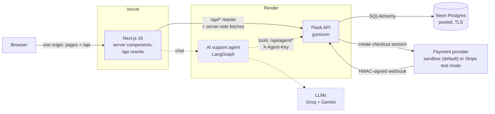

# Kora Outfitters

A full-stack e-commerce store (Next.js, Flask, Postgres) built as the foundation for a multi-agent AI customer support system.

**Live demo:** _coming soon_ <!-- TODO: https://kora-outfitters.vercel.app -->
&nbsp;·&nbsp; **Docs:** [architecture](docs/ARCHITECTURE.md) · [phase guides](docs/guide/) · [deployment](DEPLOY.md)

<!-- TODO: add a screenshot after deploying, e.g. docs/images/home.png

-->

---

## What it is

Kora Outfitters is a fictional clothing brand with a store that behaves like a real one: a catalog with filters and
search, accounts, a checkout that takes (test) payments through signed webhooks, order tracking, returns with real
policy rules, and an admin dashboard.

It exists to give an AI support agent **real work to do**. Customer support is mostly "where is my order?", "can I
return this?" and "what size should I get?". Answering those well needs live order data, policy rules and an audit
trail, not a toy FAQ. So the store was built first, with that agent in mind:
- Every order status change is recorded in an `order_events` timeline.
- Store policies live in the database: one source of truth for the website and the agent.
- `/api/agent/*` is reserved for the agent, behind an API key.

**Phase 8 (next):** a LangGraph multi-agent system. A supervisor routes each conversation to order, product and
returns specialists that call the backend as tools. It includes identity checks before sharing order data, escalation
to a human, and an evaluation suite run in CI.

## Architecture



- **The browser only talks to the Next.js site.** Vercel forwards `/api/*` to Flask on Render, so the session cookie
  is first-party (httpOnly, Secure, SameSite=Lax) and no CORS is needed.
- **Flask owns every business rule:** prices, stock, order states, return eligibility and permissions. Next.js renders
  pages, mostly as server components that stream data into a prerendered shell.
- **Payments go through an adapter.** A built-in sandbox or Stripe creates a checkout session, and the order is only
  marked paid when a signed webhook arrives.
- Dashed parts are planned for Phase 8.

## Tech stack

| Layer | Technology |
|---|---|
| Frontend | Next.js 16 (App Router, server components, Cache Components), React 19, TypeScript, Tailwind CSS 4, Motion |
| Backend | Python 3.12, Flask 3 (app factory, blueprints), SQLAlchemy 2, Alembic, Pydantic 2, gunicorn |
| Database | PostgreSQL 17 (Neon in production, Docker locally) |
| Auth and security | argon2id passwords, JWT in httpOnly cookies, CSRF double-submit, Flask-Limiter, CSP and HSTS |
| Payments | Provider adapter: built-in HMAC-signed sandbox, or Stripe Checkout (test mode) |
| Images | sharp (WebP pipeline), `next/image` |
| Testing | pytest (324 tests against real Postgres), Node test runner, Playwright for end-to-end checks |
| Hosting | Vercel (frontend), Render (API, `render.yaml`), Neon (database), GitHub Actions (scheduled job) |
| AI agent (Phase 8) | LangGraph, Groq, Gemini |

## Features

**Storefront**
- Catalog with category pages, search, size, colour and price filters, five sort orders and pagination. Filters live
  in the URL, so pages can be shared and bookmarked.
- Product pages with a colour-aware photo gallery and live stock per size and colour.
- A homepage curated by product tags, a cart drawer priced by the server, and subtle animation that respects
  `prefers-reduced-motion`.

**Accounts and checkout**
- Sign up, log in, saved addresses and order history. Guest checkout works too.
- Checkout with US, express and international shipping rules, through a hosted payment page.

**After the sale**
- Order tracking by order number and email, with a status timeline, carrier and delivery estimate.
- Returns and exchanges that follow the store's policy: a 30-day window, unworn items only, and final-sale exclusions.
  Each rule is tested.
- A contact form that creates support tickets.

**Admin dashboard**
- Revenue and order stats.
- Orders with a status state machine.
- Products and stock adjustments, tags and photos.
- Returns with partial refunds, support tickets, and editable store policies.

## Engineering highlights

- **A payment provider adapter, with a sandbox I built because Stripe isn't available in Pakistan.**
  - A `PaymentProvider` interface has two implementations: Stripe and a sandbox. The sandbox signs its webhooks with
    HMAC-SHA256 the way Stripe does, including a timestamp and a 5-minute replay window, checked with a
    constant-time comparison.
  - Both providers share one verification, idempotency and stock path, so the live demo exercises the real payment
    flow. Switching is one environment variable.
- **Idempotent webhooks with row locks.**
  - Each event id is inserted in the same transaction as the work it triggers, so a retried webhook is skipped.
  - The order row and every variant row are locked with `SELECT … FOR UPDATE`, variants in id order to avoid
    deadlocks. Stock is only taken on confirmed payment, and a `CHECK (stock >= 0)` constraint is the last line of
    defence.
  - Concurrency tests prove that two buyers can't both get the last item.
- **The server sets every price.** Prices are integer cents. The client sends only variant ids and quantities, and
  the backend recalculates prices, shipping and stock on every quote and checkout. Order items snapshot name and
  price, so history never changes when the catalog does.
- **An image pipeline with a manifest and an idempotent sync.**
  - A sharp script turns originals into 4:5 WebP files. Product shots are padded with the colour sampled from their
    edges, never cropped, so no sleeve is cut off. It also writes a committed manifest.
  - `flask images sync` matches file names to products and colours, upserts rows by URL, reports misnamed files with
    suggestions, and is safe to run on every deploy. It never touches orders or accounts.
- **Role-based access enforced by the backend.**
  - A single `before_request` hook guards every admin route, and a test discovers all admin routes automatically
    and checks that customers get 403 on each one.
  - The JWT's role claim is only a routing hint for the UI. Flask reads the role from the database on every request,
    and a test shows a forged "admin" claim unlocks nothing.
- **Production on free tiers without cutting corners.**
  - Render's free plan has no pre-deploy step or cron, so migrations run in an idempotent start script and the
    hourly clean-up runs on GitHub Actions.
  - Render's health check is a liveness check that doesn't query the database, so Neon's serverless compute can
    sleep.
  - The production config refuses to start with weak secrets, a non-HTTPS frontend URL, or a database URL without
    TLS.

## Try the demo

Everything is fictional, and no real payments are taken.

| What | How |
|---|---|
| Pay | At checkout you're sent to the **sandbox payment page** (labelled "no real money"). Card `4242 4242 4242 4242` succeeds, `4000 0000 0000 0002` is declined. Any future expiry, any CVC, any name |
| Customer account | Sign up with any email and a password of 10+ characters. Nothing is sent to that address |
| Track an order | `/track` with order **KO-1002** and **daniel.brooks@example.com** (shipped), or **KO-1009** and **mia.garcia@example.com** (delayed) |
| Return an item | `/returns` with **KO-1001** and **emily.carter@example.com** (eligible). Try **KO-1007** and **ava.thompson@example.com** to see a return refused because it's outside the 30-day window |
| Admin dashboard | Available on request. A shared admin login would let anyone change the demo for everyone |

## Run it locally

Requirements: Docker, Python 3.12 ([uv](https://docs.astral.sh/uv/) recommended), and Node.js 22.

```bash
git clone git@github.com:abdullahrasheed102/kora-store.git && cd kora-store

# Backend: Postgres in Docker, Flask on http://localhost:5000
cd backend
cp .env.example .env                      # local defaults; never commit real secrets
docker compose up -d --wait               # Postgres 17 (databases: kora, kora_test)
uv venv --python 3.12 && source .venv/bin/activate
uv pip install -r requirements-dev.txt
flask db upgrade && flask seed --reset    # schema + demo data (20 products, 12 orders, admin from .env)
flask run

# Frontend: in a second terminal, http://localhost:3000
cd frontend
npm install
npm run dev
```

Checks: `cd backend && pytest` · `cd frontend && npm test && npm run lint && npm run build`

## Documentation

| Document | What's in it |
|---|---|
| [docs/ARCHITECTURE.md](docs/ARCHITECTURE.md) | The whole system on one page: diagrams, data model, every API endpoint, security layers |
| [docs/guide/](docs/guide/) | One guide per phase (00 setup → 07 deployment): what was built, design decisions and alternatives, what could go wrong, sequence diagrams |
| [DEPLOY.md](DEPLOY.md) | Step-by-step deployment to Neon, Render and Vercel, with troubleshooting |
| [docs/PLAN.md](docs/PLAN.md) | The original spec and build phases, including the Phase 8 agent plan |

## How I built this

I designed this project and directed its build. That covered the product scope, the architecture, the data model,
the rules (money in integer cents, stock taken only on a confirmed webhook, policies as the single source of truth),
the order of the phases, and what "done" meant for each one.

The code was implemented with **Claude Code** as an AI pair programmer, working phase by phase from the written plan
in [docs/PLAN.md](docs/PLAN.md) and the project rules in [CLAUDE.md](CLAUDE.md). My part was:
- reviewing each phase and deciding the trade-offs
- testing it end to end
- making sure I can explain every part of it

That last point is why each phase ships with a written guide covering the reasoning, the alternatives and the failure
modes, not only the code. Using an AI coding agent well, and being able to explain the result, is part of what this
project demonstrates. Phase 8 builds the agent side of that.

---

Built by **Abdullah Rasheed**, AI Engineer. Kora Outfitters is a fictional brand; no real brands or logos are used.
