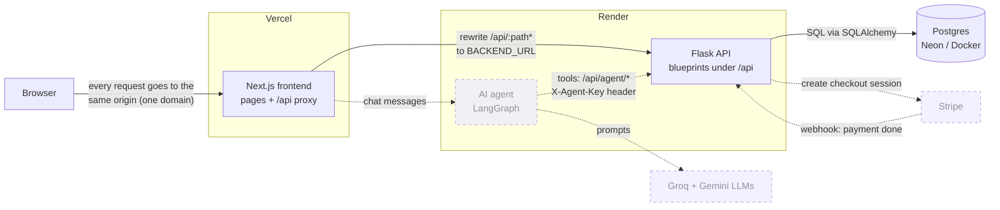
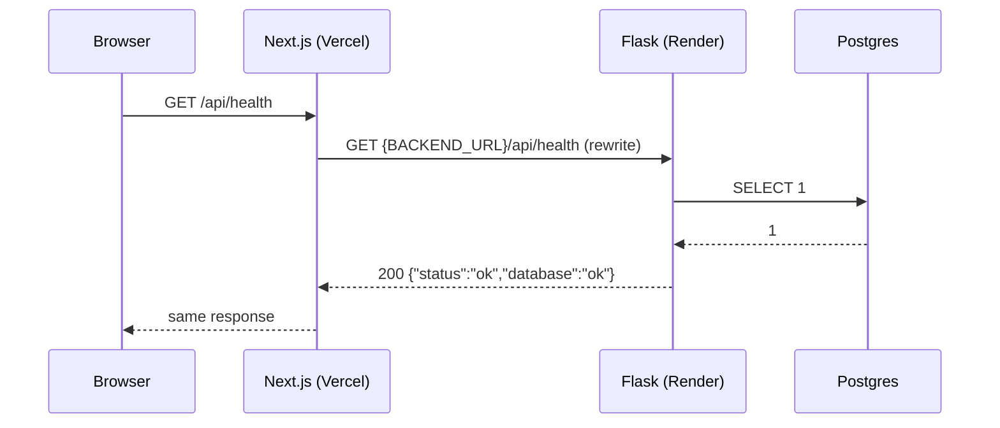
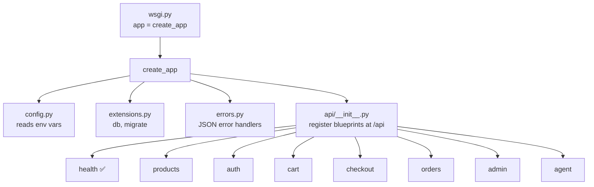

# Architecture

This page shows the whole Kora Outfitters system on one page: what the parts are, and how a request moves
between them. It is updated after every phase.

**Status:** Phase 0 (backend half) is built. Everything marked *planned* comes in a later phase.

## The parts

| Part | What it is | Where it runs | Status |
|---|---|---|---|
| Browser | The customer's or admin's web browser | User's device | — |
| Next.js frontend (`frontend/`) | The website: pages, cart, checkout screens. It also **forwards** every `/api/...` request to Flask. | Vercel | *planned (Phase 0, frontend half)* |
| Flask backend (`backend/`) | The API: business rules, prices, stock, orders, auth. Returns JSON only. | Render | ✅ skeleton + `/api/health` |
| Postgres database | Stores products, orders, users, policies | Neon (prod), Docker (local) | ✅ running locally, no tables yet |
| Stripe | Takes card payments, then tells our backend with a **webhook** (a message Stripe sends to our server) | Stripe | *planned (Phase 4)* |
| AI support agent (`agent/`) | A LangGraph program that answers customer questions by calling `/api/agent/*` | Render | *planned (Phase 8)* |
| Groq / Gemini | Large language models (LLMs) the agent uses | Their clouds | *planned (Phase 8)* |

## System diagram

Dashed lines and boxes are planned. Solid lines are the main path every request takes.

## How a request flows

Every request follows the same path. The browser never talks to Flask directly. It only talks to the
Next.js site, and Next.js forwards anything under `/api` to Flask.

**Why the proxy?** The site lives on `vercel.app` and the API on `onrender.com`. Those are two different
domains. If the browser called the API directly, we would need CORS rules (browser rules for cross-domain
requests), and our login cookie would be a "third-party" cookie, which many browsers block. With the proxy,
the browser only sees one domain. Cookies stay first-party and CORS is never needed.

## Inside the Flask backend

Only `health` has routes so far. The other blueprints are empty and are filled in phases 2–8.

## Key rules (from CLAUDE.md)

- Money is stored as **integer cents** (`2999` means $29.99), never as floats.
- The backend recalculates every price. It never trusts prices from the browser.
- Stock goes down only when Stripe confirms payment (in the webhook).
- Every order status change writes a row to `order_events`.
- Store policies live in the database, so the website and the agent read the same text.
- `/api/agent/*` uses an `X-Agent-Key` header, not user cookies.
