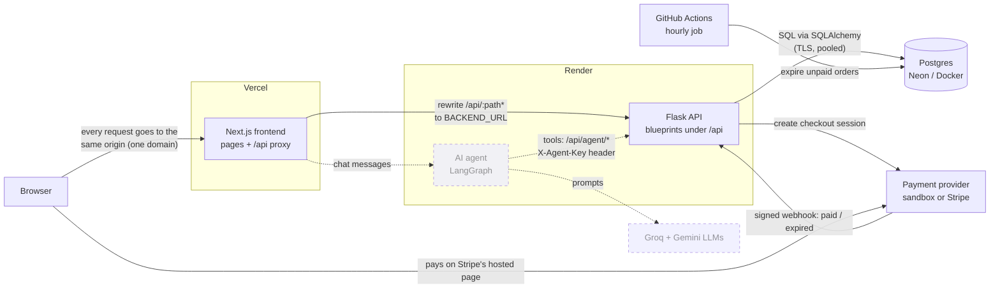
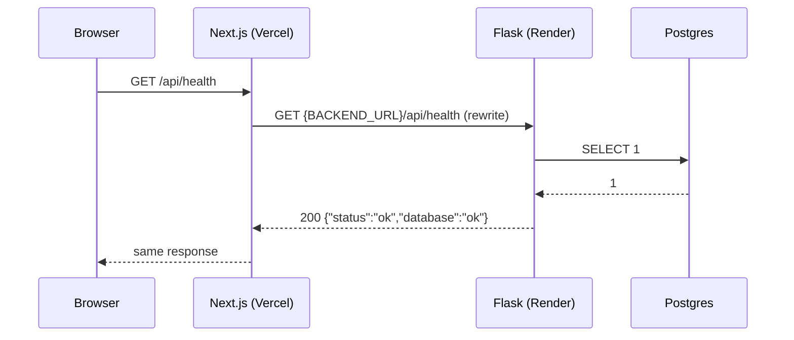
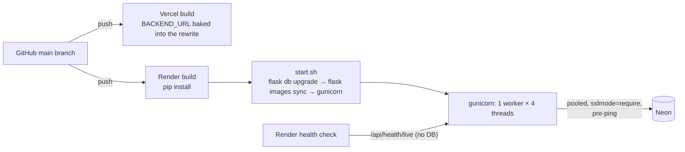
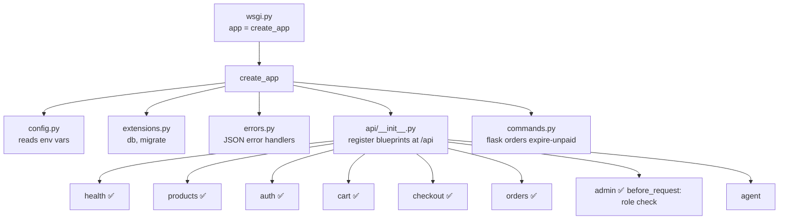
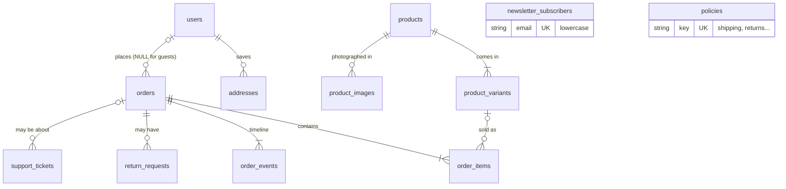
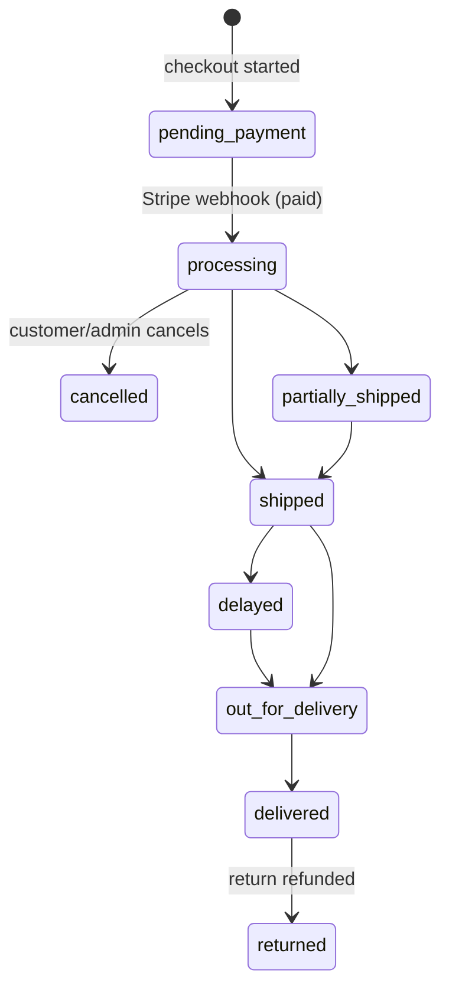
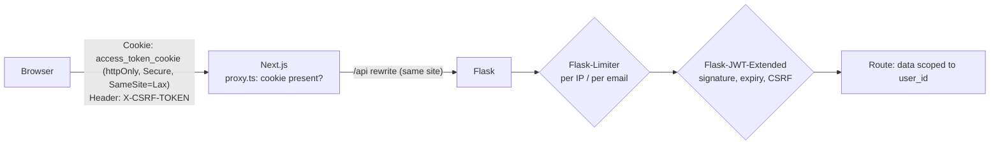
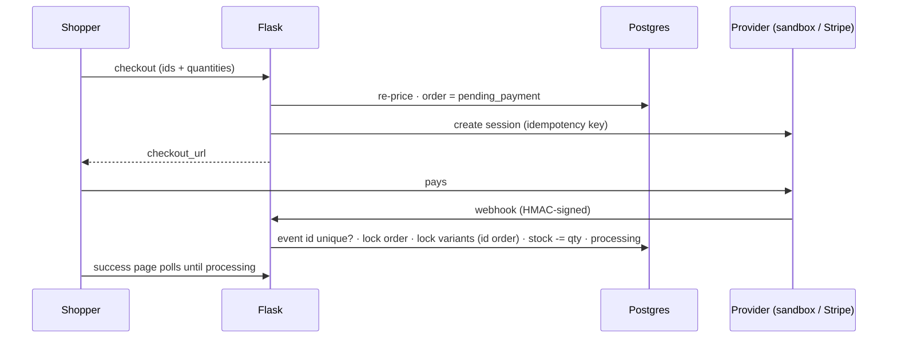
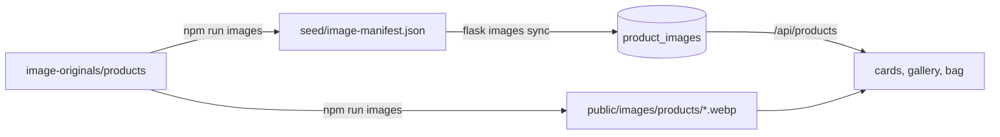

# Architecture

This page shows the whole Kora Outfitters system on one page: what the parts are, and how a request moves
between them. It is updated after every phase.

**Status:** Phases 0–7 are built: the backend skeleton, the database, the catalog and storefront, cart and accounts, payments (sandbox by default, Stripe optional), order tracking and returns, the admin dashboard, and the production deployment setup (Render + Vercel + Neon, see [DEPLOY.md](../DEPLOY.md)). Next: the AI agent (8). Everything marked *planned* comes in a later phase.

## The parts

| Part | What it is | Where it runs | Status |
|---|---|---|---|
| Browser | The customer's or admin's web browser | User's device | — |
| Next.js frontend (`frontend/`) | The website: pages, cart, checkout screens. It also **forwards** every `/api/...` request to Flask. | Vercel (`iad1`), `vercel.json` | ✅ |
| Flask backend (`backend/`) | The API: business rules, prices, stock, orders, auth. Returns JSON only. | Render (Virginia), gunicorn, `render.yaml` | ✅ |
| Postgres database | Stores products, orders, users, policies | Neon (prod, pooled + TLS), Docker (local) | ✅ |
| Scheduled job | Cancels never-paid orders every hour (`flask orders expire-unpaid`) | GitHub Actions | ✅ |
| Payment provider | Takes payment, then tells our backend with a signed **webhook**. `PAYMENT_PROVIDER=sandbox` (our own fake provider, the default, because Stripe isn't available in Pakistan) or `stripe` (test mode) | Our backend / Stripe | ✅ |
| AI support agent (`agent/`) | A LangGraph program that answers customer questions by calling `/api/agent/*` | Render | *planned (Phase 8)* |
| Groq / Gemini | Large language models (LLMs) the agent uses | Their clouds | *planned (Phase 8)* |

## System diagram



Dashed lines and boxes are planned. Solid lines are the main path every request takes.

## How a request flows

Every request follows the same path. The browser never talks to Flask directly. It only talks to the
Next.js site, and Next.js forwards anything under `/api` to Flask.



**Why the proxy?** The site lives on `vercel.app` and the API on `onrender.com`. Those are two different
domains. If the browser called the API directly, we would need CORS rules (browser rules for cross-domain
requests), and our login cookie would be a "third-party" cookie, which many browsers block. With the proxy,
the browser only sees one domain. Cookies stay first-party and CORS is never needed.

## Production deployment



| Concern | How it's handled |
|---|---|
| Config | Environment variables only; `ProductionConfig` refuses unsafe values (weak secrets, http frontend, DB without TLS) |
| Migrations | `start.sh` on every start (free plan has no pre-deploy step); Alembic skips what already ran |
| Health | `/api/health/live` for Render (lets Neon sleep), `/api/health` with a DB query for people |
| Security headers | API: `default-src 'none'` CSP, nosniff, DENY framing, no-referrer, HSTS. Site: CSP, HSTS, nosniff, frame and permissions policies |
| Client IP | `ProxyFix(x_for=TRUSTED_PROXY_COUNT=2)`: browser → Vercel → Render. Checked from the `xff=` log field |
| Cold starts | Render free sleeps after 15 min (≈1 min to wake); Neon compute after 5 min (≈1 s) |

Steps: [DEPLOY.md](../DEPLOY.md). Reasons: [guide/07-deployment.md](guide/07-deployment.md).

## Inside the Flask backend



`health`, `products`, `auth` and `cart` are complete; `orders` has the account order history. The rest are filled in phases 4–8.

Other backend modules:

| Module | Role |
|---|---|
| `app/models/` | SQLAlchemy models for all 10 tables (Phase 1) |
| `app/catalog.py` | Catalog queries: filters, search, sort, pagination, facets (Phase 2). Reused by the agent in Phase 8. |
| `app/validation.py` | Validates query strings and JSON bodies with Pydantic; bad input becomes `400 validation_error`, non-JSON becomes `415` |
| `app/sessions.py` | JWT-in-cookie sessions and their JSON error responses (Phase 3) |
| `app/payments/` | `PaymentProvider` interface + `StripeProvider` and `SandboxProvider` adapters (Phase 4) |
| `app/sandbox.py` | The sandbox's hosted payment page: session data, test cards, signed self-webhook (Phase 4) |
| `app/checkout.py` | Create pending orders, handle webhooks (idempotent, row locks), expire unpaid orders (Phase 4) |
| `app/commands.py` | `flask orders expire-unpaid` (Phase 4) |
| `app/admin.py` | Admin operations: products and stock deltas, order and return state machines, tickets, policies, stats (Phase 6) |
| `app/support.py` | Support tickets (contact form now, agent in Phase 8) |
| `app/returns.py` | Guest order lookup without leaks, tracking view, the returns policy as 9 tested rules (Phase 5). Reused by the agent in Phase 8. |
| `app/accounts.py` | Signup/login rules, addresses, a user's own orders. Every query is scoped to `user_id` (Phase 3) |
| `app/pricing.py` | Shipping rules and `quote_cart()`. Shared by the seed, the cart and checkout. |
| `app/security.py` | argon2 password hashing. Shared by the seed (admin user) and login. |
| `app/seed.py` | `flask seed [--reset]`: loads `backend/seed/*.json` |
| `migrations/` | Alembic migrations. Every schema change is a file here. |

## Data model



Full columns and the reasons behind them: [guide/01-database.md](guide/01-database.md).

**How an order's status changes** (each arrow writes one `order_events` row):



## Key rules (from CLAUDE.md)

- Money is stored as **integer cents** (`2999` means $29.99), never as floats. The database checks `total = subtotal + shipping`.
- The backend recalculates every price. It never trusts prices from the browser.
- Stock goes down only when Stripe confirms payment (in the webhook). The database refuses negative stock.
- Every order status change writes a row to `order_events`.
- Store policies live in the database, so the website and the agent read the same text.
- `/api/agent/*` uses an `X-Agent-Key` header, not user cookies.

## API endpoints (built so far)

| Method + path | Purpose | Phase |
|---|---|---|
| `GET /api/health` | Is the app up, can it reach the database? | 0 |
| `GET /api/health/live` | Is the process up? (no database; Render's health check) | 7 |
| `GET /api/products` | List with `category`, `tag`, `q`, `size`, `color`, `min_price`, `max_price`, `sort`, `page`, `per_page`; returns `items` (each with `tags` and `images`), `total`, `total_pages`, `facets` | 2 |
| `GET /api/products/<slug>` | One product with variants, live stock, images and related products | 2 |
| `GET /api/categories` | Categories with product counts | 2 |
| `GET /api/policies`, `GET /api/policies/<key>` | Store policies: `title`, one-line `summary`, full `body` | 2 |
| `POST /api/newsletter` | `{email}` → subscribe. Always the same friendly message (new or existing), so it reveals nothing. JSON only, rate limited (5/min, 20/h per IP) | 2 |
| `POST /api/cart/quote` | Price a cart from `[{variant_id, quantity}]` + shipping method | 3 |
| `POST /api/auth/signup`, `/login`, `/logout` · `GET /api/auth/me` | Accounts and sessions (rate limited) | 3 |
| `GET/POST /api/account/addresses` · `PUT/DELETE /api/account/addresses/<id>` | Saved addresses 🔒 | 3 |
| `GET /api/account/orders` · `GET /api/account/orders/<number>` | Your own orders 🔒 | 3 |
| `POST /api/checkout/session` | Card: pending order + Stripe Checkout Session → `{checkout_url}` (guests or logged in) | 4 |
| `POST /api/checkout/cod` | Cash on delivery: order confirmed at once (`processing` + `unpaid`), stock taken now, phone required, US only. Rate limited: 3/h and 10/day per IP, 3/day per phone | 4 |
| `POST /api/stripe/webhook` | Stripe events, verified by HMAC signature (only when `PAYMENT_PROVIDER=stripe`) | 4 |
| `POST /api/sandbox/webhook` | Sandbox events, same verification (only when `PAYMENT_PROVIDER=sandbox`) | 4 |
| `GET /api/sandbox/sessions/<id>` · `POST /api/sandbox/sessions/<id>/pay` | The sandbox payment page | 4 |
| `GET /api/orders/<number>/confirmation?session_id=` | Thank-you page data; needs the Stripe session id | 4 |
| `POST /api/orders/track` | Order number + email → status, timeline, carrier, ETA (no address). Same 404 for any mismatch | 5 |
| `POST /api/returns/eligibility` | Which items can be returned, and why not (guest: + email; logged in: own orders) | 5 |
| `POST /api/returns` | Start a refund or exchange; rules re-checked, order row locked | 5 |
| `POST /api/support/contact` | Contact form → support ticket (rate limited) | 6 |
| `/api/admin/*` (16 routes, incl. `POST /api/admin/orders/<n>/cash-collected`) | Stats, products (incl. `tags`), variants, orders, returns, tickets, policies (incl. `summary`). 🛡 admin role on every route | 6 |

🔒 = needs a login cookie; writes also need the `X-CSRF-TOKEN` header.
🛡 = one `before_request` hook on the admin blueprint: no cookie → 401, not an admin → 403.

Lookups (`track`, `returns/*`) share one rate limit, per IP and per order number, that counts only failed (404) lookups.

**`POST /api/newsletter` in detail**

```http
POST /api/newsletter
Content-Type: application/json

{"email": "sam@example.com"}
```

| Response | When |
|---|---|
| `200 {"message": "Thanks for subscribing! Look out for our next letter in your inbox."}` | Subscribed, **or already subscribed** (same answer on purpose) |
| `400 {"error": {"code": "validation_error", ...}}` | Missing or invalid email |
| `415` | Body is not JSON (also blocks cross-site HTML forms) |
| `429` | More than 5 tries a minute or 20 an hour from one IP |

Emails are stored trimmed and lowercase in `newsletter_subscribers` (UNIQUE email). The insert is
`INSERT … ON CONFLICT (email) DO NOTHING`, so two requests at the same moment can't create two rows.

## Sessions and security layers



Full reasoning: [guide/03-cart-and-auth.md](guide/03-cart-and-auth.md).

## Payment flow (summary)



Full diagram and reasoning: [guide/04-payments.md](guide/04-payments.md).

**Cash on delivery** skips the provider entirely: `POST /api/checkout/cod` locks the variant rows, takes the stock and
creates the order as `processing` + `payment_status=unpaid` in one transaction. An admin marks the cash collected once
the order is out for delivery or delivered. `orders.payment_method` / `payment_status` keep "where the money is"
separate from `status` ("where the parcel is"). Details: [guide/04-payments.md](guide/04-payments.md#cash-on-delivery-cod).

## Inside the Next.js frontend

```mermaid
flowchart TB
    subgraph Shell["Static shell (prerendered at build time)"]
        L[app/layout.tsx<br/>fonts, header, footer]
        H[components/site-header.tsx<br/>+ mobile-nav (client)]
    end
    subgraph Streamed["Streamed per request inside &lt;Suspense&gt;"]
        S[shop-results.tsx]
        P[products/[slug] ProductContent]
        PO[policies pages]
    end
    C[lib/api.ts<br/>typed client] --> F[(Flask /api)]
    S --> C
    P --> C
    PO --> C
    S --> FP[filter-panel.tsx (client)<br/>writes filters to the URL]
    P --> PV[product-view.tsx (client)<br/>colour/size picker, live stock]
```

| Route | What it shows |
|---|---|
| `/` | Hero, categories, then sections chosen by **product tags**: New for autumn (`new`), The Autumn Edit (`autumn-edit`), Bestsellers (`bestseller`); the AI assistant teaser (switched by `NEXT_PUBLIC_ASSISTANT_ENABLED`); perks from policy summaries; newsletter |
| `/shop`, `/shop/[category]` | Product grid with filters, sort, pagination; filters (including `?tag=`) live in the URL |
| `/products/[slug]` | Product detail, variant picker, live stock, related products |
| `/policies`, `/policies/[key]` | Policies from the database |
| `/cart` + cart drawer | Bag stored in `localStorage` (ids + quantities), priced by `/api/cart/quote` |
| `/login`, `/signup` | Account forms; `?next=` only allows our own paths |
| `/checkout` | Address, shipping method by country, "Pay" → Stripe |
| `/order/success` | Waits for the webhook, then confirms and clears the bag |
| `/pay/sandbox/[sessionId]` | The sandbox's hosted payment page ("no real money", test cards) |
| `/track` | Order lookup: progress bar, timeline, carrier and ETA |
| `/returns` | Return wizard: find order → choose items → refund/exchange → next steps |
| `/contact` | Contact form → support ticket |
| `/about` | Brand story and a note that this is a portfolio demo |
| `/admin`, `/admin/orders`, `/admin/products`, `/admin/returns`, `/admin/tickets`, `/admin/policies` | Admin UI; one gate in `app/admin/layout.tsx` (non-admins get a 404) |
| `/account`, `/account/orders`, `/account/orders/[number]`, `/account/addresses` | Account area; `proxy.ts` redirects logged-out visitors |
| any unknown URL | `app/not-found.tsx`; API errors show `app/error.tsx` |

**Animation:** CSS for the hero text, card zoom and cart drawer; Motion (`LazyMotion` + `m`) for
scroll reveals. Only `opacity`/`transform` animate (no layout shift), and `prefers-reduced-motion` turns
everything into fades. Details: [guide/02-catalog.md](guide/02-catalog.md#the-homepage-tags-sections-and-animation).

## Who can do what

| Action | Guest | Customer | Admin | AI agent (Phase 8) |
|---|---|---|---|---|
| Browse, cart, checkout | ✅ | ✅ | ✅ | read-only search |
| Track order / return with number + email | ✅ | ✅ | ✅ | ✅ via `/api/agent/*` |
| Own orders and addresses | — | ✅ (own only) | ✅ (own only) | — |
| `/api/admin/*` | 401 | 403 | ✅ | ✗ (uses `X-Agent-Key` routes only) |

Every order and return change writes an `order_events` row with `created_by` = `system`, `admin` or `agent`.

## Images

Original photos (`image-originals/`, git-ignored) → `npm run images` (sharp → WebP) → `frontend/public/images/`
(committed) → `next/image` (responsive `srcset`, lazy loading, `preload` for the hero).

- **Site photos** (hero, category tiles and banners, About) are static imports in `lib/site-images.ts`.
- **Product photos** are data. The script pads colour photos to 4:5 (never crops them) and centre-crops lifestyle
  photos, then writes `backend/seed/image-manifest.json`. `flask images sync` turns the manifest into
  `product_images` rows (idempotent; runs after `flask seed --reset` and on deploy), and the products API returns
  them. Products without a photo show placeholder art.



Details: [guide/02-catalog.md](guide/02-catalog.md#site-photography-how-the-images-work) and
[the product photos section](guide/02-catalog.md#product-photos-manifest-sync-and-placeholders).
