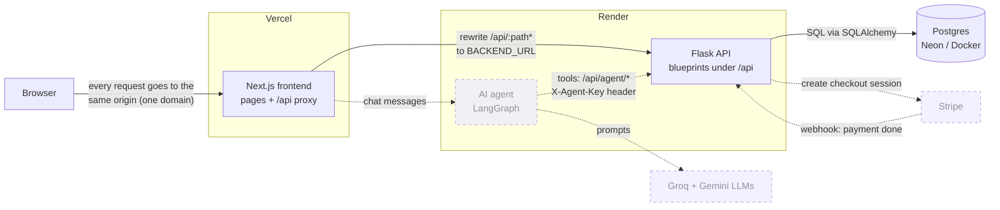
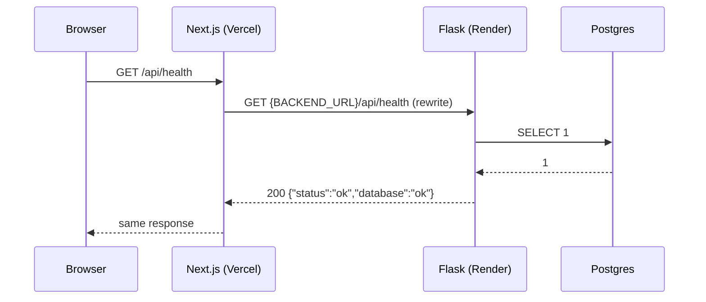
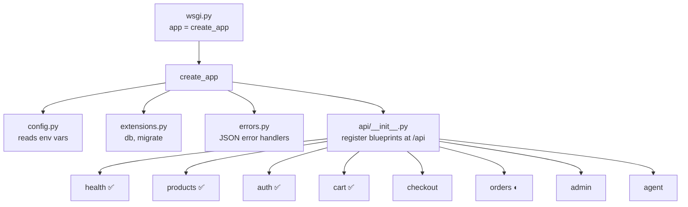
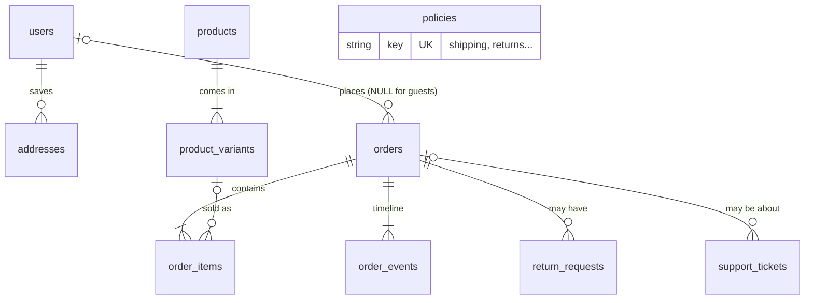
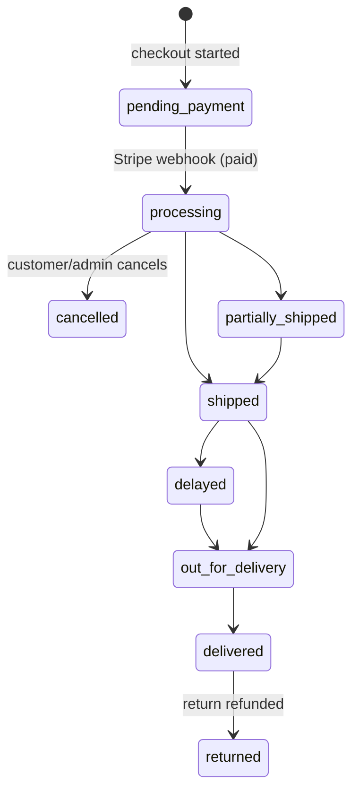
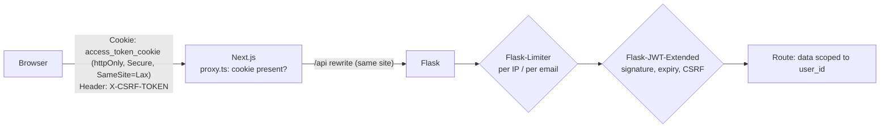

# Architecture

This page shows the whole Kora Outfitters system on one page: what the parts are, and how a request moves
between them. It is updated after every phase.

**Status:** Phases 0–3 are built: the backend skeleton, the database, the catalog and storefront, and the cart and accounts. Everything marked *planned* comes in a later phase.

## The parts

| Part | What it is | Where it runs | Status |
|---|---|---|---|
| Browser | The customer's or admin's web browser | User's device | — |
| Next.js frontend (`frontend/`) | The website: pages, cart, checkout screens. It also **forwards** every `/api/...` request to Flask. | Vercel | ✅ storefront, cart, login, account |
| Flask backend (`backend/`) | The API: business rules, prices, stock, orders, auth. Returns JSON only. | Render | ✅ health, catalog, cart quote, auth, account |
| Postgres database | Stores products, orders, users, policies | Neon (prod), Docker (local) | ✅ 10 tables, migration, seed data |
| Stripe | Takes card payments, then tells our backend with a **webhook** (a message Stripe sends to our server) | Stripe | *planned (Phase 4)* |
| AI support agent (`agent/`) | A LangGraph program that answers customer questions by calling `/api/agent/*` | Render | *planned (Phase 8)* |
| Groq / Gemini | Large language models (LLMs) the agent uses | Their clouds | *planned (Phase 8)* |

## System diagram



Dashed lines and boxes are planned. Solid lines are the main path every request takes.

## How a request flows

Every request follows the same path. The browser never talks to Flask directly. It only talks to the
Next.js site, and Next.js forwards anything under `/api` to Flask.



**Why the proxy?** The site lives on `vercel.app` and the API on `onrender.com`. Those are two different
domains. If the browser called the API directly, we would need CORS rules (browser rules for cross-domain
requests), and our login cookie would be a "third-party" cookie, which many browsers block. With the proxy,
the browser only sees one domain. Cookies stay first-party and CORS is never needed.

## Inside the Flask backend



`health`, `products`, `auth` and `cart` are complete; `orders` has the account order history. The rest are filled in phases 4–8.

Other backend modules:

| Module | Role |
|---|---|
| `app/models/` | SQLAlchemy models for all 10 tables (Phase 1) |
| `app/catalog.py` | Catalog queries: filters, search, sort, pagination, facets (Phase 2). Reused by the agent in Phase 8. |
| `app/validation.py` | Validates query strings and JSON bodies with Pydantic; bad input becomes `400 validation_error`, non-JSON becomes `415` |
| `app/sessions.py` | JWT-in-cookie sessions and their JSON error responses (Phase 3) |
| `app/accounts.py` | Signup/login rules, addresses, a user's own orders. Every query is scoped to `user_id` (Phase 3) |
| `app/pricing.py` | Shipping rules and `quote_cart()`. Shared by the seed, the cart and checkout. |
| `app/security.py` | argon2 password hashing. Shared by the seed (admin user) and login. |
| `app/seed.py` | `flask seed [--reset]`: loads `backend/seed/*.json` |
| `migrations/` | Alembic migrations. Every schema change is a file here. |

## Data model



Full columns and the reasons behind them: [guide/01-database.md](guide/01-database.md).

**How an order's status changes** (each arrow writes one `order_events` row):



## Key rules (from CLAUDE.md)

- Money is stored as **integer cents** (`2999` means $29.99), never as floats. The database checks `total = subtotal + shipping`.
- The backend recalculates every price. It never trusts prices from the browser.
- Stock goes down only when Stripe confirms payment (in the webhook). The database refuses negative stock.
- Every order status change writes a row to `order_events`.
- Store policies live in the database, so the website and the agent read the same text.
- `/api/agent/*` uses an `X-Agent-Key` header, not user cookies.

## API endpoints (built so far)

| Method + path | Purpose | Phase |
|---|---|---|
| `GET /api/health` | Is the app up, can it reach the database? | 0 |
| `GET /api/products` | List with `category`, `q`, `size`, `color`, `min_price`, `max_price`, `sort`, `page`, `per_page`; returns `items`, `total`, `total_pages`, `facets` | 2 |
| `GET /api/products/<slug>` | One product with variants, live stock and related products | 2 |
| `GET /api/categories` | Categories with product counts | 2 |
| `GET /api/policies`, `GET /api/policies/<key>` | Store policies | 2 |
| `POST /api/cart/quote` | Price a cart from `[{variant_id, quantity}]` + shipping method | 3 |
| `POST /api/auth/signup`, `/login`, `/logout` · `GET /api/auth/me` | Accounts and sessions (rate limited) | 3 |
| `GET/POST /api/account/addresses` · `PUT/DELETE /api/account/addresses/<id>` | Saved addresses 🔒 | 3 |
| `GET /api/account/orders` · `GET /api/account/orders/<number>` | Your own orders 🔒 | 3 |

🔒 = needs a login cookie; writes also need the `X-CSRF-TOKEN` header.

## Sessions and security layers



Full reasoning: [guide/03-cart-and-auth.md](guide/03-cart-and-auth.md).

## Inside the Next.js frontend

```mermaid
flowchart TB
    subgraph Shell["Static shell (prerendered at build time)"]
        L[app/layout.tsx<br/>fonts, header, footer]
        H[components/site-header.tsx<br/>+ mobile-nav (client)]
    end
    subgraph Streamed["Streamed per request inside &lt;Suspense&gt;"]
        S[shop-results.tsx]
        P[products/[slug] ProductContent]
        PO[policies pages]
    end
    C[lib/api.ts<br/>typed client] --> F[(Flask /api)]
    S --> C
    P --> C
    PO --> C
    S --> FP[filter-panel.tsx (client)<br/>writes filters to the URL]
    P --> PV[product-view.tsx (client)<br/>colour/size picker, live stock]
```

| Route | What it shows |
|---|---|
| `/` | Hero, categories, bestsellers (live), perks |
| `/shop`, `/shop/[category]` | Product grid with filters, sort, pagination; filters live in the URL |
| `/products/[slug]` | Product detail, variant picker, live stock, related products |
| `/policies`, `/policies/[key]` | Policies from the database |
| `/cart` + cart drawer | Bag stored in `localStorage` (ids + quantities), priced by `/api/cart/quote` |
| `/login`, `/signup` | Account forms; `?next=` only allows our own paths |
| `/account`, `/account/orders`, `/account/orders/[number]`, `/account/addresses` | Account area; `proxy.ts` redirects logged-out visitors |
| any unknown URL | `app/not-found.tsx`; API errors show `app/error.tsx` |
