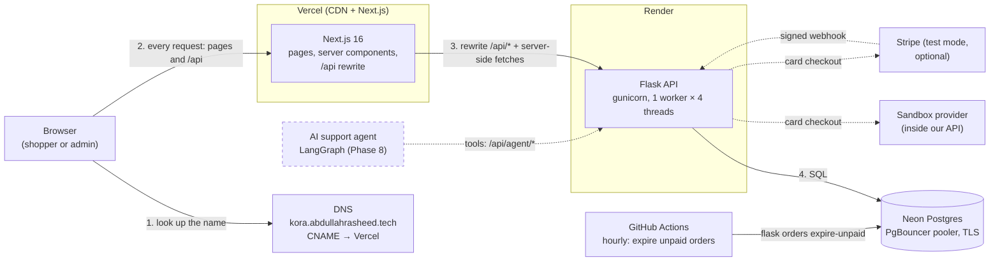
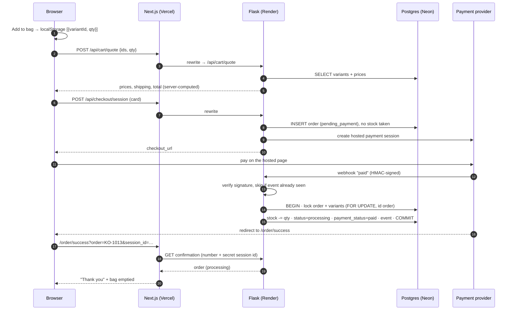

# Kora Outfitters — Study Guide

This is the one document to study before an interview. It explains the whole project from the beginning: what we
built, every idea it uses, why we chose each design, the real problems we hit, and how we fixed them. At the end there
are more than 60 interview questions with answers, and a one-page cheat sheet.

**How to use it**
1. Read Part 1 and practise saying both pitches out loud until you don't need the page.
2. Read Part 2 until you can draw the architecture diagram on a whiteboard from memory.
3. Read one phase from Part 3 per day. After each one, open the files it lists and find the code excerpts.
4. Answer the questions in Part 4 out loud. Then read the model answer and the follow-up.
5. Read the cheat sheet (Part 5) just before the interview.

Every technical word is explained the first time it appears (look for **bold** words). The full alphabetical list
of terms is in [GLOSSARY.md](GLOSSARY.md). The detailed guide for each phase is in [guide/](guide/).

**Contents**
- [Part 1 — The pitch](#part-1--the-pitch)
- [Part 2 — Architecture](#part-2--architecture)
- [Part 3 — The project, phase by phase](#part-3--the-project-phase-by-phase)
  - [Phase 0 — Project setup](#phase-0--project-setup)
  - [Phase 1 — Database, models and seed data](#phase-1--database-models-and-seed-data)
  - [Phase 2 — Catalog API and storefront](#phase-2--catalog-api-and-storefront)
  - [Phase 3 — Cart, accounts and security](#phase-3--cart-accounts-and-security)
  - [Phase 4 — Payments: sandbox, Stripe and cash on delivery](#phase-4--payments-sandbox-stripe-and-cash-on-delivery)
  - [Phase 5 — Order tracking and returns](#phase-5--order-tracking-and-returns)
  - [Phase 6 — Admin dashboard and role-based access](#phase-6--admin-dashboard-and-role-based-access)
  - [The image pipeline](#the-image-pipeline)
  - [The homepage: tags, animation and the newsletter](#the-homepage-tags-animation-and-the-newsletter)
  - [Phase 7 — Deployment](#phase-7--deployment)
- [Part 4 — Interview questions](#part-4--interview-questions)
- [Part 5 — Cheat sheet](#part-5--cheat-sheet)

---

## Part 1 — The pitch

### The 30-second version

> "Kora Outfitters is a full-stack clothing store I built as the foundation for an AI customer support agent. It has
> a Next.js storefront on Vercel, a Flask API on Render and Postgres on Neon. Customers can browse, check out by card
> or cash on delivery, track orders and start returns, and staff have an admin dashboard. The interesting parts are the
> backend rules: the server sets every price, payments are confirmed by signed webhooks that are safe to receive twice,
> stock is protected with row locks, and access is enforced by the backend, not the UI. Next, I'm adding a LangGraph
> multi-agent support system that uses this store's real data as its tools."

### The 2-minute version

> "Kora Outfitters is a fictional clothing brand with a store that behaves like a real one. I built it because
> customer support questions, like 'where is my order?' or 'can I return this?', need real order data and real policy
> rules to answer. A toy FAQ isn't enough. So the store comes first, and an AI support agent comes next.
>
> The architecture has three parts. The website is Next.js on Vercel. The API is Flask with SQLAlchemy on Render. The
> database is Postgres on Neon. The browser only ever talks to the website's own domain. Next.js forwards anything
> under `/api` to Flask, so the login cookie is first-party and I never need CORS.
>
> A few engineering decisions I'm proud of. First, the server prices everything in integer cents. The browser only
> sends product ids and quantities. Second, payments. Stripe isn't available in Pakistan, so I designed a payment
> provider interface with two adapters: Stripe, and my own sandbox that signs its webhooks with HMAC, exactly like
> Stripe. Orders are only marked paid when a signed webhook arrives. The handler is idempotent, so a webhook delivered
> twice does nothing the second time, and it locks the stock rows so two buyers can never both get the last item. I
> also added cash on delivery, where stock is reserved at once and orders are rate limited, because fake orders cost
> nothing to place.
>
> Third, security. Passwords use argon2id. The session is a JWT in an httpOnly cookie with CSRF protection. Login is
> rate limited per IP and per account. Order tracking gives the same answer for a wrong number or a wrong email, so it
> leaks nothing. Admin rights are checked in the database on every request.
>
> It's deployed on free tiers. That needed some workarounds: migrations run in a start script, a GitHub Action runs
> the hourly clean-up job, and the health check doesn't touch the database, so Neon can sleep. There are 345 backend
> tests against a real Postgres.
>
> Next is the agent: a LangGraph supervisor that routes conversations to order, product and returns specialists,
> which call this API as tools. It will have identity checks, escalation to a human, and an evaluation suite."

---

## Part 2 — Architecture

### The whole system



| Part | What it does | Where it runs |
|---|---|---|
| **DNS** | Turns the name `kora.abdullahrasheed.tech` into the address of a server (here, a **CNAME** that points to Vercel) | The DNS provider for `abdullahrasheed.tech` |
| **Next.js** | Builds the HTML pages and forwards `/api` calls to Flask | Vercel, region `iad1` (Washington, D.C.), served through Vercel's **CDN** |
| **Flask** | The API: every business rule (prices, stock, orders, returns, permissions). Returns JSON only | Render, Virginia |
| **Postgres** | Stores products, variants, orders, users, policies, photos | Neon, AWS US East (N. Virginia) |
| **Payment provider** | Takes the payment and tells our API with a signed webhook | Our own sandbox (default), or Stripe test mode |
| **GitHub Actions** | Runs an hourly job that cancels never-paid orders | GitHub |
| **AI agent** | Will answer customers by calling our API (Phase 8) | Planned |

**Why are all three in the US East region?** Every page render makes several calls from Vercel to Render, and every
API call makes several queries from Render to Neon. Each hop crosses the distance between the two data centres. If
they were on different continents, every page would wait for dozens of slow trips. Keeping them together makes those
trips short. The browser can be anywhere: Vercel's CDN (see below) serves it from a nearby location.

### Words you need for this diagram

- **Client and server.** The *client* asks (your browser). The *server* answers (a program on another computer).
- **API (Application Programming Interface).** A set of URLs a program can call to get data or make changes. Ours
  speaks JSON. Example: `GET /api/products/linen-button-up-shirt` returns that product as JSON.
- **REST.** A common style for APIs. URLs name *things* (`/products`, `/orders/KO-1013`), and HTTP methods say what to do
  with them: `GET` reads, `POST` creates, `PATCH`/`PUT` change, `DELETE` removes. Status codes say how it went: 200 OK,
  201 created, 400 bad input, 401 not logged in, 403 not allowed, 404 not found, 409 conflict, 429 too many requests,
  500 server error.
- **Reverse proxy.** A server that receives requests and passes them on to another server behind it. Our Next.js app is
  a reverse proxy for `/api`: the browser asks Vercel, and Vercel passes the request to Render and returns the answer.
  Render's load balancer is a second reverse proxy in front of gunicorn.
- **CDN (Content Delivery Network).** Many servers around the world that keep copies of files close to users. Vercel
  serves our pages, images and scripts from its CDN. When we tested from Pakistan, the response header
  `x-vercel-id: bom1::…` showed it came from Vercel's Mumbai location, and `x-vercel-cache: HIT` showed it was already
  cached there.
- **DNS (Domain Name System).** The internet's phone book: it turns a name into an address. A **CNAME record** says
  "this name is another name for that name". Our `kora.abdullahrasheed.tech` is a CNAME to a Vercel name, so Vercel
  can move its servers without us changing anything.
- **Environment variables.** Settings given to a program by the system it runs on, not written in the code. Example:
  `DATABASE_URL` is different on your laptop and on Render, but the code is the same. Secrets live here, never in git.

### One full request: from "Add to bag" to the order being saved

This is the most important flow to be able to explain. It has four stages.

**Stage 1 — Add to bag (only the browser).**
1. On the product page you pick a colour and size, then click **Add to bag**.
2. `components/product/product-view.tsx` calls `addItem(variantId)`. The bag is stored in the browser's
   **localStorage** (a small key-value store inside the browser) as a list of `{variantId, quantity}`. **No prices are
   stored**, only ids and quantities.
3. The button shows "Added to bag ✓" for 1.8 seconds, and the bag drawer slides in.

**Stage 2 — The server prices the bag.**
4. The bag needs prices, so the browser sends `POST /api/cart/quote` with the ids and quantities.
5. The request goes to the website's own domain. Vercel's **rewrite** forwards it to Flask on Render.
6. Flask's `quote_cart()` (`backend/app/pricing.py`) loads the variants from Postgres, uses the **database** prices,
   checks stock, adds shipping ($6.95, or free over $75), and returns the totals. Anything the browser said about
   prices is ignored.

**Stage 3 — Checkout.**
7. On `/checkout` you enter your email and address, choose shipping, then choose **Card** or **Cash on delivery**.
8. **Card:** the browser calls `POST /api/checkout/session`. Flask prices everything again, creates an order with
   status `pending_payment` (**no stock taken yet**), asks the payment provider for a hosted payment page, and returns
   its URL. The browser goes there.
9. **Cash on delivery:** the browser calls `POST /api/checkout/cod`. In **one database transaction** Flask prices
   everything, locks the stock rows, takes the stock, and saves the order as `processing` and `unpaid`.

**Stage 4 — The order is saved and confirmed.**
10. **Card:** you pay on the sandbox (or Stripe) page. The provider sends a **webhook** (a server-to-server message)
    to Flask: "session X was paid". Flask checks the **HMAC signature**, records the event id (so a repeat is ignored),
    **locks** the order row and the variant rows, takes the stock, sets `processing` + `paid`, writes an
    `order_events` row, and commits everything at once.
11. Your browser is sent to `/order/success`. That page asks Flask for the order. While it's still
    `pending_payment`, the page checks again every 2 seconds. When it's confirmed, it empties your bag.
12. **Cash on delivery:** you go straight to `/order/success`, because the order is already confirmed.



---

## Part 3 — The project, phase by phase

Each phase follows the same pattern: **what we built and why**, **the concepts** (each with a small example), **the
design decisions**, **the real problems we hit**, **the files to look at**, and a **60-second script**.

---

### Phase 0 — Project setup

**What we built and why.** The empty skeleton of the backend that every later phase plugs into: an app factory,
configuration from environment variables, blueprints under `/api`, a JSON error format, a health check, Postgres in
Docker, and pytest. Getting these right first means every later feature is testable and deployable from day one.

**Concepts**

- **Flask.** A small Python web framework. You write functions, and Flask calls them when a URL is requested.
  ```python
  @bp.get("/health")
  def health():
      return {"status": "ok"}
  ```
- **App factory.** Instead of creating the app at import time (`app = Flask(...)` at the top of a file), a function
  builds it: `create_app(config)`. *Example:* the tests call `create_app(TestingConfig())` with a test database;
  production calls `create_app()`, which reads Render's environment variables. Two apps with different settings can
  exist in one process, and importing a module never connects to a database by accident.
- **Blueprint.** A group of related routes, registered on the app. We have one per area: `health`, `products`, `auth`,
  `cart`, `checkout`, `orders`, `admin`, `agent`, `newsletter`, all mounted under `/api`. *Example:* the `admin`
  blueprint has a single permission check that runs before every admin route (Phase 6).
- **Environment variables and fail-fast config.** `backend/app/config.py` reads every setting from the environment.
  `require_env("SECRET_KEY")` stops the app at startup with a clear message if a required value is missing. A crash at
  startup is much better than a strange error later. `APP_ENV` defaults to `production`, so forgetting it is *safe*
  (debug off), not dangerous.
- **JSON error envelope.** Every error, including 404 and 500, returns the same shape:
  `{"error": {"code": "order_not_found", "message": "Order not found."}}`. The frontend (and later the AI agent) can
  handle errors in one way.
- **Docker / Docker Compose.** Docker runs software in an isolated "container". Compose starts the containers a
  project needs from one file. Our `backend/docker-compose.yml` starts Postgres 17, the same engine as production,
  with two databases: `kora` (development) and `kora_test` (tests delete data, so they get their own).
- **Health check.** `GET /api/health` runs `SELECT 1`. It returns 200 if the database answers, or 503 and logs the real
  error if not. It catches only database errors, so a bug in our own code still shows up as a real 500.
- **pytest.** The Python test runner. Tests use real Postgres, never SQLite, so they behave like production.

**Design decisions**

| We chose | Instead of | Because |
|---|---|---|
| App factory | One global app | Tests need their own app and database; no side effects on import |
| Config from env vars only | Config files per environment | One codebase for laptop, CI and Render; secrets stay out of git |
| Postgres in Docker locally | SQLite | Same database as production, so no surprises (e.g. row locks, sequences, `ILIKE`) |
| psycopg 3 | psycopg2 | Newer, actively developed |
| Python 3.12 via `uv` | Ubuntu's system Python 3.14 | Same version as Render; doesn't touch the system Python |

**Files to look at:** `backend/app/__init__.py` (`create_app`), `backend/app/config.py`, `backend/app/errors.py`,
`backend/app/api/health.py`, `backend/docker-compose.yml`, `backend/tests/conftest.py`.

**Explain it in 60 seconds**
> "The backend is a Flask API built with the application factory pattern: `create_app` loads config from environment
> variables, connects the database and registers one blueprint per area under `/api`. Tests build their own app with
> a separate Postgres database, and production builds it from Render's environment. Nothing secret is in the code,
> and missing settings stop the app at startup. Every error returns the same JSON shape, and there's a health check
> that proves the database answers. Locally, Postgres runs in Docker, the same engine as production."

---

### Phase 1 — Database, models and seed data

**What we built and why.** Ten tables as SQLAlchemy models, the first Alembic migration, and `flask seed --reset`,
which loads 20 products (217 variants), 12 demo orders with full timelines, 5 policies and an admin user. The data
model is the foundation of everything, including the AI agent, which will read order timelines and policies.

**Concepts**

- **ORM (Object-Relational Mapper).** Lets you work with database rows as Python objects. **SQLAlchemy** is our ORM.
  ```python
  class ProductVariant(db.Model):
      __tablename__ = "product_variants"
      id: Mapped[IntPK]
      sku: Mapped[str] = mapped_column(String(40), unique=True)
      stock: Mapped[int] = mapped_column(default=0, server_default="0")
  ```
  `variant.stock -= 1` then `session.commit()` becomes `UPDATE product_variants SET stock = … WHERE id = …`.
- **Migration.** A versioned script that changes the database structure (add a table, add a column). **Alembic**
  (through Flask-Migrate) generates them from the models: `flask db migrate -m "…"`, then `flask db upgrade` applies
  them. The `alembic_version` table remembers which migrations ran, so running `upgrade` again does nothing.
- **Constraints.** Rules the database enforces on every write, whoever writes: `CHECK (stock >= 0)`,
  `CHECK (total_cents = subtotal_cents + shipping_cents)`, `UNIQUE (sku)`. Python validation can be skipped by a bug, a
  script or two requests at once. The database can't be skipped.
- **Integer cents for money.** $24.00 is stored as `2400`. **Floats** (decimal numbers in binary) can't store most
  decimal values exactly: in Python, `0.1 + 0.2` is `0.30000000000000004`. Add many prices and the cents drift. Integers
  are exact, and Stripe also uses integer cents.
- **Sequence.** A Postgres counter that hands out each number exactly once, even when two transactions ask at the same
  moment. Order numbers come from `'KO-' || nextval('order_number_seq')`. *Why not `MAX(id) + 1`?* Two checkouts can read
  the same maximum at the same time and both get KO-1014.
- **Snapshots.** An order item copies the product name, size, colour, price and final-sale flag at purchase time. If
  the product is renamed or repriced later, the order still shows what the customer actually bought and paid.
- **Enums as `VARCHAR` + `CHECK`.** Statuses like `processing` are stored as text with a check constraint, not as a
  native Postgres `ENUM` type. Adding a new value later is then a normal migration.
- **`TIMESTAMPTZ`.** Times are stored with a time zone (in UTC), so there's no confusion between server time and local
  time.
- **Audit trail.** Every order status change writes a row to `order_events`: status, note, time and who caused it
  (`system`, `admin` or `agent`). It becomes the customer's tracking timeline, the staff history and, later, the
  agent's view of what happened.
- **Relative seed dates.** `orders.json` says "delivered 10 days ago", not a date. The seed turns that into a real date
  *at seed time*, so the demo never looks stale.

**Design decisions**

| We chose | Instead of | Because |
|---|---|---|
| Stock on the variant (size + colour) | Stock on the product | You run out of "M in Black", not of "the tee" |
| Shipping address copied onto the order | A link to the saved address | Guests have no saved addresses; editing a saved address must not change past orders |
| Constraints in the database too | Python checks only | Concurrent requests and future bugs all pass through the database |
| Tests build the database with the real migrations | `db.create_all()` | `create_all` would have hidden a migration bug (see below) |
| Category as a text column | A `categories` table | Six fixed names, no extra data per category |

**Real problems we hit**

1. **The autogenerated migration was wrong, twice.** Alembic didn't create the order-number **sequence** (it doesn't
   detect sequences), and it emitted **duplicate CHECK constraints** for enum columns, which fail with "constraint
   already exists". We now **read every generated migration** before using it. The same duplicate-CHECK problem
   appeared again in later migrations, and we fixed it the same way. Because tests run the real migrations, the
   missing sequence was caught immediately.
2. **Wiping the dev database by accident.** During Phase 3, the AI coding assistant ran `flask seed --reset` against
   the development database twice. That command deletes everything, including accounts. The lesson shaped later
   design: production is never reseeded, and changes to live data go through safe, idempotent commands
   (`flask images sync`, `flask policies sync`) that only touch what they own.

**Files to look at:** `backend/app/models/` (`catalog.py`, `order.py`, `types.py`), `backend/migrations/versions/`,
`backend/app/seed.py`, `backend/seed/*.json`.

**Explain it in 60 seconds**
> "Postgres, with SQLAlchemy 2 models and Alembic migrations. Products have variants per size and colour, and stock
> lives on the variant. Order items snapshot the name and price, so history never changes. Every status change is a row
> in `order_events`, which is the tracking timeline and the agent's history. Money is integer cents. Order numbers come
> from a Postgres sequence, which is safe under concurrency. Important rules are database constraints, like stock never
> below zero. I read every generated migration: the first one was missing the sequence. The tests build the database
> by running the real migrations, which is how that was caught."

---

### Phase 2 — Catalog API and storefront

**What we built and why.** The product API (filters, search, sort, pagination, facets), and the storefront in
Next.js: home, shop, category pages, product pages with live stock, policy pages, header, footer and 404. This is
what every visitor sees, and the AI agent will reuse the same search.

**Concepts**

- **Pagination.** Returning a big list one page at a time: `GET /api/products?page=2&per_page=12`. We use **offset
  pagination** (`LIMIT 12 OFFSET 12`). It's simple and supports "jump to page 3". *Keyset* (cursor) pagination is
  faster for huge tables and infinite scroll, but our catalog is small.
- **Stable sorting.** Every sort ends with `Product.id`. If two products have the same price, Postgres may return them
  in a different order on each page, and an item could appear twice or never. A unique tie-breaker fixes that.
- **N+1 queries.** Loading a list with 1 query, then running 1 more query *per item* to get related data. 12 products →
  13 queries. Slow, and it gets worse as data grows. We load all variants of all listed products in **one** extra
  query:
  ```python
  .options(selectinload(Product.variants), selectinload(Product.images))
  ```
  A test **counts the SQL queries** of a product-list request, so an N+1 can't come back unnoticed.
- **Facets.** The filter options that actually exist for the current category/search (sizes, colours, price range), so
  the sidebar never offers a filter that returns nothing.
- **Validation with Pydantic.** Each query or JSON body is described by a class. Bad input becomes a clear
  `400 validation_error`. Unknown parameters are ignored.
  ```python
  class ProductListQuery(BaseModel):
      per_page: int = Field(12, ge=1, le=48)   # 1 to 48
      sort: SortOption = "best_selling"
  ```
- **Service layer.** Routes stay thin; the logic lives in modules like `app/catalog.py`. That logic is easy to test,
  and the agent can call the same functions.
- **Server components and client components (React/Next.js).** A *server component* runs on the server and sends
  HTML; its code never reaches the browser. A *client component* (`"use client"`) also runs in the browser, so it can
  react to clicks. Most pages are server components; only interactive parts (colour picker, bag, forms) are client
  components.
- **Streaming with `<Suspense>` (Cache Components).** Next.js prerenders a **static shell** (header, layout, headings)
  at build time and sends it instantly. Parts that need live data (prices, stock) sit inside `<Suspense>` and stream in
  when ready. The build never needs the API, and stock is always live.
- **Rewrite.** `next.config.ts` forwards `/api/:path*` to Flask's URL (`BACKEND_URL`). The browser sees one domain.
- **Filters in the URL.** `/shop/tops?size=M&sort=price_asc`. Shareable, bookmarkable, and the back button works.

**Design decisions**

| We chose | Instead of | Because |
|---|---|---|
| Offset pagination | Keyset pagination | Small catalog; "page 3" links work |
| `ILIKE` search | Full-text search or a search engine | Enough for 20 products; full-text search is the next step |
| Live data in `<Suspense>`, not cached | Caching product pages | Stock must be live; the build must not need the API |
| Server components call Flask directly | Going through the rewrite | One less network hop. The rewrite exists for the browser's cookies |

**Real problems we hit**
- **A build error about `usePathname()` in the layout.** Reading the URL in a client component inside the layout
  blocks prerendering. *Fix:* the mobile menu closes when a link is clicked, instead of watching the URL.
- **A wrong product URL returns status 200, not 404.** With streaming, the response has already started with 200 when
  we find out the product doesn't exist. Next.js shows the 404 page and marks it `noindex`, so search engines ignore
  it. A true 404 status would need a check before rendering starts.

**Files to look at:** `backend/app/catalog.py`, `backend/app/api/products.py`, `frontend/app/shop/`,
`frontend/components/shop/shop-results.tsx`, `frontend/lib/api.ts`, `frontend/next.config.ts`.

**Explain it in 60 seconds**
> "The catalog API supports filters, search, five sort orders and offset pagination, validated with Pydantic. Each
> sort ends with the id so pages are stable, and related data is loaded with `selectinload`, so there's no N+1. A test
> counts the queries to prove it. On the frontend, Next.js prerenders a static shell and streams live data like stock
> inside Suspense, so pages are fast but never stale. Filters live in the URL, and the browser talks only to the
> Next.js domain, which forwards `/api` to Flask."

---

### Phase 3 — Cart, accounts and security

**What we built and why.** A cart priced by the server, sign-up and login, saved addresses and order history. This is
where security matters most, because it's where money, passwords and personal data appear.

**Concepts**

- **Server-side pricing.** The browser sends only `variant_id` and `quantity`. The server looks up real prices in
  the database every time. *Why:* the browser belongs to the user. Anyone can edit localStorage or a request and set a
  price of $0.01. Extra fields like `price_cents` are dropped by Pydantic.
- **Password hashing (argon2id).** We never store passwords, only a *hash*: a one-way scramble. At login we hash what
  was typed and compare. **argon2id** is deliberately slow and memory-heavy, so a thief with our database can only test a
  few guesses per second. A random **salt** inside each hash means two users with the same password get different
  hashes. *Why not SHA-256?* It's built to be fast: billions of guesses per second on a graphics card.
- **JWT (JSON Web Token) in an httpOnly cookie.** After login, the server gives the browser a signed token saying
  "user 42". The signature proves we made it. It's stored in a **cookie** marked:
  - `HttpOnly`: JavaScript can't read it, so an injected script (**XSS**, cross-site scripting) can't steal it.
  - `Secure`: only sent over HTTPS.
  - `SameSite=Lax`: not sent on cross-site form posts.

  The token lasts 7 days, and the cookie's `max_age` matches it.
- **CSRF (Cross-Site Request Forgery).** Another website makes *your* browser send a request to *our* site, and the
  browser attaches *our* cookie automatically. *Example:* evil.com has a hidden form that posts "change my address" to
  our API. Defences, in layers:
  1. SameSite=Lax blocks most cross-site posts.
  2. **Double-submit token:** a second, *readable* cookie `csrf_access_token` holds a random value. Our frontend copies
     it into the `X-CSRF-TOKEN` header. Another site can make the browser *send* our cookies, but it can't *read* them,
     so it can't fill in the header.
  3. **JSON only:** HTML forms can't send `application/json`, and a cross-site `fetch` with JSON triggers a CORS check
     we never approve. This also protects login and sign-up, which have no session yet.
- **User enumeration.** Learning which emails have accounts from different answers. Login returns the same "Wrong email
  or password" for both cases, and even runs a **dummy hash** for unknown emails, so the response time is the same.
  ```python
  if user is None:
      verify_password(DUMMY_PASSWORD_HASH, body.password)  # same work, same timing
  ```
  (Sign-up does say "email already exists". That's an honest trade-off: hiding it needs email verification.)
- **Rate limiting.** Limiting how many requests one client can make in a time window, with **Flask-Limiter**. Login: 5
  per minute and 30 per hour per IP, plus 10 per hour **per email** (against attackers spread over many IPs). Too many
  → `429 Too Many Requests`. *Why not lock the account after 5 failures?* Then an attacker could lock out a real user on
  purpose.
- **ProxyFix.** Behind proxies, the "client IP" Flask sees is the proxy's. ProxyFix reads the real one from the
  `X-Forwarded-For` header, trusting exactly `TRUSTED_PROXY_COUNT` hops. Trust too many, and a client can fake its IP.
- **The cart in localStorage, read with `useSyncExternalStore`.** No server-side cart table: guests can shop without an
  account, and nothing needs cleaning up. React's `useSyncExternalStore` reads it without a flash of wrong content and
  stays in sync across browser tabs.
- **"Not found" instead of "forbidden".** Asking for someone else's address or order returns 404, not 403. A 403 would
  confirm the thing exists.

**Design decisions:** the full table of 14 security choices, each with its threat and alternative, is in
[guide/03-cart-and-auth.md](guide/03-cart-and-auth.md#security-reasoning-choice-by-choice). The key ones:

| We chose | Instead of | Because |
|---|---|---|
| JWT in an httpOnly cookie | JWT in localStorage | Any XSS could steal a token from localStorage |
| CSRF token + SameSite + JSON-only | SameSite alone | Defence in depth; SameSite has gaps in older browsers |
| Rate limit per IP and per email | Account lockout | Lockout lets attackers lock out real users |
| 7-day token, no refresh token | Short token + refresh token | Simple and bounded for a shop; logout deletes the cookie |
| Cart in localStorage, priced by the server | A cart table | Works for guests; no cleanup |

**Real problems we hit**
- **A stale redirect after sign-up (found in Phase 5's browser tests).** Production Next.js *prefetches* links it sees.
  The header's "Your account" link was prefetched while logged out, so the browser cached "redirect to /login". After
  sign-up, navigating to `/account` reused that cached redirect. *Fix:* login, sign-up and logout do a full page load
  (`window.location.assign`), which clears every client cache. It only happened in production builds, because the dev
  server doesn't prefetch. Lesson: always test the production build.
- **The session cookie lived for a year** (the library's default) while the token inside expired after 7 days. *Fix:*
  set the cookie's `max_age` to the token lifetime, with a test.
- **React 19 `<form action>` resets the form fields**, which wiped what users typed when the server returned an
  error. *Fix:* use `onSubmit` handlers for these forms.

**Files to look at:** `backend/app/pricing.py`, `backend/app/security.py`, `backend/app/sessions.py`,
`backend/app/api/auth.py`, `backend/app/validation.py`, `frontend/lib/cart-store.ts`, `frontend/lib/api.ts` (CSRF
header), `frontend/proxy.ts`.

**Explain it in 60 seconds**
> "The browser stores only product ids and quantities; the server prices everything from the database, so nobody can
> change a price. Passwords are hashed with argon2id. The session is a JWT in an httpOnly, Secure, SameSite=Lax cookie,
> so scripts can't steal it, and every write needs a CSRF header copied from a readable cookie, which another site
> can't read. Login gives one message for wrong email or wrong password, with the same timing, so it can't be used to
> find accounts. It's rate limited per IP and per email, and ProxyFix makes sure we see the real IP behind our proxies."

---

### Phase 4 — Payments: sandbox, Stripe and cash on delivery

**What we built and why.** A checkout that creates the order, sends the shopper to a hosted payment page, and only
confirms the order when the payment provider says "paid" through a signed webhook. Then a second payment method, cash
on delivery. Payments are where bugs cost real money, so this phase is about correctness under failure and under
concurrency.

**The problem: Stripe isn't available in Pakistan.** The plan was Stripe Checkout in test mode, but Stripe doesn't
accept accounts from Pakistan. Instead of skipping payments, we kept the real engineering: we designed a payment
**interface** and wrote two **adapters**. One is Stripe (kept, unchanged, for anyone with an account in a supported
country). The other is our own **sandbox** provider that behaves like Stripe: a hosted payment page and HMAC-signed
webhooks with Stripe's event shape. `PAYMENT_PROVIDER=sandbox` is the default; switching is one environment variable.

**Concepts**

- **Hosted payment page.** The card form lives on the provider's page, not ours. Card numbers never touch our servers,
  which keeps our security scope small. (The sandbox page lives on our site but is clearly labelled, and only accepts the
  test cards: `4242 4242 4242 4242` succeeds, `4000 0000 0000 0002` is declined, and every other number is refused.)
- **Webhook.** A message one server sends to another when something happens: "session cs_… was paid". It's more
  reliable than trusting the browser to come back: the customer might close the tab, and anyone can open a "success"
  URL by hand. The provider *retries* a webhook until we answer with a 2xx status.
- **HMAC signature.** HMAC (Hash-based Message Authentication Code) is a fingerprint of a message made with a secret
  key. Only someone with the key can make a valid one. The sandbox signs `"<timestamp>.<body>"` with HMAC-SHA256 and
  sends `t=<timestamp>,v1=<signature>`, like Stripe:
  ```python
  hmac.new(secret.encode(), f"{timestamp}.".encode() + payload, hashlib.sha256).hexdigest()
  ```
  We check it against the **raw body bytes** (re-encoding JSON could change a byte and break the signature). We reject
  signatures older than **5 minutes** (so a stolen old message can't be "replayed"), and we compare with
  `hmac.compare_digest`, which takes the same time whatever the input. A normal `==` stops at the first different
  character, and that timing difference can leak the signature bit by bit.
- **Idempotency.** Doing something twice has the same effect as doing it once. Providers *will* send the same webhook
  twice (retries, network hiccups). We have two layers:
  1. The event id is inserted into `stripe_events` **in the same transaction** as the work. A second delivery finds it
     and returns `"duplicate"`.
  2. The order row is locked and its status checked: an order that's already `processing` isn't processed again.
- **Transaction.** A group of database changes that succeed or fail together (all or nothing). Taking stock, changing
  the order status, writing the event and recording the event id are one transaction. If anything fails, nothing is
  saved, and the provider retries.
- **Race condition.** A bug that depends on timing. Two buyers pay for the last shirt at the same moment. Both
  webhooks read "stock = 1", both subtract 1, and we've sold two shirts we don't have.
- **Row lock (`SELECT … FOR UPDATE`).** Locks the selected rows until the transaction ends. The second webhook *waits*
  until the first one commits, then sees "stock = 0", cancels that order and refunds it automatically. We lock variants
  **in id order** every time. If one transaction locked A then B, and another locked B then A, each would wait for the
  other forever (a **deadlock**). The `CHECK (stock >= 0)` constraint is the last line of defence.
- **Adapter pattern.** One interface (`PaymentProvider` with `create_checkout_session`, `verify_webhook`, `parse_event`,
  `refund_payment`) and one class per provider that "adapts" that provider's API to it. The checkout and webhook logic
  is written and tested once, for both.
- **Refund after commit.** Calling Stripe is a network request that can be slow. We never hold row locks while waiting
  for the network: commit first, then refund. If the refund fails, the order is marked "needs a manual refund".
- **Idempotency keys** on calls to Stripe: the Stripe library retries failed requests, and a key makes those retries
  safe (no double session, no double refund).

**Cash on delivery (COD).** The customer pays the courier in cash at the door. This is common in Pakistan and many
other markets.
- `POST /api/checkout/cod` creates the order straight away as `processing`, with `payment_status = unpaid`. No
  provider is involved. A phone number is required, and COD is for US addresses only.
- **Stock is reserved at once**, in the same transaction, with the same row locks as the webhook (`_lock_variants`
  and `_short_items` are shared by both paths).
- `orders.payment_method` (`card`/`cod`) and `orders.payment_status` (`unpaid`/`paid`/`refunded`) are new columns.
  "Where the parcel is" (`status`) and "where the money is" (`payment_status`) are now separate, because a COD order
  can be delivered and still unpaid.
- An admin clicks **Mark cash collected** once the order is out for delivery or delivered. It sets `paid` and writes an
  order event. Cancelling a COD order restores the stock, and there's no refund, because nothing was paid. COD
  refunds for returns are made by bank transfer or store credit.

**Why reserve stock immediately for COD, but only after payment for card?**
- **Card:** most started checkouts are never paid. Reserving stock for them would hide items from real buyers for up
  to 30 minutes per abandoned checkout. So we take stock in the webhook. The rare cost is "sold out while you were
  paying", which we handle with an automatic refund.
- **COD:** there's no later "paid" moment before shipping. We promise to ship now, so we must hold the items now, or
  we could sell the last one twice.

**The fraud risk of COD.** Placing a COD order costs nothing, so someone could place fake orders that hold stock (real
customers then see "sold out") and waste courier trips. Our defences:
- strict rate limits: **3 per hour and 10 per day per IP, plus 3 per day per phone number**, because an attacker with
  many IPs usually reuses a few numbers. Rejected attempts count too, so probing isn't free.
- a required phone number
- US only
- admin cancellation, which restores stock

What a real shop would add: SMS verification, a maximum COD order value, and blocking numbers with many refused
deliveries.

**Design decisions**

| We chose | Instead of | Because |
|---|---|---|
| Confirm from the webhook | Confirm when the browser reaches the success page | The browser may never arrive, and anyone can open that URL |
| Card: take stock at payment | Reserve at checkout | No stock held by abandoned checkouts |
| COD: take stock at placement | Take it at delivery | We commit to ship now, so the items must be held now |
| Row locks (pessimistic) | Optimistic locking with a version column | Simple and correct for multi-item orders; a clear yes/no for "sold out" |
| Event-id table + status check | Status check only | Also covers events that don't change an order, and records what we processed |
| Our own sandbox as the default | Skip payments, or a third-party sandbox | Stripe isn't available in Pakistan; this keeps the real hosted-page + webhook engineering |
| Sandbox webhook delivered in-process | A real HTTP request to our own URL | A self-request can deadlock a single worker. The in-process request still goes through signature verification |
| Policy text versioned, `flask policies sync` | Reseeding | Production can't be reseeded without deleting real orders |

**Real problems we hit**
1. **Stripe isn't available in Pakistan** → the adapter pattern and the sandbox provider (above).
2. **Stripe renamed a parameter.** `payment_method_types` became `allowed_payment_method_types` in the API version we
   used, and Stripe refused our requests. A test now checks that every parameter we send exists in the installed
   library's schema.
3. **We proved the lock works by removing it.** The concurrency test (`test_two_payments_for_the_last_item_sell_it_once`)
   runs two webhooks in parallel threads for the last item. With the lock, one sells and one refunds. With the lock
   commented out, the test failed. A test that can't fail proves nothing.
4. **"Validate first, then change" (found while adding COD).** The first version of "refund a return" changed the
   return's status and *then* checked whether the COD cash had been collected. In the test, all requests shared one
   database session, so the next request saved the half-made change. *Fix:* every check runs before anything changes.
5. **Changing policy text on a live database.** COD needed new shipping and refunds text, but production can't be
   reseeded. *Fix:* each policy in `policies.json` has a `version`. `flask policies sync` (run on every deploy) only
   applies a higher version, so an admin's edits survive until someone deliberately ships a new version.

**Files to look at:** `backend/app/checkout.py` (`create_checkout`, `create_cod_order`, `handle_payment_event`,
`_fulfil`, `_lock_variants`), `backend/app/payments/` (`base.py`, `sandbox_provider.py`, `stripe_provider.py`),
`backend/app/sandbox.py`, `backend/app/policies.py`, `backend/tests/test_checkout.py`, `backend/tests/test_cod.py`,
`frontend/components/checkout/checkout-form.tsx`.

**Explain it in 60 seconds**
> "Checkout creates a pending order and sends the shopper to a hosted payment page. The order is only confirmed when the
> provider's webhook arrives. I verify its HMAC signature over the raw body, with a five-minute window and a
> constant-time comparison. The handler is idempotent: the event id is saved in the same transaction as the work, and
> the order row is locked, so a duplicate does nothing. Stock rows are locked in id order with SELECT FOR UPDATE, so two
> buyers can't both get the last item. I tested that with two parallel webhooks. Stripe isn't available in Pakistan, so
> I put payments behind an interface with a Stripe adapter and my own sandbox that signs webhooks the same way. I also
> added cash on delivery: stock is reserved at once because there's no later payment step, and orders are rate limited
> per IP and per phone number, because fake COD orders cost nothing."

---

### Phase 5 — Order tracking and returns

**What we built and why.** Public order tracking by order number and email, and a returns flow that follows the
store's returns policy. These are the top two support questions, so they're also the first tools the AI agent will
use.

**Concepts**

- **Leak-free lookup.** `POST /api/orders/track` finds the order with **one query** that matches the number *and* the
  email together. A wrong number and a wrong email take the same path and get exactly the same 404, so nobody can
  learn which order numbers exist (another form of **enumeration**).
- **POST for lookups.** The email goes in the request body, not the URL, so it stays out of logs, browser history and
  `Referer` headers.
- **Smart rate limiting.** 10 per minute and 60 per hour per IP, plus 20 per hour per order number. **Only failed
  lookups count** (`deduct_when`). A real customer who tracks, checks eligibility and starts a return isn't blocked,
  but someone guessing emails is.
- **Policy as code.** The returns policy is nine small rules in `backend/app/returns.py`, each a function with one test:
  delivered within 30 days, not final sale, not already returned, condition confirmed by the customer, and so on. The
  current time is passed in (`now`), so tests can check exact boundaries.
- **Locking on create.** Creating a return locks the order row, so two quick submissions can't both return the same
  item.
- **Days left are rounded up.** "7 days 23 hours" is "8 days left" to a person. Rounding down would take a day away.

**Design decisions**

| We chose | Instead of | Because |
|---|---|---|
| Number + email in one query | Find by number, then compare the email | One code path: no difference in message, status or timing |
| Only failed lookups count toward the limit | Count every request | Real customers aren't blocked; guessing still is |
| No street address on the tracking page | Show everything | Number + email isn't strong proof of identity |
| Rules as small functions with `now` passed in | One big `if` block | Each rule tested alone, and reusable by the agent |

**Real problems we hit** (found by running real journeys in a browser against a production build, after all unit
tests passed)
1. **The rate limit blocked real customers.** Track → eligibility → submit used up "10 per minute". *Fix:* only failed
   lookups count.
2. **"7 days left" when it was 7 days 23 hours.** *Fix:* round up, with a test.
3. **The stale redirect after sign-up** and **the year-long cookie** (both described in Phase 3) were found here too.

**Files to look at:** `backend/app/returns.py`, `backend/app/api/orders.py`, `frontend/app/track/`,
`frontend/app/returns/`, `frontend/components/orders/`.

**Explain it in 60 seconds**
> "Tracking takes an order number and email in a POST body and finds the order in one query that matches both, so a
> wrong number and a wrong email look identical. That stops enumeration. It's rate limited per IP and per order number,
> counting only failed lookups, so real customers are never blocked. The returns policy is nine small rule functions
> with one test each, and the server re-checks every rule when a return is created, with the order row locked."

---

### Phase 6 — Admin dashboard and role-based access

**What we built and why.** Admin screens for products and stock, orders, returns, support tickets, policies and
stats. They're protected by a role check on every route. Staff need these tools to run the store, and the order
history they produce is what the agent will read.

**Concepts**

- **Authentication vs authorization.** *Authentication* answers "who are you?" (login). *Authorization* answers "what
  may you do?" (permissions).
- **Role-based access control (RBAC).** Permissions come from a role: `customer` or `admin`. A single `before_request`
  hook on the admin blueprint checks the role **from the database** on every request: not logged in → 401, not an
  admin → 403. It's impossible to forget it on a new route.
- **Permission tests that discover routes.** The tests list every `/api/admin` route from Flask's URL map and check
  that each one refuses guests (401) and customers (403). New routes are covered automatically. We proved they can
  fail by disabling the hook: the tests failed.
- **"The UI hides, the backend enforces."** Hiding a button is for the person using the site. Refusing the request is
  for security, because anyone can send any request with DevTools. *Example:* the checkout form is hidden from admins,
  and the API *also* returns `403 admin_cannot_order`.
- **State machine.** An order can only move along allowed paths: `processing → shipped → out_for_delivery →
  delivered`, and so on. `delivered → shipped` is refused with 409. The UI shows only the allowed moves.
- **Stock as deltas.** An admin enters "+10" or "−1", which becomes `UPDATE … SET stock = stock + 10`. Writing an
  absolute number would lose a sale that happened while the admin was editing (a **lost update**).
- **Audit trail.** Every admin change to an order writes an `order_events` row with `created_by = "admin"`.
- **SQL aggregates.** The dashboard's revenue, orders by status and low stock are computed by Postgres (`SUM`,
  `COUNT`, `GROUP BY`), not by loading every order into Python.

**The problem: admins kept seeing customer pages.** After login, an admin landed on `/account` (a customer page), the
header said "Your account", and an admin could even try to check out. *Fixes:*
- Admins go to `/admin` after login, and customers to `/account`.
- `proxy.ts` redirects an admin away from `/account` **before** the page renders, so there's no flash of the customer
  page.
- The header shows an "Admin" badge, and the admin area has its own profile section.
- Checkout is disabled for admins, and the backend refuses it.

To redirect before rendering, `proxy.ts` needs the role, but it only sees cookies. So at login Flask adds a `role`
claim to the JWT. The proxy reads it **without checking the signature**, which is safe only because the claim is a
**routing hint**: it decides where to send someone, never what they may see. If someone forges "admin", they're sent
to `/admin`, the page asks Flask, Flask checks the database, and they get a 404. A test shows that even a *validly
signed* token claiming "admin" for a customer gets 403.

**Design decisions**

| We chose | Instead of | Because |
|---|---|---|
| One `before_request` hook | A decorator on each route | Can't be forgotten |
| Role read from the database each request | Role trusted from the JWT | Removing admin rights works immediately |
| Non-admins see a 404 page (the API says 403) | Show "403 Forbidden" | Pages don't reveal that an admin area exists |
| Stock changes as deltas | Absolute values | No lost updates |
| `returned` set only by refunding returns | An admin can set it directly | The status can't claim a refund that didn't happen |

**Real problems we hit**
1. **Admins seeing customer pages**, fixed with role-based redirects (above).
2. **Duplicate ids across pages.** Next.js keeps the previous page mounted (hidden) after a navigation. Two pages
   both had `id="name"`, so a label pointed at the wrong input. *Fix:* React's `useId()` for every form field.
3. **A grid item stretched the page on phones** (556px wide in a 390px screen). A grid item's default `min-width: auto`
   made it as wide as the scrolling nav. *Fix:* `min-w-0`.
4. **Chart labels collided.** *Fix:* skip a tick near the last label.

**Files to look at:** `backend/app/admin.py`, `backend/app/api/admin.py` (`require_admin`),
`backend/tests/test_admin.py` (`admin_routes`), `frontend/proxy.ts`, `frontend/lib/session-hint.ts`,
`frontend/app/admin/`.

**Explain it in 60 seconds**
> "Every admin API route goes through one before-request hook that reads the user's role from the database, so it's
> impossible to forget, and removing someone's admin rights works immediately. The permission tests discover every
> admin route automatically and check that guests get 401 and customers get 403. Orders move through a state machine,
> stock changes are deltas so concurrent sales aren't lost, and every change writes an audit event. For the user
> experience, the JWT carries a role hint that the Next.js proxy uses to redirect admins before a page renders. It's
> only a hint: every real decision is made by the backend."

---

### The image pipeline

**What we built and why.** Real photos for the site (hero, category tiles, About page) and for every product (one
photo per colour, plus a "lifestyle" photo of someone wearing it). The originals were about 3 MB each. Sent as they
are, they would make every page slow, especially on phones.

**Concepts**

- **Image optimization.** Making images smaller without visible loss. Our script, `frontend/scripts/optimize-images.mjs`
  (run with `npm run images`), uses **sharp** (a fast image library) to resize photos (max 1200px wide; the hero 2400px)
  and convert them to **WebP** at quality 80. WebP is a modern format, typically 25–35% smaller than JPEG at the same
  visible quality. *Measured:* the first 7 site photos went from 23 MB to 1.2 MB, and the first 36 product files from
  91.5 MB to 2.9 MB.
- **Responsive images (`next/image`).** Next.js makes several widths of each image (a `srcset`). The `sizes`
  attribute tells the browser how wide the image will be on screen, so a phone downloads a small version and a desktop
  a larger one. *Example:* `sizes="(min-width: 1024px) 25vw, 50vw"` on a product card. Without it, a phone would
  download a full-screen-width file for a small card.
- **Lazy loading.** Images below the screen are only downloaded when you scroll near them. The default in
  `next/image`.
- **LCP (Largest Contentful Paint).** The time until the biggest thing on the first screen appears. It's a Core Web
  Vitals score. Our hero photo is the LCP, so it uses `preload` to start downloading at once, and it's never animated.
- **Pad, don't crop.** Every product card is 4:5. A photo with a different shape is **padded**: strips are added to
  the short sides, filled with the colour sampled from that edge, so the join is invisible. *Why not crop?* Cropping a
  square product photo to 4:5 cuts off the sides, which on a shirt are the sleeves. Lifestyle photos show a scene, so
  they *are* centre-cropped.
- **The manifest.** The script writes `backend/seed/image-manifest.json`: a list of every optimized product photo. It's
  committed, because the backend on Render never sees the frontend's files. The manifest is how the backend learns
  which photos exist.
- **Idempotent sync.** `flask images sync` reads the manifest, works out which product and colour each file name
  belongs to (`{product-slug}-{color-slug}` or `{product-slug}-lifestyle`), and **upserts** (inserts or updates) one
  `product_images` row per file, found by its URL. Running it twice gives the same result. The second run prints
  `0 added, 0 updated, 65 unchanged`. That's why it can run on every deploy. It only touches rows for our own photo
  files, never orders or accounts.
- **Name checking.** `flask images check` is a **dry run** (it reports but saves nothing). It lists files that match no
  product, with the closest real name, and every photo that's still missing.

**Real problems we hit**
1. **The padding showed a grey band.** sharp's `.stats()` measures the *input* image and ignores an `.extract()`
   earlier in the same chain. So we averaged the whole photo, including the dark sweater, instead of the edge. We found
   it by **measuring row colours** rather than trusting a screenshot. *Fix:* cut the strip into its own image first,
   then measure it. The padded rows now match the edge to within 1–3 levels out of 255.
2. **A misnamed file.** `everyday-cotton-tee-white.png.jpeg` had a double extension, so it matched no colour. The
   checker reported it with the suggestion "did you mean everyday-cotton-tee-white?". We asked before renaming
   anything, and after the rename the white tee's photo appeared.
3. **Photos arrived in batches.** Everything had to work with a partial set: products without a photo show a clean
   placeholder drawing in the brand colours, and an `onError` fallback shows it if a file fails to load.
4. **Originals are not committed.** Git keeps every version of every file forever, so each replaced 3 MB photo would
   stay in the repository permanently. `image-originals/` is git-ignored; only the small WebP files are committed. The
   originals need their own backup.

**Files to look at:** `frontend/scripts/optimize-images.mjs`, `backend/app/images.py`,
`backend/seed/image-manifest.json`, `frontend/lib/product-images.ts`, `frontend/components/product-photo.tsx`.

**Explain it in 60 seconds**
> "Photos go through a sharp script that converts them to WebP: 23 megabytes became 1.2 for the site photos. Product
> photos must all be 4:5, so the script pads them with colour sampled from the edge instead of cropping, which would
> cut off sleeves. It writes a committed manifest, because the backend on Render can't see the frontend's files. Then
> an idempotent `flask images sync` upserts one row per photo, keyed by URL, which is safe on every deploy. A dry-run
> check catches misnamed files. On the page, `next/image` serves the right size for each screen, lazy-loads below the
> fold, and preloads only the hero."

---

### The homepage: tags, animation and the newsletter

**What we built.** A complete homepage (hero, categories, "New for autumn" row, "The Autumn Edit", bestsellers, an AI
assistant teaser, a perks strip and a newsletter sign-up) and calm animation across the site.

**Concepts**
- **Tags drive the homepage.** Products have a `tags` array (`new`, `bestseller`, `autumn-edit`), with a **GIN index**
  (an index on each element of an array). Each section asks the API for a tag, like `GET /api/products?tag=new`, never
  for product ids. An admin re-tags products, and the homepage changes with no code change.
- **One source of truth for the perks.** The "Free US shipping over $75" text comes from the shipping policy's
  `summary` field in the database. A test checks that the summaries mention the same numbers the code enforces, so the
  homepage can't promise something checkout doesn't do.
- **Feature switch.** The AI assistant's "Try it" button shows "Coming soon" until `NEXT_PUBLIC_ASSISTANT_ENABLED=true`.
- **Newsletter without leaks.** `POST /api/newsletter` answers the same for new and existing emails (no enumeration),
  uses `INSERT … ON CONFLICT DO NOTHING` (no race between "check" and "insert"), and is rate limited.
- **Animation that doesn't hurt.** Only `opacity` and `transform` are animated. The browser can animate those on the
  GPU without recalculating layout, so nothing shifts. The hero text uses plain CSS; scroll reveals use the **Motion**
  library, loaded with `LazyMotion` to keep it small (about 33 KB gzipped).
- **`prefers-reduced-motion`.** An operating-system setting for people who get dizzy or distracted by movement. When
  it's on, nothing moves: animations become short fades or nothing.

**Real problems we hit**
- **With reduced motion on, sections still jumped 16px.** Motion skipped the animation, but the starting offset was in
  the server HTML. *Fix:* a CSS rule removes the offset from the first paint. Found by sampling the element's
  `transform` in a test browser.
- **The newsletter field collapsed to a thin line on phones.** `flex-1` in a vertical layout sets the *height* to 0.
- **Measuring before blaming.** Lighthouse (local runs) pointed at a large script. We rebuilt with Motion switched off,
  and the score was the same within noise, so Motion wasn't the cause.

---

### Phase 7 — Deployment

**What we built and why.** The production setup: `render.yaml` for the API, `vercel.json` for the site, a start
script, gunicorn settings, Neon connection settings, production safety checks, security headers, health checks and a
scheduled job. Everything runs on free plans.

**Concepts**

- **WSGI and gunicorn.** WSGI is the standard way Python web apps and web servers talk. `flask run` is a development
  server. **gunicorn** is a production one: it runs workers, restarts stuck ones, and shuts down gracefully. We use
  **1 worker × 4 threads**. Requests mostly wait on the database, and threads share that waiting well. One process
  also keeps the in-memory rate-limit counters correct.
- **PaaS (Platform as a Service).** Render and Vercel run our code from GitHub and handle servers, HTTPS certificates
  and restarts. A push to `main` redeploys both.
- **Infrastructure as code.** Hosting settings live in files (`render.yaml`, `vercel.json`, the GitHub workflow), so
  they're reviewed and versioned like code.
- **Serverless Postgres (Neon).** The compute (the part that runs queries) sleeps after 5 idle minutes and wakes in
  about a second. That's why the free plan is cheap, and why idle connections disappear.
- **Connection pooling.** Opening a database connection is slow (TLS handshake + login), so a *pool* keeps a few open
  and reuses them. We have two: SQLAlchemy's pool inside our app, and **PgBouncer**, Neon's pooler (the `-pooler`
  hostname). PgBouncer lets many app processes share a few real connections. Settings:
  - `pool_pre_ping` checks a connection before use, because Neon closes idle ones.
  - `pool_recycle=300` replaces connections older than 5 minutes.
  - On the pooler, psycopg's automatic **prepared statements** (pre-compiled queries) are off. In PgBouncer's
    *transaction mode*, the next query may run on a different real connection, where the prepared statement doesn't
    exist.
- **TLS and `sslmode=require`.** Encrypts the connection between Render and Neon, so the password and data never cross
  the internet in plain text.
- **Cold start.** The wait when something asleep must start. Render's free instance sleeps after 15 minutes without
  traffic and takes about a minute to wake. Neon takes about a second.
- **Liveness vs readiness.** *Liveness:* is the process running? *Readiness:* can it do its job now (e.g. reach the
  database)? Render's health check uses **liveness** (`/api/health/live`, no database). If it queried the database every
  few seconds, Neon could never sleep and the free compute hours would run out. `/api/health` still checks the database
  for people.
- **Fail fast.** `ProductionConfig` refuses to start with unsafe settings and lists every problem at once:
  - a secret shorter than 32 characters, or still a placeholder
  - a non-https `FRONTEND_URL`
  - a remote database URL without `sslmode=require`
  - Stripe without both keys
  - in-memory rate limits with more than one worker
- **Security headers.** Instructions the server sends to the browser:
  - **HSTS:** "only use HTTPS for this site for two years".
  - **CSP (Content Security Policy):** "only load scripts, fonts and API calls from our own origin; nobody may put
    this site in a frame". The API's CSP is `default-src 'none'`, because it only returns JSON.
  - `X-Frame-Options`, `nosniff`, `Referrer-Policy` and `Permissions-Policy`.
- **Finding the real client IP.** Browser → Vercel → Render's load balancer → gunicorn. Each proxy adds to
  `X-Forwarded-For`. `ProxyFix(x_for=2)` takes the value our first trusted proxy saw. Too low a number, and attackers
  can fake their IP. Too high, and every visitor shares one rate limit.

**Real problems we hit**
1. **Render's free plan has no shell, no pre-deploy command, no cron jobs, and it sleeps.** Each limit got a
   workaround:
   - **No pre-deploy command:** migrations run in `backend/start.sh` before gunicorn starts. That's safe because
     Alembic records which migrations already ran: `flask db upgrade` → `flask policies sync` → `flask images sync` →
     `exec gunicorn`. All three are idempotent. `set -e` stops the start if a migration fails, so new code never runs
     on an old schema.
   - **No shell:** the first seed ran **from the laptop** against Neon (`DATABASE_URL="$NEON_URL" flask seed`). Plain
     `flask seed` refuses a database that already has data, and `--reset` is never used on production.
   - **No cron jobs:** a **GitHub Actions** workflow runs `flask orders expire-unpaid` every hour. It skips itself until
     the `DATABASE_URL` secret exists.
   - **Sleeping:** the first visitor after a quiet period waits about a minute. Open the site before a demo, or use an
     uptime pinger on `/api/health/live`, which doesn't wake Neon.
2. **Choosing matching regions.** Every page render makes several server-to-server calls, so Vercel (`iad1`), Render
   (Virginia) and Neon (US East) are all in the same area. If they were far apart, each page would wait for many slow
   round trips.
3. **The wrong redirect after payment, caused by `FRONTEND_URL`.** The API builds the address it sends shoppers back to
   after paying (`success_url`, `cancel_url`) from the `FRONTEND_URL` environment variable. It still pointed at an old
   address, not the site the shopper was using, so after paying they landed on the wrong site. Cookies and the bag
   belong to one domain, so on the wrong site the order looked lost. *Fix:* set `FRONTEND_URL` on Render to the live
   address (`https://kora.abdullahrasheed.tech`, no trailing slash) and redeploy. *Lesson:* any setting that builds
   absolute URLs must match the domain people actually use, and it must be updated whenever the domain changes.
4. **Setting up the custom domain.** The site moved from the `vercel.app` address to `kora.abdullahrasheed.tech`:
   - in Vercel: Project → Settings → Domains → add the domain
   - at the DNS provider of `abdullahrasheed.tech`: a **CNAME** record for `kora` pointing to the Vercel name
   - Vercel checks the record and issues the HTTPS certificate automatically
   - update `FRONTEND_URL` on Render (problem 3) and `NEXT_PUBLIC_SITE_URL` on Vercel, which is built into the pages,
     so it needs a redeploy

   A CNAME is better than an IP address here, because Vercel can change its servers without us touching DNS.
5. **A health-check trap avoided.** A health check that queries the database would have kept Neon awake 24/7. That
   would have used up the free compute and could make Render restart a healthy app during a short database blip.
6. **Testing what can't be tested locally.** In a local rehearsal of production, Next.js's own server didn't add
   `X-Forwarded-For`, so the proxy count could only be checked on the live site, from the `xff=` field gunicorn
   writes to the Render logs.

**Files to look at:** `render.yaml`, `backend/start.sh`, `backend/gunicorn.conf.py`, `backend/app/config.py`
(`engine_options`, `production_problems`), `backend/app/api/health.py`, `frontend/next.config.ts` (headers, CSP),
`frontend/vercel.json`, `.github/workflows/expire-unpaid.yml`, `DEPLOY.md`.

**Explain it in 60 seconds**
> "Three managed services on free plans in the same region: Next.js on Vercel, Flask on Render behind gunicorn, and
> Postgres on Neon. The browser only talks to my own domain, which is a CNAME to Vercel. Vercel forwards `/api` to
> Render, so cookies stay first-party. Hosting is code: a Render blueprint and a start script that runs idempotent
> migrations, a policy sync and an image sync before gunicorn. The free plan has no cron, so an hourly GitHub Action
> cancels unpaid orders. The production config refuses to start with weak secrets, a non-https frontend URL or a
> database without TLS. For Neon I use the pooled endpoint with pre-ping. Render's health check is a liveness check that
> doesn't touch the database, so Neon can sleep. Both apps send security headers, including a CSP and HSTS."

---

## Part 4 — Interview questions

Each question has a **model answer** in plain spoken English, and one likely **follow-up** with its answer. Don't
memorise the words. Understand the idea, then say it your own way. Shorter is fine, as long as you give the reason.

### A. Project overview

**A1. Tell me about this project.**
Use the 30-second pitch from Part 1, then stop and let them choose what to go deeper into.
- *Follow-up: Why build a store if you want an AI engineering job?*
  "Because a useful support agent needs real data and real rules to act on. Most agent demos call fake tools. Mine will
  call a real API with order timelines, return rules and payment states, and the guardrails, like checking the email
  before sharing order data, matter because the data is real."

**A2. What was the hardest part?**
"Making payments correct under failure. Webhooks can arrive twice, two buyers can pay for the last item at the same
moment, and a refund can fail. I handled that with an event-id table in the same transaction as the work, row locks
taken in id order, and refunds only after the commit. Then I proved it with a test that runs two webhooks in parallel."
- *Follow-up: How do you know the test really tests the lock?* "I removed the lock and ran it: it failed. A test that
  can't fail proves nothing."

**A3. Who is this for, and what can a user do?**
"Shoppers can browse, filter, check out by card or cash on delivery, track an order with its number and email, and
start a return. Staff have an admin dashboard for orders, stock, returns, support tickets, policies and revenue stats."
- *Follow-up: What can't it do?* "There are no emails sent, no real payments, no product reviews, and no image upload in
  the admin. The AI agent isn't built yet; it's the next phase."

**A4. Why these technologies?**
"Next.js gives me server rendering and streaming, which makes the store fast and good for SEO. Flask is small and
explicit, so every rule is visible in the code. It's also Python, which is where the AI agent lives. Postgres gives me
real transactions, row locks and constraints. The hosts are free and deploy from git."
- *Follow-up: Why not do everything in Next.js?* "I could, but keeping business rules in one Python API means the
  website and the AI agent share exactly the same logic, and the agent will be Python anyway."

**A5. How big is it?**
"About 20 products with 217 size and colour variants, 65 product photos, 12 seeded orders, 46 API endpoints, and 345
backend tests against a real Postgres, plus frontend unit tests."
- *Follow-up: Why test against Postgres and not SQLite?* "Row locks, sequences, `ILIKE` and constraints behave
  differently in SQLite. Tests must use the same database as production, or they can pass while production fails."

**A6. What are you most proud of?**
"That the important rules hold even if someone skips the UI. Prices, permissions, stock and return rules are all
enforced by the backend and the database, with tests for each one."
- *Follow-up: Give an example.* "Admins can't check out. The button is hidden, and the API also returns 403 if someone
  sends the request by hand."

**A7. What's next for the project?**
"Phase 8, the agent: a LangGraph supervisor that sends each conversation to an order, product or returns specialist.
The specialists call this API as tools, with guardrails and an evaluation suite in CI."
- *Follow-up: Why a supervisor and specialists, not one agent?* "Smaller, focused prompts and tool sets are easier to
  test and to control. The router can use a small fast model, and the specialists a stronger one."

### B. Backend

**B1. What is the application factory pattern, and why use it?**
"Instead of creating the Flask app when a module is imported, a function, `create_app`, builds it with a given config.
Tests create apps with a test database, production creates one from environment variables, and importing a file never
connects to a database by accident."
- *Follow-up: What goes inside `create_app`?* "Loading config, initialising the extensions (database, migrations, JWT,
  rate limiter), registering error handlers and blueprints, and adding the CLI commands."

**B2. What are blueprints?**
"Groups of related routes, like `auth`, `products` or `admin`, registered on the app under `/api`. They keep the code
organised, and a blueprint can have its own hooks: the admin blueprint runs one permission check before every route."
- *Follow-up: Why put the logic outside the route functions?* "Routes stay thin and only handle HTTP. The logic in
  modules like `catalog.py` or `checkout.py` is easier to test, and the AI agent can call the same functions."

**B3. How do you validate input?**
"With Pydantic models. Each request body or query string is a class with types and limits. Bad input returns 400 with a
clear message, and unknown fields are ignored. That's how a `price_cents` sent by the browser is simply dropped."
- *Follow-up: Why also require JSON for every write?* "It's a CSRF defence. An HTML form on another site can't send
  `application/json`, and a cross-site `fetch` with JSON needs a CORS approval we never give."

**B4. What's REST, and is your API RESTful?**
"REST means URLs name resources, HTTP methods say the action, and status codes say the result. Mostly yes: `GET
/api/products/<slug>`, `POST /api/returns`, 404 for not found, 409 for conflicts. A few actions are verbs, like
`POST /api/admin/orders/<n>/cash-collected`, because they're events, not simple field updates."
- *Follow-up: Why 409 for an invalid status change?* "The request is well-formed, but it conflicts with the current
  state of the order. That's what 409 Conflict means."

**B5. How do errors work?**
"Every error returns the same JSON shape, `{error: {code, message}}`, with the right status code, including 404 and 500.
The frontend and the agent handle errors in one place. A 500 never leaks a stack trace or database details; those go
to the logs."
- *Follow-up: Why a `code` and a `message`?* "The code is stable for programs, like `cart_changed`. The message is
  for people and can change."

**B6. What's a WSGI server, and why gunicorn?**
"WSGI is the standard interface between Python web apps and web servers. Flask's built-in server is for development:
it handles one request at a time with no protection. Gunicorn runs workers, kills stuck requests after a timeout and
shuts down gracefully during deploys."
- *Follow-up: Why one worker with four threads?* "The requests mostly wait on the database, which threads handle well.
  One process keeps the in-memory rate-limit counters correct, and it fits the free instance's memory."

**B7. How do you run maintenance jobs?**
"As Flask CLI commands: `flask orders expire-unpaid`, `flask images sync`, `flask policies sync`. They reuse the app's
code and config. In production, the start script runs the syncs, and a GitHub Action runs the expiry job hourly."
- *Follow-up: What makes them safe to run repeatedly?* "They're idempotent. Each one compares the desired state with the
  current state and only changes the difference, so a second run does nothing."

**B8. How does the backend log what happens?**
"Flask's logger at INFO level in production, to stderr, which Render collects. Payment events log their outcome, like
`fulfilled` or `duplicate`. Gunicorn's access log includes the X-Forwarded-For chain, which is how I checked the proxy
setting on the live site."
- *Follow-up: What would you add?* "Request ids to connect log lines, error tracking like Sentry, and metrics on
  checkout failures and webhook delays."

### C. Database

**C1. Why not store prices as floats?**
"Floats store numbers in binary, and most decimal fractions can't be stored exactly: 0.1 plus 0.2 is
0.30000000000000004. Add up many prices and you lose or gain cents. I store integer cents, so $24.00 is 2400. Integer
maths is exact, and Stripe uses cents too."
- *Follow-up: What about tax or percentage discounts?* "Do the calculation in integers with one clearly defined
  rounding rule at a single point, or use a decimal type. Never floats."

**C2. What's an ORM, and what are its risks?**
"An Object-Relational Mapper lets me work with rows as Python objects. I use SQLAlchemy 2. The main risk is hidden
queries, like the N+1 problem, and not understanding the SQL it generates."
- *Follow-up: What's the N+1 problem, and how did you prevent it?* "Loading 12 products with one query, then one more
  query per product for its variants: 13 queries. I use `selectinload`, which loads all the variants in one extra query,
  and a test counts the queries so it can't come back."

**C3. What is a migration, and what did you learn from autogenerating them?**
"A versioned script that changes the schema. Alembic generates them by comparing models to the database. I learned to
read every generated file: the first one was missing the order-number sequence, and enum columns produced duplicate
CHECK constraints. Because my tests build the database with the real migrations, the mistake showed up immediately."
- *Follow-up: How do you change data on a live database?* "In a migration, carefully. When I added payment status, the
  migration set each old order's status from its history: never paid stays unpaid, returned becomes refunded. A test
  downgrades, inserts old-style rows, upgrades, and checks the result."

**C4. Why put rules in database constraints when you already validate in Python?**
"Python checks can be skipped by a bug, a script or two requests at the same moment. The database checks every write.
So stock can't go below zero, the total must equal subtotal plus shipping, and statuses must be valid values."
- *Follow-up: What happens when a constraint fires?* "The transaction fails and rolls back. That's the last line of
  defence. The normal path is still the row lock, which prevents it from happening."

**C5. How do you generate order numbers like KO-1013?**
"From a Postgres sequence, so each value is handed out exactly once, even with concurrent checkouts. `MAX(id) + 1`
would let two transactions read the same maximum and create the same number."
- *Follow-up: Why are there gaps in the numbers?* "A failed checkout still uses a number, and sequences never reuse
  values, even after a rollback. Gaps are normal and harmless."

**C6. Why do order items copy the product name and price?**
"They're snapshots of what the customer bought. If the product is renamed or repriced later, the order, the receipt
and the return rules still use what was true at purchase time."
- *Follow-up: Why copy the shipping address too?* "Guests have no saved addresses, and editing a saved address must
  never change where a past order was sent."

**C7. What is a transaction, and where do you rely on one?**
"A group of changes that all succeed or all fail. When a payment arrives, I take the stock, change the order status,
write the timeline event and record the webhook id in one transaction. If any step fails, nothing is saved, and the
provider retries later."
- *Follow-up: What's isolation?* "How much concurrent transactions can see of each other. Postgres's default, Read
  Committed, isn't enough by itself for 'check stock then subtract', which is why I add explicit row locks."

**C8. What indexes did you add, and why?**
"For the lookups we actually do: orders by email for tracking, orders by status and date for the expiry job, products
by category, and a GIN index on product tags so `tags @> '{new}'` can use an index. Unique indexes also protect data,
like SKU and webhook event id."
- *Follow-up: Did Postgres use the tag index?* "Not at 20 rows: reading the whole table is faster at that size, and the
  query plan showed a sequential scan. The index matters when the catalog grows."

### D. Security

**D1. Why store the session in an httpOnly cookie instead of localStorage?**
"JavaScript can read localStorage, so any injected script, an XSS attack, could steal the token. An httpOnly cookie
can't be read by JavaScript at all. It's also Secure, so HTTPS only, and SameSite=Lax."
- *Follow-up: Cookies bring CSRF. How do you handle it?* "With layers. SameSite=Lax stops most cross-site posts. A
  double-submit token: a readable `csrf_access_token` cookie that our frontend copies into the `X-CSRF-TOKEN` header,
  which another site can't do because it can't read our cookies. And JSON-only bodies."

**D2. Explain CSRF in simple terms.**
"Another website tricks your browser into sending a request to our site. The browser attaches our cookie
automatically, so the request looks like it came from you. The defence is to require something the other site can't
get, like the CSRF header copied from a cookie it can't read."
- *Follow-up: Does login need CSRF protection?* "Yes, against 'login CSRF', where you're logged into the attacker's
  account. There's no session yet, so no token. The JSON-only rule protects it, because a cross-site form can't send
  JSON."

**D3. How do you store passwords?**
"Hashed with argon2id, which is slow and memory-heavy on purpose, so stolen hashes can only be guessed a few times per
second. Each hash has a random salt. At login, if the stored hash used weaker settings, I rehash it with the current
ones."
- *Follow-up: Why not SHA-256 with a salt?* "SHA-256 is designed to be fast. Attackers can try billions of guesses per
  second on a graphics card."

**D4. What is user enumeration, and where did you prevent it?**
"Learning which accounts or records exist from different responses. Login returns the same message for a wrong email
and a wrong password, and runs a dummy hash for unknown emails so the timing is the same too. Order tracking matches
number and email in one query and returns the same 404 either way. The newsletter answers the same for new and
existing emails."
- *Follow-up: Doesn't sign-up reveal existing emails?* "Yes, it returns 'already exists'. That's a deliberate trade-off.
  Hiding it needs email verification, a big feature. Sign-up is rate limited instead."

**D5. How does your rate limiting work?**
"Flask-Limiter counts requests per key in a time window and returns 429 when the limit is reached. Login is limited per
IP and per email address. Lookups count only failed attempts. Cash-on-delivery orders are limited per IP and per phone
number."
- *Follow-up: Why not lock the account after five failures?* "Then an attacker could lock out a real customer on
  purpose. Per-email rate limiting slows guessing without giving attackers that power."

**D6. How do you know the client's real IP behind proxies?**
"Each proxy appends to X-Forwarded-For. ProxyFix trusts exactly as many hops as I have, two: Vercel and Render's load
balancer. So it takes the address our first trusted proxy saw. Values further left could be typed by the client."
- *Follow-up: What if the number is wrong?* "Too low, and attackers can fake their IP to dodge limits. Too high, and
  everyone falls back to the load balancer's IP, sharing one limit, so one person can lock everyone out."

**D7. How is role-based access enforced?**
"One before-request hook on the admin blueprint reads the user's role from the database on every request: 401 if not
logged in, 403 if not an admin. Tests discover every admin route automatically and check both cases."
- *Follow-up: Your JWT contains the role. Isn't that a risk?* "It's only a routing hint for the frontend proxy, so it can
  redirect admins before a page renders. It never grants anything. A test shows that even a validly signed token
  claiming admin for a customer gets 403, because the backend checks the database."

**D8. What security headers do you send?**
"HSTS, so browsers use HTTPS only. A Content Security Policy that limits scripts, fonts and API calls to our own
origin and forbids framing. X-Frame-Options, nosniff, a referrer policy and a permissions policy. The API's CSP is
`default-src 'none'`, because it only serves JSON."
- *Follow-up: Your CSP allows inline scripts. Why?* "Next.js adds small inline scripts to every page. The strict fix
  is a nonce, which forces every page to render per request, losing the prerendered static shell. I kept everything
  else strict, and React escapes what it renders."

**D9. What does "the UI hides, the backend enforces" mean?**
"Hiding a button is a convenience for the user. Security must hold even when someone skips the UI and sends requests by
hand. So every rule, like prices, permissions and 'admins can't check out', is enforced by the API."
- *Follow-up: Give an example of the UI and backend both acting.* "The checkout page shows admins a message instead of
  the form, and `POST /api/checkout/session` returns `403 admin_cannot_order`."

### E. Payments

**E1. What happens if the webhook arrives twice?**
"Nothing, the second time. Before doing any work, I insert the event id into a `stripe_events` table in the same
transaction as the work. A second delivery finds the id and returns 'duplicate'. If two copies arrive at the same
moment, the second one waits on the unique key and then fails cleanly. There's also a second layer: the order row is
locked, and an order that's already processing isn't processed again."
- *Follow-up: Why save the event id in the same transaction, not before?* "If I saved it first and the work then failed,
  the retry would be skipped and the order would never be fulfilled. In one transaction, a failure leaves no id, so the
  retry runs."

**E2. Why confirm the order from the webhook, not when the customer returns to the success page?**
"The customer might close the tab or lose their connection, and anyone can open a success URL by hand. The webhook is
signed by the provider and retried until we accept it, so it's the reliable signal."
- *Follow-up: What does the success page do then?* "It shows the order. If the webhook hasn't arrived yet, it checks
  again every 2 seconds for up to 30 seconds, then shows the confirmation and empties the bag."

**E3. How do you verify a webhook?**
"The provider signs a timestamp plus the raw body with HMAC-SHA256 and a shared secret. I recompute it on the exact raw
bytes, reject anything older than five minutes to stop replays, and compare with `hmac.compare_digest`, which takes
constant time."
- *Follow-up: Why the raw bytes?* "Parsing and re-encoding JSON can change spacing or key order, and then the signature
  no longer matches. The signature covers the exact bytes that were sent."

**E4. Two customers pay for the last shirt at the same moment. What happens?**
"Both webhooks arrive. Each one locks the variant rows with `SELECT … FOR UPDATE`, always in id order. The first one
takes the stock and commits. The second waits, then sees stock zero, cancels that order and refunds the payment
automatically. A `CHECK (stock >= 0)` constraint is the last line of defence."
- *Follow-up: Why lock in id order?* "If one transaction locked A then B, and another locked B then A, each could wait
  for the other forever: a deadlock. A fixed order makes that impossible."

**E5. Why not reserve stock when checkout starts?**
"Most started checkouts are never paid. Reserving would hide stock from real buyers for up to 30 minutes per abandoned
checkout. Taking stock at payment is simpler, and the rare 'sold out while paying' case gets an automatic refund."
- *Follow-up: When would you reserve?* "For limited drops, like a sneaker launch, where overselling is a big problem.
  Also for cash on delivery, where there's no later payment step."

**E6. Explain the adapter pattern in your payments code.**
"There's one interface, `PaymentProvider`: create a checkout session, verify a webhook, parse an event, refund. Stripe
and my sandbox are two classes that implement it. The checkout, webhook, stock and idempotency logic is written once
and doesn't know which provider is active."
- *Follow-up: Why did you need it?* "Stripe doesn't accept accounts from Pakistan. Instead of faking payments, I built a
  sandbox provider that signs webhooks exactly like Stripe, so the real engineering is still there, and switching to
  Stripe is one environment variable."

**E7. How does cash on delivery work, and how is it different from card?**
"There's no payment provider. The order is created as processing with payment status unpaid, and the stock is taken
at once in the same transaction, with the same row locks the webhook uses. An admin marks the cash collected when the
order is out for delivery or delivered. That writes an event and sets it paid. Cancelling restores the stock, with no
refund, because nothing was paid."
- *Follow-up: Why reserve stock immediately for COD but not for card?* "For card, most checkouts are abandoned, so I
  only take stock once money arrives. For COD there's no later money moment before shipping. I commit to ship now, so I
  must hold the items now, or I could sell the last one twice."

**E8. What's the fraud risk of cash on delivery, and what did you do about it?**
"Placing a COD order costs nothing, so fake orders can hold stock and waste deliveries. I limited COD to 3 orders an
hour and 10 a day per IP, plus 3 a day per phone number, because attackers with many IPs often reuse numbers. Refused
attempts count too. A phone number is required, it's US-only, and admins can cancel, which restores stock."
- *Follow-up: What would a real shop add?* "SMS verification of the phone number, a maximum COD order value, a
  confirmation call before shipping, and blocking numbers with many refused deliveries."

**E9. Why is payment status a separate column from order status?**
"Order status says where the parcel is; payment status says where the money is. Before COD they always moved together,
because card orders only become 'processing' once paid. A COD order can be delivered and still unpaid, so they had to
be separate."
- *Follow-up: How did you fill the new column for old orders?* "The migration looks at each order's history: pending or
  cancelled before payment stays unpaid, returned or cancelled after paying becomes refunded, and everything else is
  paid. A test checks each case."

**E10. What happens if a refund call fails?**
"The order is cancelled and committed first, so the lock is released. Then I call the provider. If the refund fails, the
order note says 'automatic refund failed: needs a manual refund', so staff can see it. I never hold row locks while
waiting on a network call."
- *Follow-up: What stops a retried refund from refunding twice?* "Idempotency keys on every call to the provider. A
  retried request with the same key returns the first result instead of refunding again."

### F. Frontend

**F1. Explain server components and client components.**
"A server component runs only on the server and sends HTML; its code never reaches the browser. A client component also
runs in the browser, so it can handle clicks and state. Most of my pages are server components. Only interactive parts,
like the colour picker, the bag and the forms, are client components."
- *Follow-up: Can a client component contain a server component?* "Yes, as children. My product row is a client
  component for scrolling, and the product cards inside it are rendered on the server and passed in."

**F2. How does a page load fast but still show live stock?**
"Next.js prerenders a static shell at build time: header, layout, headings. The parts that need live data sit inside
`<Suspense>` and stream in when the API answers. The first paint is instant, and the stock is never stale."
- *Follow-up: What happens if the API is down at build time?* "Nothing. The build doesn't call the API, because live data
  is only fetched per request inside Suspense."

**F3. Why does the browser only talk to the Next.js domain?**
"Next.js rewrites `/api/*` to Flask. The browser sees one domain, so the login cookie is first-party, many browsers
block third-party cookies, and I never need CORS."
- *Follow-up: Then why do server components call Flask directly?* "The rewrite exists for the browser's cookies.
  Server-to-server calls skip a hop. When they need the user, they forward the cookie explicitly."

**F4. How did you optimise images?**
"A sharp script turns originals into WebP, so 23 megabytes of site photos became 1.2. Then `next/image` serves the
right width for each screen using `sizes`, lazy-loads images below the fold, and preloads only the hero."
- *Follow-up: What happens if `sizes` is wrong?* "The browser guesses the image is full-screen width, and a phone
  downloads a much bigger file than it shows. That's slow, and it costs the user mobile data."

**F5. How did you add animation without hurting performance or accessibility?**
"Only opacity and transform are animated, which the browser handles without re-doing layout, so layout shift stayed at
zero. The hero image isn't animated because it's the largest element. Motion is loaded with LazyMotion, about 33 KB.
For people who turn on reduced motion, everything becomes a fade or nothing."
- *Follow-up: How did you check reduced motion?* "In a test browser with reduced motion on, I sampled an element's
  transform while it faded in. That's how I found sections were still jumping 16 pixels, and fixed it with CSS."

**F6. Where is the cart stored, and why?**
"In localStorage, as variant ids and quantities only, read with React's `useSyncExternalStore`. Guests can shop without
an account, there's no cart table to clean up, and the server prices it on every change."
- *Follow-up: What's the downside?* "The cart doesn't follow you to another device. A logged-in server-side cart would
  fix that."

**F7. Tell me about an accessibility detail you handled.**
"Form fields use React's `useId` for unique ids, because Next.js keeps the previous page mounted after navigation, and two
pages with the same id made a label point at the wrong input. Also visible focus styles, alt text on every image, real
labels, and reduced-motion support."
- *Follow-up: How did you find the duplicate-id bug?* "In an end-to-end browser test: an input's accessible name
  appeared as 'Name Name', because two labels pointed at it."

### G. Deployment

**G1. Walk me through how the app is deployed.**
"Next.js on Vercel, Flask on Render with gunicorn, Postgres on Neon, all in US East. My domain is a CNAME to Vercel.
Render reads a `render.yaml` blueprint, installs pinned packages and runs a start script: migrations, a policy sync, an
image sync, then gunicorn. A push to main redeploys both. A GitHub Action runs the hourly clean-up."
- *Follow-up: Why are all three in the same region?* "Every page makes several server-to-server calls. If the services
  were far apart, each call would add a long round trip."

**G2. Render's free plan has no pre-deploy step. How do you run migrations?**
"In the start script, before gunicorn. Alembic records which migrations already ran, so on a normal start
`flask db upgrade` does nothing. `set -e` stops the start if a migration fails, so new code never runs on an old schema."
- *Follow-up: What's the risk?* "Migrations run on every restart, which adds a little start-up time, and a long
  migration would delay the app. For big changes I'd use a separate release step."

**G3. What's a cold start, and how does it affect you?**
"The delay when a sleeping service has to start. Render's free instance sleeps after 15 minutes without traffic and
takes about a minute to wake. Neon's compute sleeps after 5 minutes and wakes in about a second. `pool_pre_ping`
handles the dropped database connections."
- *Follow-up: How do you avoid it before a demo?* "Open the site first, or set an uptime pinger on the liveness
  endpoint, which keeps Render awake without waking the database."

**G4. What's the difference between liveness and readiness checks?**
"Liveness asks if the process is running. Readiness asks if it can do its job, like reaching the database. Render's
health check uses liveness, with no query, so Neon's compute can sleep and I stay inside the free compute hours.
`/api/health` still checks the database."
- *Follow-up: Then how do you notice a broken database?* "The start script runs migrations first, so a deploy fails
  if it can't connect, and `/api/health` returns 503 with the real error in the logs."

**G5. What is connection pooling, and why does PgBouncer matter?**
"Opening a database connection is slow, so a pool keeps some open and reuses them. SQLAlchemy has its own pool, and
Neon's PgBouncer lets many app processes share a few real connections. In PgBouncer's transaction mode, the next
query may use a different real connection, so I turned off psycopg's automatic prepared statements, which live on one
connection."
- *Follow-up: What does `pool_pre_ping` do?* "It checks a connection before using it. Neon closes idle connections
  when it sleeps, and without the check the first request after a quiet period would fail."

**G6. How do you stop a misconfigured deploy?**
"The production config fails fast. It refuses to start with short or placeholder secrets, a non-https frontend URL, a
database URL without TLS, Stripe without both keys, or in-memory rate limits with several workers. It lists every
problem at once."
- *Follow-up: Did a setting ever cause a real problem?* "Yes. After paying, shoppers were sent back to the wrong
  address, because `FRONTEND_URL`, which the API uses to build the return URL, still pointed at an old address. I set
  it to the live domain and redeployed. Now I check every URL-building setting whenever the domain changes."

**G7. How did you set up the custom domain?**
"I added the domain in Vercel's project settings, then created a CNAME record for `kora` at my DNS provider, pointing to
the name Vercel gave me. Vercel verified it and issued the HTTPS certificate automatically. Then I updated the
settings that build absolute URLs: `FRONTEND_URL` on Render and the site URL on Vercel."
- *Follow-up: Why a CNAME and not an A record?* "A CNAME points to Vercel's name, not a fixed IP. Vercel can move or
  change its servers without me touching DNS."

### H. System design

**H1. How would this scale to 10,000 orders a day?**
"10,000 a day is about 7 a minute on average. Even at ten times that at peak, it's about one or two a second, which
Postgres handles easily. The limits are elsewhere:
- **No sleeping, more processes:** a paid instance that doesn't sleep, and more gunicorn workers or instances.
- **Shared rate limits:** move the counters to Redis, because each process keeps its own in memory.
- **Background work:** move slow tasks, like refunds and emails, to a job queue.
- **Caching:** cache product pages, which change rarely, while stock stays live.

I'd also check the indexes on the order queries, and add monitoring for webhook delays and checkout errors."
- *Follow-up: What would break first?* "The in-memory rate limits as soon as I add a second process, then the free
  instance's single CPU. The database would be fine for a long time."

**H2. How would you handle a flash sale where 1,000 people want 50 items?**
"Taking stock only at payment would mean many people paying and then getting refunds. For a drop, I'd reserve stock
when checkout starts, with a short expiry, using an atomic `UPDATE … SET stock = stock - 1 WHERE stock >= 1`, and put a
queue or waiting room in front. Rate limits per user would stop bots."
- *Follow-up: Why the atomic update instead of a lock?* "For a single item it's one statement that can't oversell, with
  no lock held between statements, so it's faster under heavy contention."

**H3. How would you add order confirmation emails?**
"Send them from a background job triggered after the payment commits, not inside the webhook transaction, so a slow
email service can't delay or roll back payment processing. Use an idempotency key per order, so a retried job doesn't
send twice."
- *Follow-up: Why not send it inside the webhook?* "The provider waits for our answer and retries on timeout. A slow
  email call could cause retries, and a failure there shouldn't undo a valid payment."

**H4. How will the AI agent access data safely?**
"Through dedicated `/api/agent/*` routes protected by an API key, never by a user's cookie. Order tools will require
the order number and the matching email before sharing details, the same rule as the tracking page. Risky actions
will be escalated to a human."
- *Follow-up: Why separate agent routes?* "So the agent's permissions are explicit and limited, they're easy to audit,
  and a bug in the agent can't reach admin functions."

**H5. How would you make search better?**
"Move from `ILIKE` to Postgres full-text search, which understands that 'shirts' matches 'shirt' and can rank
results, or a trigram index for typos. For a big catalog, a dedicated search engine."
- *Follow-up: And for the AI agent?* "Add semantic search with embeddings, so 'something warm for winter' finds the
  merino sweater and the wool coat."

### I. What would you improve?

**I1. What would you do differently?**
"Three things:
- **Payment status from day one.** I'd design payment status as its own column from the start. Adding cash on
  delivery showed that 'processing' was secretly also meaning 'paid'.
- **Shared rate-limit storage early.** I'd use Redis for rate limits early, so scaling to more workers is just a
  setting.
- **The audit trail.** I'd extend it to product and policy edits, not only orders."
- *Follow-up: Why didn't you do that at the start?* "It wasn't needed for card-only payments, and adding it later with a
  careful data migration was a good exercise. But it's a lesson about naming states precisely."

**I2. What's missing for a real shop?**
"Emails, real payment accounts, email verification, an admin audit log for product changes, image upload in the admin,
proper monitoring and alerting, tax handling, and SMS verification for cash on delivery."
- *Follow-up: Which first?* "Monitoring and alerting. Without it, a failing webhook or a refund that needs manual work
  could go unnoticed."

**I3. What are the known weaknesses today?**
"Rate limits are in memory, so they reset on restart and need Redis to scale. The free instance sleeps, so the first
visit is slow. Sign-up reveals whether an email exists. Seed dates are fixed at seed time, so the demo orders slowly
age on the live site."
- *Follow-up: How would you fix the ageing demo orders?* "A small command that shifts only the seeded orders' dates
  forward, never touching real orders, run on a schedule."

**I4. What tests would you add?**
"Browser end-to-end tests in CI with Playwright, for checkout and returns. Load tests on checkout. A test that alerts
when the policy text and the code's rules drift apart, beyond the ones I have for shipping and returns."
- *Follow-up: Why aren't the browser tests in CI already?* "I ran them during development against production builds,
  and they found real bugs, but they aren't wired into CI yet. That's the next step."

### J. Behavioural

**J1. Tell me about a bug you fixed.**
"After sign-up, users were sent to the login page instead of their account, but only in production. Production Next.js
prefetches links it sees, and it had prefetched 'Your account' while the user was logged out, caching a redirect to
login. After sign-up, the client reused that cached redirect. I fixed it with a full page load after login, sign-up and
logout, which clears the client cache. The lesson: always test the production build, because the dev server doesn't
prefetch."
- *Follow-up: How did you find it?* "Running the real sign-up journey in a browser against a production build, after
  all the unit tests had passed."

**J2. Tell me about another bug, one with data.**
"Product photos are padded to 4:5 using the colour of the photo's edge, but a grey band appeared. The image library's
`stats` function measured the whole input image and ignored the crop step before it, so it averaged the whole photo,
including a dark sweater. I found it by measuring the colour of each row of pixels instead of trusting a screenshot,
then cut the strip into its own image before measuring."
- *Follow-up: What did you learn?* "Verify with numbers. A screenshot looked almost fine; the measurement showed exactly
  what was wrong."

**J3. How did you use AI tools to build this?**
"Openly and deliberately. I designed and directed the project. I wrote the plan, chose the architecture, the data model
and the rules, like money in integer cents and stock only taken on a confirmed webhook. I decided the trade-offs at each
phase. Claude Code, an AI coding agent, wrote the code. I reviewed it, tested it end to end, and made sure I can explain
every part, which is why every phase has a written guide with its reasoning and alternatives. Working this way taught me
a lot about directing an AI agent: clear specs, small phases, tests as proof, and checking its work. That's directly
relevant to building AI systems myself."
- *Follow-up: How do you know the code is right if you didn't type it?* "The same way a tech lead does: clear
  requirements, review, and tests that can fail. For example, the concurrency test was checked by removing the lock and
  watching it fail. I also ran the real journeys in a browser, which found bugs the unit tests missed."

**J4. Tell me about a trade-off you made.**
"Content Security Policy. A strict CSP needs a nonce on every response, which would force every page to render per
request and lose the fast prerendered shell. I chose to allow inline scripts and keep everything else strict: our own
origin only, no framing, no plugins."
- *Follow-up: Would you choose differently for a bank?* "Yes. With higher stakes, I'd accept dynamic rendering to get a
  nonce-based CSP."

**J5. Tell me about a time you hit an external limit.**
"Stripe doesn't accept accounts from Pakistan. Rather than skip payments, I put them behind an interface and built a
sandbox provider that behaves like Stripe, with signed webhooks. The demo works for every visitor, and the Stripe
adapter is ready for anyone in a supported country. Render's free plan had limits too: no shell, no pre-deploy step and
no cron. Each got a workaround."
- *Follow-up: What did that teach you?* "To separate what a system needs, verified payment events, from how one vendor
  provides it."

**J6. Tell me about a mistake and what you changed afterwards.**
"Early in the project, the development database was wiped twice by running `flask seed --reset`, which deletes
everything, including accounts. It was only development data, but it changed how I treat live data. Production is
never reseeded. Changes go through idempotent commands, like the image sync and the versioned policy sync, that only
touch what they own and are safe to run on every deploy."
- *Follow-up: How do you change the policy text in production now?* "Each policy in the seed file has a version. The sync
  only applies a higher version, so admin edits survive until I deliberately ship a new one. It's like migrations, but
  for content."

---

## Part 5 — Cheat sheet

**The stack:** Next.js 16 + React 19 + Tailwind 4 on **Vercel** (`iad1`) · Flask 3 + SQLAlchemy 2 + Alembic + Pydantic 2
+ gunicorn on **Render** (Virginia) · Postgres 17 on **Neon** (US East, pooled, TLS) · domain
`kora.abdullahrasheed.tech` (CNAME → Vercel) · hourly job on **GitHub Actions** · Phase 8 agent: LangGraph, Groq, Gemini.

**The path of every request:** Browser → Vercel (CDN + Next.js) → `/api` rewrite → Render (gunicorn → Flask) → Neon.
The browser talks to one domain only: first-party cookies, no CORS.

**Key numbers**

| | |
|---|---|
| Catalog | 20 products · 217 variants · 65 product photos · 12 seeded orders · 5 policies |
| Tests | 345 backend (real Postgres) · 22 frontend unit tests · 46 API endpoints |
| Shipping | Free over $75 · standard $6.95 (3–6 days) · express $14.95 (2 days) · international $19.95 (7–14 days) |
| Returns | 30 days from delivery · refunds in 5–7 business days · COD refunds by bank transfer or store credit |
| Session | JWT in httpOnly + Secure + SameSite=Lax cookie · 7 days · argon2id · passwords 10–128 characters |
| Rate limits | Login 5/min + 30/h per IP, 10/h per email · sign-up 10/h · tracking 10/min + 60/h per IP and 20/h per order (failed only) · COD 3/h + 10/day per IP, 3/day per phone · newsletter 5/min + 20/h · contact 5/h |
| Webhooks | HMAC-SHA256 over `"<t>.<body>"` · 5-minute window · `compare_digest` · checkout session expires after 30 min · expiry job hourly for orders older than 60 min |
| Production | gunicorn 1 worker × 4 threads, 30 s timeout · Render sleeps after 15 min (≈1 min to wake) · Neon sleeps after 5 min (≈1 s) · `pool_recycle` 300 s · secrets ≥ 32 characters |
| Images | 23 MB → 1.2 MB (first 7 site photos) · 4:5 product photos, padded not cropped · WebP quality 80, max 1200 px (hero 2400) |
| Homepage (local Lighthouse, median of 3) | Mobile 90, desktop 74 · layout shift 0 · Motion ≈ 33 KB gzipped |

**Ten decisions to remember**

1. **Server prices everything, in integer cents.** The browser sends ids and quantities only.
2. **Card orders are confirmed by the signed webhook**, never by the success page.
3. **Idempotency in two layers:** event id saved in the same transaction + order row lock.
4. **Row locks in id order** (`SELECT … FOR UPDATE`) + `CHECK (stock >= 0)`. Proven by a test that fails without the
   lock.
5. **Card takes stock at payment; COD reserves at placement.** COD is rate limited per IP and per phone.
6. **Adapter pattern for payments:** Stripe + our own sandbox (Stripe isn't available in Pakistan).
7. **Same answer for different failures** (login, tracking, newsletter): no enumeration.
8. **Roles checked in the database on every request;** the JWT role is only a routing hint. The UI hides, the backend
   enforces.
9. **Idempotent syncs, never reseed production:** migrations, `flask policies sync` (versioned), `flask images sync`
   (by URL).
10. **Free-tier workarounds:** migrations in `start.sh`, seed from the laptop, GitHub Actions for cron, liveness
    health check so Neon can sleep, fail-fast production config.

**Real problems to talk about:**
- Stripe isn't available in Pakistan → sandbox adapter
- the stale prefetch redirect → full page load
- admins seeing customer pages → role hint in `proxy.ts`
- the padding colour bug → measure, don't trust screenshots
- validate before you change state
- the `FRONTEND_URL` wrong redirect
- custom-domain setup
- matching regions
- Render's free-plan limits
- duplicate CHECKs and the missing sequence in autogenerated migrations
- reduced-motion "jump"

**Terms to be able to define in one sentence:** app factory, blueprint, ORM, migration, REST, pagination, N+1, Pydantic,
argon2id, JWT, httpOnly, SameSite, CSRF, XSS, enumeration, rate limiting, ProxyFix, integer cents, snapshot, sequence,
constraint, transaction, row lock, deadlock, race condition, webhook, HMAC, replay attack, idempotency, adapter pattern,
state machine, RBAC, audit trail, WebP, `srcset`/`sizes`, LCP, lazy loading, upsert, dry run, manifest, GIN index,
WSGI, gunicorn, cold start, connection pool, PgBouncer, TLS, liveness/readiness, CSP, HSTS, reverse proxy, CDN, DNS,
CNAME, environment variable, fail fast, COD.

**The honest AI answer:** "I designed and directed it, Claude Code wrote the code, I reviewed and tested it, and I can
explain every part."
