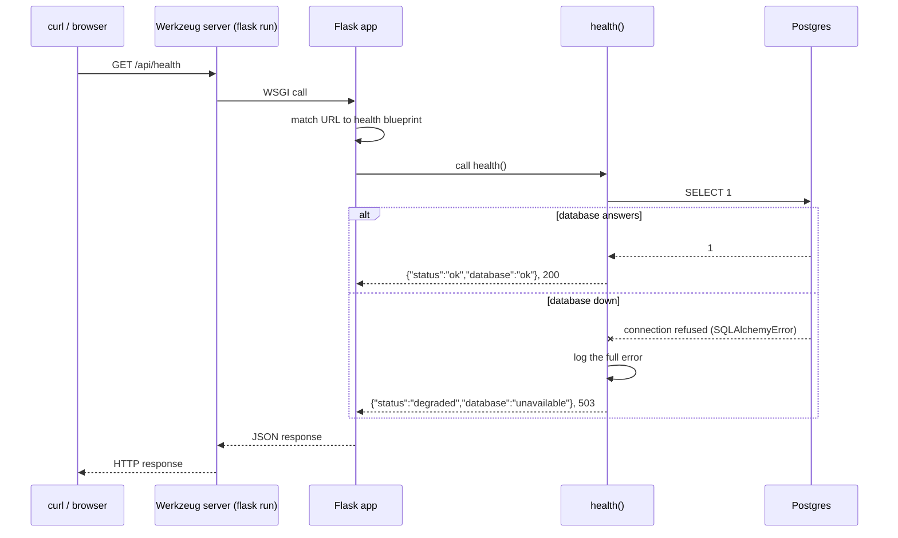

# Phase 0 — Project setup

> **Note:** this guide covers the backend setup. The frontend setup (Next.js, design tokens, the `/api` rewrite and
> `lib/api.ts`) was built together with the storefront and is explained in [02-catalog.md](02-catalog.md).

## What we built

A working skeleton for the Flask backend. It does almost nothing yet, but every later phase plugs into it:

- An **app factory**: a function, `create_app()`, that builds the Flask app.
- **Config from environment variables**: the same code runs on a laptop, in tests and on Render.
- **Eight blueprints** (groups of routes), all under `/api`. Only `health` has a route so far.
- **JSON errors** for every failure, in one shape: `{"error": {"code", "message"}}`.
- `GET /api/health`, which also checks that the database answers.
- A **local Postgres database** in Docker, with a separate database for tests.
- **pytest** with 11 passing tests.

## Key concepts

**Flask.** A small Python web framework. You write a function, attach a URL to it, and Flask calls the function
when a request for that URL arrives.

**Application factory.** Instead of creating the app at the top of a file, we write a function that creates it.
Importing the code then does nothing by itself: no database connection, no secrets read. Tests can call the
function with test settings. The real server calls it with real settings.

**Environment variables.** Named values that live outside the code, in the operating system or a `.env` file.
Example: `DATABASE_URL`. Secrets go here, never in git. This idea comes from the "12-factor app" rules:
config changes between environments, code does not.

**Blueprint.** A group of related routes, like a chapter in a book. `products.py` will hold the product routes,
`auth.py` the login routes, and so on. The factory attaches all of them to the app.

**Virtual environment (venv).** A private folder of Python packages for one project (`backend/.venv`). It stops
projects from fighting over package versions. We use **uv**, a fast tool that creates the venv and installed
Python 3.12 for us.

**Docker Compose.** A tool that starts programs in containers (small isolated boxes) from one file. We use it to
run Postgres without installing it on Ubuntu.

**Health check.** A URL that answers "am I working?". Hosting platforms like Render call it to decide whether a new
deploy is ready.

**pytest fixture.** A function that prepares something a test needs, like a test app or a test client. pytest
passes it into any test that names it as a parameter.

## How it works here

### `backend/app/__init__.py` — the factory

```python
def create_app(config: BaseConfig | None = None) -> Flask:
    app = Flask(__name__, static_folder=None)
    app.config.from_object(config or config_from_env())

    db.init_app(app)
    migrate.init_app(app, db)

    register_error_handlers(app)
    register_blueprints(app)
    return app
```

The order matters. Config is loaded first, because the extensions read it (`db` needs the database URL).
`static_folder=None` turns off Flask's file serving. This is a JSON API; Next.js serves all images and CSS.

### `backend/app/config.py` — settings from the environment

```python
class BaseConfig:
    SQLALCHEMY_ENGINE_OPTIONS = {"pool_pre_ping": True}

    def __init__(self) -> None:
        self.SECRET_KEY = require_env("SECRET_KEY")
        self.SQLALCHEMY_DATABASE_URI = normalize_database_url(require_env("DATABASE_URL"))
```

Four things to notice:

1. **Values are read in `__init__`**, when the object is created, not when the file is imported. So tests can
   import this file safely.
2. **`require_env` fails fast.** If `SECRET_KEY` is missing, the app refuses to start with a clear message. A crash
   at startup is better than a strange error on the first real request.
3. **`normalize_database_url`.** Neon gives us `postgresql://...`. SQLAlchemy would read that as the old psycopg2
   driver. We installed psycopg 3, so we rewrite it to `postgresql+psycopg://...`.
4. **`pool_pre_ping`.** SQLAlchemy keeps a *pool* of open connections and reuses them. Neon closes connections that
   sit idle, and Render's free plan sleeps. Pre-ping tests each connection before use, so we never use a dead one.

The config class comes from `APP_ENV` (`development`, `production` or `testing`). The default is `production`,
so debug mode is never switched on by accident.

`TestingConfig` ignores `DATABASE_URL` and uses `TEST_DATABASE_URL` (the `kora_test` database). Later tests will
delete tables, so they must never be able to reach real data.

### `backend/app/extensions.py` — shared objects

```python
db = SQLAlchemy(model_class=Base)
migrate = Migrate()
```

These are created *without* an app, then connected inside `create_app` with `init_app`. Models (Phase 1) will do
`from app.extensions import db`. If `db` lived in `app/__init__.py`, models would import the factory and the factory
would import models: a **circular import**, which Python can't resolve.

### `backend/app/errors.py` — one error shape

```python
@app.errorhandler(HTTPException)
def handle_http_exception(err):
    code = (err.name or "error").lower().replace(" ", "_")   # "Not Found" -> "not_found"
    return error_response(code, err.description or "", err.code or 500)
```

By default Flask returns HTML error pages. The frontend and the agent need JSON, so we convert every error.
Unexpected crashes become a generic 500 message, so no stack trace or database detail reaches the user.
Routes can also `raise APIError("out_of_stock", "Only 2 left.", 409)` to send a specific error.

### `backend/app/api/__init__.py` — registering blueprints

```python
for blueprint in BLUEPRINTS:
    app.register_blueprint(blueprint, url_prefix="/api")
```

All blueprints use the `/api` prefix, so a route written as `/health` is served at `/api/health`.

### `backend/app/api/health.py` — the health route

```python
@bp.get("/health")
def health():
    try:
        db.session.execute(text("SELECT 1"))
    except SQLAlchemyError:
        current_app.logger.exception("Health check failed: database unreachable")
        return {"status": "degraded", "database": "unavailable"}, 503
    return {"status": "ok", "database": "ok"}
```

- `SELECT 1` is the cheapest query possible. It proves we can connect and run SQL.
- We catch only `SQLAlchemyError`. If we caught every `Exception`, a typo in our own code would be reported as
  "database down", and we would look in the wrong place.
- The real error message contains the database host and username. It goes to the **log** (only we can see it),
  not the response (anyone can see it).
- **503** means "Service Unavailable": the server is alive but can't do its job right now.

### `backend/wsgi.py` — the entry point

```python
app = create_app()
```

**WSGI** is the standard way Python web apps talk to web servers. `flask run` (development) and
`gunicorn wsgi:app` (production on Render) both load this `app` object. `.flaskenv` tells the `flask` command
where to find it.

### `backend/docker-compose.yml` — local Postgres

Runs Postgres 17 on port 5432 with user `kora` and password `kora`. The script in `docker/initdb/` creates a second
database, `kora_test`, the first time the container starts. The `healthcheck` lets `docker compose up --wait` wait
until Postgres is really ready.

We use Postgres locally (not SQLite) so that local behaviour matches production. Row locks, JSON columns and some
constraints work differently in SQLite.

### `backend/tests/` — tests

- `conftest.py` holds fixtures: `app`, `client`, and `unreachable_db_client` (its database URL points at port 1,
  where nothing listens, so it acts like a database that is down).
- `test_health.py` checks the 200 case, the 503 case, and that `POST` gets a 405.
- `test_errors.py` checks the JSON error shape.
- `test_config.py` checks URL normalizing, fail-fast on missing variables, and the `production` default.

### Other files

| File | Purpose |
|---|---|
| `requirements.txt` | Exact versions of runtime packages. Render installs these. |
| `requirements-dev.txt` | Runtime packages plus `pytest`. For laptops and CI only. |
| `.env.example` | Every variable the app uses, with safe sample values. Committed to git. |
| `.env` | Your real local values. **Ignored by git** (see `.gitignore`). |
| `.python-version` | Says "3.12" so uv picks the right Python. |
| `pyproject.toml` | pytest settings (where tests live). |

## Request flow

What happens when you run `curl localhost:5000/api/health`:



## Design decisions and alternatives

| Decision | Alternatives | Why we chose this |
|---|---|---|
| App factory | One global `app = Flask(...)` | Tests need their own app with test settings. A global app reads secrets and connects on import. |
| Config from env vars only | Config files per environment, hard-coded values | One codebase for laptop, CI and Render. Secrets stay out of git. |
| Default `APP_ENV=production` | Default to development | Forgetting the variable should be safe (debug off), not dangerous. |
| All blueprints at `/api` | `/api/products`, `/api/auth`… per blueprint | One blueprint serves several paths (`products` will serve `/products`, `/categories`, `/policies`). |
| Postgres in Docker locally | SQLite, or Postgres installed on Ubuntu | Same database as production. Docker keeps it isolated and easy to wipe. |
| Separate `kora_test` database | Use the dev database for tests | Tests delete data. Your dev data stays safe. |
| psycopg 3 | psycopg2 | Newer, actively developed, supports modern Python well. |
| Health check touches the DB | Return `ok` without checking the DB | We learn fast if the DB is unreachable. The cost: if Neon has a short problem, Render may think our app is broken. Revisit in Phase 7 (*liveness* vs *readiness*). |
| uv + Python 3.12 | System Python 3.14 | Matches the version we will pin on Render. uv installs it without touching Ubuntu's Python. |

## What could go wrong

- **`RuntimeError: Missing required environment variable: SECRET_KEY`** — there is no `backend/.env`. Fix:
  `cp .env.example .env`.
- **Health returns 503 locally** — Postgres is not running. Fix: `docker compose up -d --wait`.
- **Port 5432 is already in use** — another Postgres is running on Ubuntu. Stop it
  (`sudo systemctl stop postgresql`) or change the left side of `"5432:5432"` and the URLs in `.env`.
- **`kora_test` database does not exist** — the init script only runs when the volume is first created. Fix:
  `docker compose down -v && docker compose up -d --wait` (this deletes local data).
- **`flask: command not found`** — the venv is not active. Fix: `source .venv/bin/activate`.
- **Committing `.env` by mistake** — `.gitignore` blocks it. Check `git status` before each commit anyway.

## Try it yourself

```bash
cd ~/Documents/kora-store/backend
docker compose up -d --wait          # start Postgres
source .venv/bin/activate            # use the project's Python
pytest -v                            # expect: 11 passed
flask run                            # start the dev server
```

In a second terminal:

```bash
curl -i localhost:5000/api/health        # 200 {"database":"ok","status":"ok"}
curl -i -X POST localhost:5000/api/health   # 405 with a JSON error
curl -i localhost:5000/api/nope          # 404 with a JSON error
docker compose stop                      # stop Postgres...
curl -i localhost:5000/api/health        # ...now 503, and the flask terminal logs the real error
docker compose start
```

## Explain it in 60 seconds

> "The backend is a Flask API that uses the application factory pattern. A function, `create_app`, builds the
> app: it loads config from environment variables, connects SQLAlchemy and Flask-Migrate, registers JSON error
> handlers, and registers one blueprint per area of the API under `/api`. Because the app is built by a function,
> tests can create it with a separate test database, and production builds it from Render's environment variables.
> Nothing secret is in the code.
>
> There's a `/api/health` endpoint that runs `SELECT 1`. If the database answers, it returns 200. If not, it
> returns 503 and logs the real error, without leaking connection details in the response. I catch only
> SQLAlchemy errors, so bugs in my own code aren't hidden as database problems.
>
> Locally, Postgres runs in Docker Compose, the same database engine as production on Neon, and pytest runs
> against its own test database. In production, gunicorn serves the app on Render, and the Next.js frontend
> proxies `/api` to it so the browser only ever talks to one domain."
