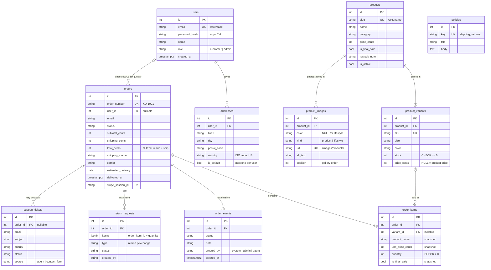
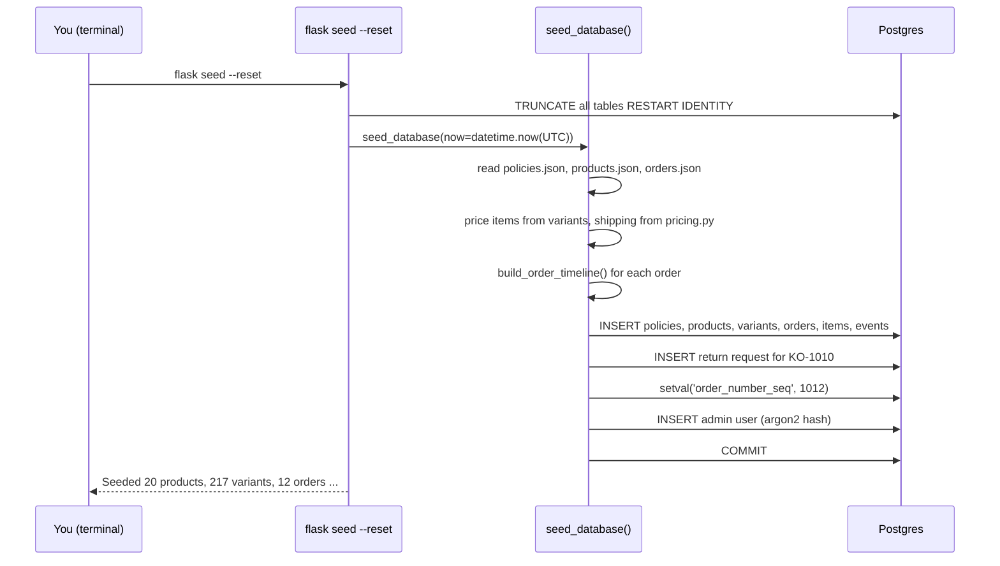

# Phase 1 — Database, models and seed

## What we built

- **10 tables** in Postgres, written as SQLAlchemy models in `backend/app/models/`.
- **The first Alembic migration**, the script that creates all those tables.
- **`flask seed --reset`**, which fills the database with the demo store: 20 products, 217 variants, 12 orders
  with full timelines, 5 policies, 1 refunded return, and an admin user.
- Two small shared modules that later phases reuse: `app/pricing.py` (shipping rules) and `app/security.py`
  (password hashing).
- **50 new tests** (61 in total).

## Key concepts

**Relational database.** Data is stored in *tables* (like spreadsheets). Each *row* is one thing (one product), and
each *column* is one fact about it (its price). Tables link to each other through ids.

**Primary key (PK).** A column that identifies each row uniquely. All our tables use `id`, a number Postgres
increases by one for each new row.

**Foreign key (FK).** A column that holds another table's primary key, like `order_items.order_id`. Postgres
guarantees that the row it points to exists. You can't add an item to order 999 if there is no order 999.

**ON DELETE rule.** What happens to linked rows when a row is deleted. `CASCADE` deletes them too. `SET NULL`
empties the link. No rule (the default) blocks the delete.

**Constraint.** A rule the database enforces on every write, whatever program does the writing. Examples:
`UNIQUE` (no duplicates), `NOT NULL` (must have a value), `CHECK` (any true/false condition, like `stock >= 0`).

**Index.** A sorted lookup structure, like the index at the back of a book. It makes `WHERE email = ...` fast
instead of reading every row. It costs a little disk space and a little time on each write.

**ORM (Object-Relational Mapper).** A library that turns rows into Python objects and back. With SQLAlchemy we
write `order.items` instead of a SQL `JOIN`. We still need to understand the SQL it runs underneath.

**Migration.** A versioned Python script that changes the database structure (`upgrade`) and can undo it
(`downgrade`). Migrations are committed to git, so every database (your laptop, CI, Neon) is built exactly the same way.

**Seed data.** Starting data loaded into an empty database, so the demo has something to show.

**Integer cents.** We store money as whole cents: `2400` means $24.00. Floats can't store most decimal amounts
exactly. In Python, `0.1 + 0.2` gives `0.30000000000000004`. Integers have no rounding errors.

**Snapshot.** A copy of data taken at one moment. Order items copy the product's name and price when the order is
placed, so later changes to the product don't change old orders.

**Sequence.** A Postgres counter that hands out the next number. Each number is given out once only, even when
many requests ask at the same time.

## The tables (ER diagram)

An ER (entity-relationship) diagram shows tables and how they link. `||--o{` means "one to zero-or-more".



## How it works here

### `app/extensions.py` — the base class

```python
NAMING_CONVENTION = {
    "ck": "ck_%(table_name)s_%(constraint_name)s",
    "uq": "uq_%(table_name)s_%(column_0_name)s",
    ...
}

class Base(DeclarativeBase):
    registry = registry(
        metadata=MetaData(naming_convention=NAMING_CONVENTION),
        type_annotation_map={datetime: DateTime(timezone=True)},
    )
```

- **The naming convention** gives every constraint a predictable name, like `ck_product_variants_stock_not_negative`.
  Error messages become readable, and a future migration can find a constraint by name to change it.
- **`DateTime(timezone=True)`** makes every timestamp a Postgres `TIMESTAMPTZ`. Times are stored in UTC, so
  "10 days ago" means the same thing on your laptop in Pakistan and on a server in the US.

### `app/models/types.py` — enums and shared column types

```python
IntPK = Annotated[int, mapped_column(primary_key=True)]
CreatedAt = Annotated[datetime, mapped_column(server_default=func.now())]

class OrderStatus(StrEnum):
    PENDING_PAYMENT = "pending_payment"
    PROCESSING = "processing"
    ...
```

`Annotated` lets each model write `id: Mapped[IntPK]` instead of repeating the same settings. A `StrEnum` member
*is* a string, so `OrderStatus.SHIPPED == "shipped"` and it goes into JSON as `"shipped"`.

`enum_column()` stores an enum as `VARCHAR` plus a `CHECK` constraint (`status IN ('pending_payment', ...)`).

### `app/models/catalog.py` — products and variants

```python
class ProductVariant(db.Model):
    __table_args__ = (
        UniqueConstraint("product_id", "size", "color", ...),
        CheckConstraint("stock >= 0", name="stock_not_negative"),
    )
    price_cents: Mapped[int | None]   # NULL means "use the product's price"

    @property
    def effective_price_cents(self) -> int:
        return self.price_cents if self.price_cents is not None else self.product.price_cents
```

A **product** is the thing you browse ("Everyday Cotton Tee"). A **variant** is the thing you actually buy
("white, size M"). Stock lives on the variant. `Mapped[int | None]` makes the column nullable; `Mapped[int]`
makes it `NOT NULL`. SQLAlchemy reads this from the type hint.

### `app/models/order.py` — orders, items, events

```python
order_number_seq = Sequence("order_number_seq", start=1001, metadata=db.metadata)

class Order(db.Model):
    order_number: Mapped[str] = mapped_column(
        String(20), unique=True,
        server_default=text("'KO-' || nextval('order_number_seq')"),
    )
    __table_args__ = (
        CheckConstraint("total_cents = subtotal_cents + shipping_cents", name="total_adds_up"),
        ...
    )
```

- **Order numbers** come from the database. When a new order is inserted without a number, Postgres runs
  `'KO-' || nextval(...)` and the order becomes `KO-1013`.
- **The shipping address is copied onto the order** (`shipping_line1`, `shipping_city`…), not linked to `addresses`.
  If a customer edits their saved address, the old order still shows where it was really sent.
- **`OrderItem`** stores snapshots: `product_name`, `unit_price_cents`, `is_final_sale`.
- **`OrderEvent`** rows are only ever added, never changed. Together they are the order's history. The tracking page
  and the AI agent will both read them.

### `app/models/user.py` — users and addresses

```python
Index("uq_addresses_one_default_per_user", "user_id", unique=True, postgresql_where=text("is_default"))
```

This is a **partial unique index**. It only checks rows where `is_default` is true. So a user can have many
addresses, but only one default. The database enforces it, so even two requests at the same time can't break it.

Emails are trimmed and lowercased by `@validates("email")`, and a `CHECK (email = lower(email))` constraint backs it up.

### `app/models/support.py` and `policy.py`

`ReturnRequest.items` is a **JSONB** column (JSON stored in a binary format Postgres can search):
`[{"order_item_id": 15, "quantity": 1}]`. `Policy` holds the store policy text that both the website and the
agent will read.

### `migrations/versions/2026_10_19_..._initial_schema.py` — the migration

We generated it with `flask db migrate`. Alembic compared the models with the empty database and wrote the
`CREATE TABLE` steps. Then **we fixed two things by hand**:

1. Autogenerate doesn't create standalone sequences, so we added
   `op.execute(sa.schema.CreateSequence(sa.Sequence("order_number_seq", start=1001)))`.
2. It wrote each enum CHECK constraint twice, with the same name. We deleted the copies.

Lesson: **always read an autogenerated migration before you run it.**

### `app/seed.py` — the seed command

```python
def seed_database(session, *, now, seed_dir=SEED_DIR, admin_email=None, admin_password=None) -> SeedCounts:
    policies = [Policy(**row) for row in _load_json(seed_dir / "policies.json")]
    products = [_build_product(row) for row in _load_json(seed_dir / "products.json")]
    orders = [_build_order(row, variants, now) for row in _load_json(seed_dir / "orders.json")]
    ...
    session.execute(select(func.setval("order_number_seq", highest)))
    session.commit()
```

Key steps:

1. **Relative dates become real dates.** `created_days_ago: 15` becomes `now - 15 days`. `now` is a parameter, so tests
   can pass a fixed date and check exact values.
2. **Prices come from the catalog**, not the JSON. Each item's price is looked up from its variant, and shipping comes
   from `pricing.shipping_cents()`, the same function the cart will use in Phase 3.
3. **Timelines.** `build_order_timeline()` creates events that end in the order's status. For example, a `returned`
   order gets: pending_payment → processing → shipped → out_for_delivery → delivered → returned. If the dates are
   impossible (delivered before shipped), it raises an error instead of saving nonsense.
4. **The sequence is moved forward.** We inserted KO-1001 to KO-1012 by hand, so the sequence never handed those out.
   `setval` moves it to 1012, so the next real order is KO-1013.
5. **The admin user** is created from `ADMIN_EMAIL` and `ADMIN_PASSWORD`. The password is hashed with argon2, and
   passwords shorter than 12 characters are refused.
6. **Everything is one transaction.** One `commit()` at the end, so either all the data loads or none of it does.

`flask seed` refuses to run on a database that already has data. `flask seed --reset` first runs
`TRUNCATE ... RESTART IDENTITY CASCADE` (empties every table and restarts the id counters).

### `app/pricing.py` and `app/security.py`

```python
def shipping_cents(method, subtotal_cents) -> int:
    if method is ShippingMethod.STANDARD and subtotal_cents > FREE_SHIPPING_THRESHOLD_CENTS:
        return 0
    return SHIPPING_RATES_CENTS[method]
```

The policy says "free over $75", so exactly $75.00 still pays $6.95. The test file shows this edge case.
`security.py` wraps argon2: `hash_password()` and `verify_password()`.

### Tests

| File | What it checks |
|---|---|
| `tests/conftest.py` | Builds `kora_test` with the **real migration** once per run; `db_session` empties every table after each test |
| `tests/factories.py` | `make_product`, `make_order`… to build valid rows quickly |
| `tests/test_models.py` | Every constraint (negative stock, wrong total, unknown status, duplicate email, one default address), the order number sequence, and that **the migration matches the models** |
| `tests/test_seed.py` | The phase's "done when" counts, real dates, totals, timelines, the admin user, `--reset`, and the CLI |
| `tests/test_pricing.py`, `test_security.py` | Shipping rules and password hashing |

## Request flow

Phase 1 has no new HTTP endpoints. The new flow is the seed command:



## Design decisions and alternatives

| Decision | Alternatives | Why we chose this |
|---|---|---|
| Enums as `VARCHAR + CHECK` | Native Postgres `ENUM` type | Same safety. Adding a status later is a normal migration; changing a native enum needs special handling. |
| Order number from a Postgres sequence | `f"KO-{1000 + id}"`; a random code; a `MAX()+1` query | Safe when two checkouts happen at the same time. `MAX()+1` can give two orders the same number. |
| Category as a column | A `categories` table | Only six fixed names, no extra data per category. Easy to change later if categories need images or descriptions. |
| Shipping address copied onto the order | Foreign key to `addresses` | Guests have no saved addresses, and editing a saved address mustn't change past orders. |
| Snapshots on order items | Always read from the product | Prices and final-sale flags change. Orders and return rules must use what was true at purchase. |
| `return_requests.items` as JSONB | A `return_request_items` table | A return is always read and written as a whole. A separate table is the normal-form choice if we later need to query single returned items. |
| Integer cents | `NUMERIC(10,2)`, floats | No rounding errors, simple math, and Stripe also uses integer cents. Floats are never safe for money. |
| Constraints in the database, not only Python | Validate in Python only | Raw SQL, admin scripts, future bugs and concurrent requests all go through the database. |
| Tests run real migrations | `db.create_all()` | `create_all` would have hidden the missing sequence in the migration. |
| Seed computes totals and timelines | Store them in the JSON | One source of truth for prices; the demo stays consistent if a price changes. |
| `TIMESTAMPTZ` everywhere | `TIMESTAMP` without time zone | No confusion between server time and local time. |

## What could go wrong

- **`relation "order_number_seq" does not exist`** — the migration wasn't run. Fix: `flask db upgrade`.
- **`flask seed` says "already has data"** — that's on purpose. Use `flask seed --reset` (this deletes **everything**,
  including user accounts).
- **`ADMIN_PASSWORD must be at least 12 characters`** — set a longer password in `backend/.env`.
- **You changed a model, and `test_migrations_match_models` fails** — run `flask db migrate -m "describe change"`,
  **read the new file**, then `flask db upgrade`.
- **`IntegrityError ... ck_product_variants_stock_not_negative`** — something tried to sell more than the stock.
  That's the database protecting us. In Phase 4 we'll handle it properly with row locks.
- **Times look 5 hours off** — Postgres stores UTC. Convert to local time only when showing it to a person.
- **Tests fail with "database kora_test does not exist"** — run `docker compose down -v && docker compose up -d --wait`.

## Try it yourself

```bash
cd ~/Documents/kora-store/backend
source .venv/bin/activate
docker compose up -d --wait
flask db upgrade
flask seed --reset
pytest -q                                # expect: 61 passed
```

Look at the data with `psql` inside the container:

```bash
docker compose exec db psql -U kora -d kora
```

```sql
\dt                                         -- list tables
\d orders                                   -- columns, indexes, constraints
SELECT order_number, status, total_cents FROM orders ORDER BY id;

-- KO-1010's timeline
SELECT e.status, e.created_at, e.note
FROM order_events e JOIN orders o ON o.id = e.order_id
WHERE o.order_number = 'KO-1010' ORDER BY e.created_at;

-- Watch a constraint protect you (this fails):
UPDATE product_variants SET stock = -1 WHERE sku = 'KO-001-WHIT-M';
\q
```

Or explore with the ORM in a Python shell: `flask shell`, then

```python
from app.models import Order
o = db.session.scalars(db.select(Order).filter_by(order_number="KO-1011")).one()
[(i.product_name, i.is_final_sale) for i in o.items]
```

## Explain it in 60 seconds

> "The database is Postgres, with ten tables modelled in SQLAlchemy 2.0. Products have variants, one per size and
> colour, and stock lives on the variant. Orders have items, and the items store a snapshot of the name, price and
> final-sale flag at purchase time, so later product changes never rewrite history. Every status change is a row in
> `order_events`, which becomes the tracking timeline and the AI agent's view of what happened.
>
> I enforce the important rules in the database, not just in Python: stock can't go negative, the total must equal
> subtotal plus shipping, and statuses must be valid. Money is integer cents to avoid float rounding errors. Order
> numbers like KO-1013 come from a Postgres sequence, which is safe under concurrent checkouts.
>
> Schema changes go through Alembic migrations. I read every autogenerated migration, and in this one I had to add the
> sequence by hand. The tests build the test database by running the real migration, and one test checks that the
> models and migrations haven't drifted apart. The seed command turns relative dates like 'delivered 10 days ago' into
> real timestamps, so the demo data never goes stale."
