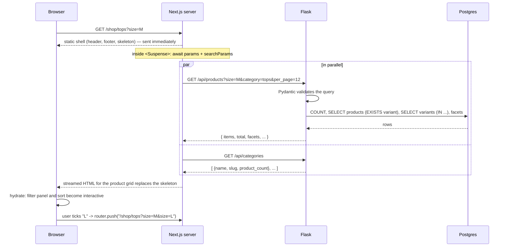
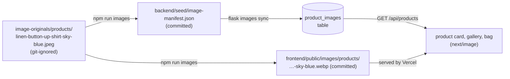

# Phase 2 — Catalog API and storefront

## What we built

**Backend (Flask)**
- `GET /api/products`: list products with filters (category, search, size, colour, price), five sort orders and
  pagination. It also returns **facets**: the sizes, colours and price range that exist, so the filter sidebar only
  offers real options.
- `GET /api/products/<slug>`: one product with every variant, its live stock and related products.
- `GET /api/categories`, `GET /api/policies`, `GET /api/policies/<key>`.
- Input validation with **Pydantic**. Bad input returns `400 validation_error`.
- 37 new tests (98 in total), including one that **counts SQL queries** to prove there is no N+1 problem.

**Frontend (Next.js)** — this also finishes the frontend half of Phase 0:
- Next.js 16 project with Tailwind CSS, the brand colours and fonts, the `/api` rewrite and a typed API client.
- Pages: home, shop, category pages, product detail, policy pages, 404 page and an error page.
- Header (desktop menu, mobile slide-in menu, search), footer, loading skeletons, SEO metadata, and product
  structured data for search engines.

## Key concepts

**REST.** A style for designing web APIs. Each URL names a *resource* (`/products/everyday-cotton-tee`) and the HTTP
method says what to do with it (`GET` = read). Responses are JSON.

**Query parameters.** The part of a URL after `?`: `/api/products?category=tops&sort=price_asc`. They are inputs to a
`GET` request. A list is sent by repeating the key: `?size=S&size=M`.

**Validation.** Checking that input has the right type and range before using it. `page=abc` or `per_page=1000`
must be refused with a clear error, not crash the server or overload the database.

**Pagination.** Returning a large list in pages. We use *offset pagination*: page 2 with 12 per page means "skip 12,
take 12" (`OFFSET 12 LIMIT 12`).

**N+1 query problem.** A common ORM performance bug. You run **1** query to get 12 products, then the code touches
`product.variants` and the ORM runs **1 more query per product**: 12 more, so N+1 = 13. It is invisible with
tiny data and slow with real data.

**Eager loading.** Telling the ORM to load related rows up front. `selectinload(Product.variants)` loads the variants
for *all* listed products in **one** extra query: `SELECT ... WHERE product_id IN (1, 2, ..., 12)`.

**Facets.** The filter options shown next to search results, with only the values that actually exist.

**Server component / client component.** In Next.js, a *server component* runs only on the server. It can fetch
data and sends finished HTML, with no JavaScript for that part. A *client component* (`"use client"`) also runs in
the browser, so it can react to clicks. We use client components only where the user interacts.

**Partial prerendering (static shell + streaming).** At build time, Next.js renders every part of a page that doesn't
need live data (header, headings, layout) into static HTML: the *shell*. Parts that need live data are wrapped in
`<Suspense>`. The shell is sent instantly with a skeleton in those places, and the real content *streams* in when the
data is ready.

**Suspense.** A React component that shows a *fallback* (our skeletons) while its children are still loading.

**Hydration.** After the HTML arrives, React runs in the browser and attaches event handlers to it, so buttons
start working.

## How it works here

### Backend

#### `backend/app/validation.py` — turning query strings into typed objects

```python
def parse_query(model: type[Model], args: MultiDict[str, str]) -> Model:
    for name, field in model.model_fields.items():
        values = [value.strip() for value in args.getlist(name) if value.strip()]
        ...
        data[name] = values if is_list else values[0]
    try:
        return model.model_validate(data)
    except ValidationError as error:
        raise APIError("validation_error", f"{field}: {first['msg']}", 400) from error
```

Query strings are always text. Pydantic converts `"2"` to the integer `2`, checks the limits, and gives us a typed
object. Empty values (`?q=`) are treated as "not given", because HTML forms send empty fields.

#### `backend/app/catalog.py` — the query logic

The rules for the list endpoint are written as a Pydantic model:

```python
class ProductListQuery(BaseModel):
    category: str | None = Field(None, max_length=60)
    q: str | None = Field(None, max_length=100)
    size: list[str] = Field(default_factory=list, max_length=20)
    sort: SortOption = "best_selling"          # only five values allowed
    page: int = Field(1, ge=1)
    per_page: int = Field(12, ge=1, le=48)     # nobody can ask for a million rows
```

**Search** uses `ILIKE` (case-insensitive match) on name, description and category. User input is escaped first:

```python
def escape_like(text: str) -> str:
    return text.replace("\\", "\\\\").replace("%", "\\%").replace("_", "\\_")
```

In `LIKE`, `%` means "anything". Without escaping, searching for `%` would match every product. This isn't SQL
injection (SQLAlchemy sends values as parameters, never as SQL text), but it is still wrong behaviour.

**Size and colour** filters use a single `EXISTS` sub-query:

```python
conditions = [ProductVariant.product_id == Product.id, ProductVariant.stock > 0]
if query.size:  conditions.append(ProductVariant.size.in_(query.size))
if query.color: conditions.append(ProductVariant.color.in_(query.color))
filters.append(exists().where(*conditions))
```

Both conditions are in the *same* `EXISTS`, so "M in Black" only matches a product that has **one in-stock variant**
that is both M and Black. Two separate checks would wrongly match a product with "M in White" and "L in Black".

**Best selling** joins a sub-query that adds up units sold, ignoring unpaid and cancelled orders:

```python
select(ProductVariant.product_id, func.sum(OrderItem.quantity).label("units"))
    .join(OrderItem, ...).join(Order, ...)
    .where(Order.status.not_in(UNSOLD_STATUSES))
    .group_by(ProductVariant.product_id)
```

Every sort ends with `Product.id` as a **tie-breaker**. Without it, Postgres may return tied rows in a different order
each time, and a product could appear on page 1 *and* page 2.

**Facets** use only the category and search filters, not the size and colour filters. If they used every filter,
picking "M" would hide all the other sizes, and you couldn't add "L".

**No N+1:**

```python
stmt = _sorted(select(Product).where(*filters), query.sort).options(selectinload(Product.variants))
```

Each list request runs the same small number of queries (count, products, variants, facets), whatever the page size.
`tests/test_catalog_api.py::test_listing_uses_the_same_number_of_queries_for_any_page_size` counts them with a
SQLAlchemy event listener.

#### `backend/app/api/products.py` — thin routes

```python
@bp.get("/products")
def list_products() -> ResponseReturnValue:
    query = parse_query(ProductListQuery, request.args)
    return catalog.list_products(db.session, query)
```

Routes only translate HTTP to Python and back. The logic lives in `catalog.py`, so the Phase 8 agent's
`/api/agent/products/search` can reuse exactly the same search.

### Frontend

#### `frontend/next.config.ts` — the `/api` proxy

```ts
async rewrites() {
  return [{ source: "/api/:path*", destination: `${backendUrl}/api/:path*` }];
},
```

The browser calls `/api/products` on our own site, and Next.js forwards it to Flask. Cookies stay first-party and we
never need CORS (see `docs/ARCHITECTURE.md`).

#### `frontend/lib/api.ts` — the typed API client

```ts
function baseUrl(): string {
  if (typeof window === "undefined") return process.env.BACKEND_URL ?? "http://localhost:5000";
  return "";   // browser: relative URL, goes through the rewrite
}

export const api = {
  products: (query: ProductQuery = {}) => request<ProductPage>(`/products?${toSearchParams(query)}`),
  product: (slug: string) => request<ProductDetail>(`/products/${encodeURIComponent(slug)}`),
  ...
};
```

Server components call Flask **directly** (server to server). There is no browser involved, so the proxy isn't
needed. Errors from the API become an `ApiError` with the status and the `code` from our JSON error envelope.
`lib/types.ts` mirrors the backend responses, so TypeScript catches a misspelled field at build time.

#### Pages: static shell + `<Suspense>`

```tsx
export default function ProductPage({ params }: PageProps<"/products/[slug]">) {
  return (
    <div className="...">
      <Suspense fallback={<ProductDetailSkeleton />}>
        <ProductContent params={params} />      {/* awaits params, fetches the product */}
      </Suspense>
    </div>
  );
}
```

This Next.js version has **Cache Components** on. The rule: anything that reads request data (`params`,
`searchParams`) or does an uncached `fetch` must sit inside `<Suspense>`. Everything else becomes the prerendered
shell. Two useful results:
- **The build never calls the API.** `npm run build` passes with Flask switched off, which matters on Vercel.
- **Stock is always live.** Product data is fetched fresh for every request, never from a cache.

The build output shows this as `◐ (Partial Prerender)` for each page.

#### `frontend/lib/shop-url.ts` + `components/shop/` — filters live in the URL

```ts
export function shopHref(category: string | undefined, filters: ShopFilters): string {
  const path = category ? `/shop/${category}` : "/shop";
  ...
}
```

The filter panel keeps no state of its own. Each click builds a new URL (`/shop/tops?size=M&sort=price_asc`) and
navigates there, and the server renders the matching products. So filtered pages can be shared and bookmarked, the
back button works, and the product grid stays a server component. `useTransition` dims the panel while the next page
loads.

#### `components/product/product-view.tsx` — the variant picker

A client component. It receives all variants (already fetched on the server) and works out what to show for the chosen
colour and size: the price, "Only 3 left", "Sold out. Restock expected in about 3 weeks", and greyed-out sizes. The
pickers are real `<input type="radio">` elements styled as buttons, so keyboards and screen readers work without
extra code. Add to bag shows the right state, but the bag itself arrives in Phase 3.

#### `components/product-art.tsx` — placeholder images

Products have no photos yet (`image_url` is null). This draws a simple line drawing of the garment type on a panel
tinted with the selected colour. When an admin sets an `image_url`, a real photo is shown instead.

#### Accessibility built in

- A "Skip to content" link, plus a visible focus outline on every interactive element.
- The mobile menu and mobile filters use the native `<dialog>` element with `showModal()`. This gives focus trapping,
  the Escape key and an inert background for free.
- Filters and pickers use `<fieldset>`/`<legend>` and real form inputs.
- `aria-live` regions announce the product count, price and stock changes.
- The muted text colour `#6b6359` was chosen to pass WCAG AA contrast on the background.

## Request flow

What happens when someone opens `/shop/tops?size=M`:



## Design decisions and alternatives

| Decision | Alternatives | Why we chose this |
|---|---|---|
| Pydantic for validation | Marshmallow, hand-written checks | Uses Python type hints we already write, fast, clear errors, and the same tool FastAPI and many AI libraries use. |
| Service layer (`catalog.py`) + thin routes | Queries inside route functions | Easy to test, and the AI agent will reuse the same search. |
| Offset pagination | Keyset (cursor) pagination | Simple, and supports "jump to page 3". Keyset is faster for huge tables and infinite scroll, but our catalog is small. |
| `ILIKE` search | Postgres full-text search, a trigram index, a search engine | Enough for 20 products. Full-text search adds stemming ("shirts" finds "shirt") and ranking; the next step if the catalog grows. |
| Unknown category → 404 | Return an empty list | The shopper typed a wrong URL. A 404 is honest, and the frontend can show the 404 page directly. |
| Exact stock in the API | Only "in stock / low / out" | The product page shows "Only 3 left", and the cart (Phase 3) needs the limit. The trade-off: competitors could read stock levels. |
| Filters in the URL | React state, or a client-side data library | Shareable, bookmarkable, back button works, server-rendered. |
| Live data in `<Suspense>`, no cache | `"use cache"` with a lifetime, or prerendering every product | Stock must be live, and the build mustn't depend on the API. Product descriptions could be cached later for speed. |
| Server calls Flask directly | Server also goes through the `/api` rewrite | One less network hop. The rewrite exists for the browser's cookies, not for the server. |
| Header categories hard-coded in `lib/site.ts` | Fetch them from `/api/categories` | The header becomes part of the static shell with no loading flicker. The shop sidebar still shows live counts. The trade-off: a new category must also be added to `lib/site.ts`. |
| Placeholder art (SVG) | Stock photos | No licence issues, and every product looks consistent. The `image_url` field switches to real photos. |

## What could go wrong

- **Every page shows "Something went wrong".** Flask isn't running, or `BACKEND_URL` is wrong. Start the backend, and
  check `frontend/.env.local`.
- **A wrong product URL returns status 200, not 404.** This is expected with streaming: the response had already
  started with `200` when we found out the product doesn't exist. Next.js shows the 404 page and adds
  `<meta name="robots" content="noindex">`, so search engines ignore it. A true 404 status would need a check in
  `proxy.ts` before rendering.
- **Build error "usePathname() ... outside of Suspense".** Reading the URL in a client component in the layout blocks
  prerendering. We hit this with the mobile menu and fixed it by closing the menu on link click instead.
- **Adding a field to an API response.** Also add it to `frontend/lib/types.ts`, or TypeScript won't let you use it.
- **A query parameter is ignored.** It must be declared in `ProductListQuery`. Unknown parameters are dropped on purpose.
- **Slow product list as data grows.** Check for missing indexes and N+1 queries. The query-count test catches N+1 in CI.

## Try it yourself

```bash
# terminal 1: backend
cd ~/Documents/kora-store/backend && source .venv/bin/activate
docker compose up -d --wait && flask seed --reset && flask run

# terminal 2: frontend
cd ~/Documents/kora-store/frontend
npm install            # first time only
npm run dev            # open http://localhost:3000
```

Things to try:
1. `/shop`: tick size M and the colour Black, then change the sort. Watch the URL change. Copy it into a new tab and
   you get the same page.
2. `/products/everyday-joggers`: sold out, with the restock note. `/products/merino-crew-sweater`: some sizes are
   greyed out.
3. `/products/gift-card`: the price changes when you pick $25 / $50 / $100.
4. Use the site with only the keyboard (Tab, Space, Enter, Escape).
5. Make your browser narrow, then open the menu and the Filters panel.
6. Call the API directly:
   ```bash
   curl -s "localhost:5000/api/products?category=tops&sort=price_asc&per_page=3" | python3 -m json.tool
   curl -s "localhost:5000/api/products?per_page=500"     # 400 validation_error
   ```
7. Run the checks: `cd backend && pytest -q` (98 passed) and `cd frontend && npm run lint && npm run build`.

## Site photography: how the images work

The homepage hero, the category tiles and banners, and the About page use real photos. (Product photos follow the
same steps plus a few more, in the next section.) Two steps get them from a
3 MB camera-style file to a fast page.

### Step 1: `npm run images` (build time, on your machine)

`frontend/scripts/optimize-images.mjs` uses **sharp** (a fast image library, the same one Next.js uses) to convert
every `.jpeg`/`.jpg`/`.png` in `image-originals/site/` and `image-originals/products/` to **WebP at quality 80**:

| Image | Max width | Before → after |
|---|---|---|
| `hero` | 2400px (fills wide screens) | 3329 KB → 326 KB |
| everything else | 1200px | e.g. 3021 KB → 94 KB (tops) |
| **all 7** | | **23 MB → 1.2 MB (−95%)** |

- Output keeps the base name: `hero.jpeg` → `public/images/site/hero.webp`.
- `.rotate()` applies the camera's orientation tag before metadata is stripped; `withoutEnlargement` never upscales.
- **Skips unchanged files**: if the `.webp` is newer than the original, it's left alone. `npm run images -- --force`
  converts everything again (use it after changing the quality or widths in the script).
- It prints each file's size before and after.

**Why WebP?** A modern image format that every current browser supports. At the same visible quality it's
typically 25–35% smaller than JPEG, and it supports transparency like PNG.

**Why the originals aren't committed.** `image-originals/` is in `.gitignore`. The originals are large (3 MB each),
they're never served to visitors, and git keeps every version of every file forever, so replacing a photo would add
another 3 MB to the repository *permanently*, and every clone would download it. Only the small WebP files in
`frontend/public/images/` are committed. Keep the originals somewhere safe (a cloud drive), because they can't be
regenerated from the WebP files.

### Step 2: `next/image` (request time, in the browser)

```tsx
// lib/site-images.ts — a static import: Next reads width/height at build time and makes a tiny blurred preview
import hero from "@/public/images/site/hero.webp";

// app/page.tsx
<Image src={HERO_PHOTO.src} alt={HERO_PHOTO.alt} fill preload placeholder="blur" sizes="100vw" ... />
```

What `next/image` does for us:
- **Responsive sizes.** It generates several widths of each image (a `srcset`) through the built-in image optimizer.
  The `sizes` attribute tells the browser how wide the image will be on screen, so it picks the smallest file that's
  still sharp. Our category tiles say
  `sizes="(min-width: 1280px) 200px, (min-width: 1024px) 16vw, (min-width: 768px) 33vw, 50vw"`. Measured: a desktop
  downloads 256px-wide tiles (7–17 KB each), while a phone with a 2× screen gets 640px versions. **A phone loading the
  homepage downloads about 245 KB of photos in total**, the hero included.
- **Lazy loading by default.** Images below the screen aren't downloaded until the visitor scrolls near them.
- **`preload` for the hero.** The hero is the largest thing on the first screen (the *LCP*, Largest Contentful
  Paint, a Core Web Vitals score). `preload` adds a `<link rel="preload">` to the `<head>`, so the download starts
  before the browser even reaches the ``. Only the homepage hero does this; preloading many images would make
  them compete. (In Next.js 16, `preload` replaces the older `priority` prop, which is deprecated.)
- **No layout shift.** Static imports give Next.js each image's dimensions, and `fill` images sit in boxes with a fixed
  aspect ratio, so text doesn't jump when an image arrives.
- **`placeholder="blur"`**: a tiny blurred version appears instantly while the real image loads.

Other details:
- **Alt text** describes what's in the photo ("A couple walking along a tree-lined city street in autumn…"), written
  once in `lib/site-images.ts`.
- **Cropping:** the same photo is used in different shapes (a 4:5 tile, a 3:1 banner, a full-screen hero). Each photo
  has a `focus` (CSS `object-position`) so the important part stays in frame, e.g. the hero keeps the couple visible
  when phones crop the sides.
- **Readable text on photos:** a gradient overlay darkens only where the text sits: from the bottom on phones, from
  the left on wider screens.
- A category without a photo still gets a styled banner (sage panel) and placeholder art, so a new category never
  shows a broken image. All six categories have photos now.

**Try it:** `cd frontend && npm run images` (it skips everything, since nothing changed). Then open the homepage, open
DevTools → Network → filter "Img", and switch the device toolbar between a phone and a desktop: watch the `w=` value
in the `/_next/image?…` requests change.

## Product photos: manifest, sync and placeholders

Site photos are fixed, so the code imports them directly. Product photos are different: they belong to **data**
(a product and a colour), they arrive a few at a time, and the backend must know about them too, because the API
sends them to the shop and later to the AI agent. So they take a longer path.



### File names are the link

A file's name says what it shows, built from data in the database:

| Name | Meaning | Example |
|---|---|---|
| `{product-slug}-{color-slug}` | the garment in one colour | `linen-button-up-shirt-sky-blue` ("Sky Blue" → `sky-blue`) |
| `{product-slug}-lifestyle` | the garment being worn | `linen-button-up-shirt-lifestyle` |

No extra config file maps photos to products, so adding a photo means: name it correctly, drop it in
`image-originals/products/`, run two commands.

### Pad, don't crop

Every product photo must be **4:5 portrait**, so all cards in a grid line up. When a photo has a different shape
(for example square), the script has two choices:

- **Crop** it to 4:5: simple, but on a square photo it cuts the sides, which is exactly where the **sleeves** are.
  A product photo that hides part of the product is worse than no photo.
- **Pad** it (what we do): keep every pixel and add strips to the short sides. The strip's colour is **sampled from
  that edge** of the photo: the average of the top 6 rows for the top strip, of the bottom 6 rows for the bottom
  strip. Product shots sit on a plain studio background, so the strip matches and you can't see where it starts.

```js
// scripts/optimize-images.mjs (simplified)
if (width / height > 4 / 5) {                      // too wide → add rows above and below
  const top = await edgeColor(raw, info, { top: 0, height: 6, ... });
  const bottom = await edgeColor(raw, info, { top: height - 6, height: 6, ... });
  ({ raw, info } = await extend(raw, info, "top", Math.floor(extra / 2), top));
  ({ raw, info } = await extend(raw, info, "bottom", Math.ceil(extra / 2), bottom));
}
```

**Lifestyle photos are cropped** (centre crop to 4:5). They show a scene, and losing a little at the edges of a scene
doesn't hide the product.

Our current photos are 1856×2304 (ratio 0.806, a little wider than 0.8), so each colour photo gets 16px of padding
(8 at the top, 8 at the bottom) and becomes 1200×1500. Measured on the result: the padded rows match the original
edge to within 1–3 levels out of 255, which is invisible.

> **A bug we hit:** the first version padded with a visibly darker grey. sharp's `.stats()` measures the *input*
> image and ignores an `.extract()` earlier in the same chain, so we were averaging the **whole photo**, including the
> charcoal sweater. The fix: extract the strip into its own small image first, then measure that. We found it by
> measuring row colours instead of trusting the screenshot.

### The manifest

After converting, the script writes `backend/seed/image-manifest.json`, one entry per WebP file:

```json
{ "name": "linen-button-up-shirt-sky-blue", "url": "/images/products/linen-button-up-shirt-sky-blue.webp",
  "width": 1200, "height": 1500 }
```

- It's rebuilt from **all** the WebP files on every run, not only the ones converted this time, so it's always complete.
- It's sorted and has no timestamps, so if nothing changed the file doesn't change (no noise in `git diff`).
- It's **committed**, and lives in `backend/`, because the backend on Render never sees `image-originals/` or the
  frontend's files. The manifest is how the backend learns which photos exist.

### `flask images sync`: idempotent, and safe on a live database

`app/images.py` builds the list of names it *expects* from the database (every product × colour, plus a lifestyle
photo per product) and compares it with the manifest:

```python
# app/images.py (simplified)
for url, (exp, _image) in matched.items():
    row = existing.get(url)                     # the file's URL identifies its row (UNIQUE in the table)
    if row is None:        session.add(ProductImage(url=url, **wanted))      # new file → insert
    elif row differs:      update the changed fields                         # e.g. alt text was edited
    else:                  leave it alone                                     # already right
for url, row in existing.items():
    if url not in matched: session.delete(row)  # file renamed or deleted → no broken image on the site
```

**Idempotent** means running it once or ten times gives the same result. That's what makes it safe to run on every
deploy and at the end of every `flask seed --reset`. The second run prints `0 added, 0 updated, 34 unchanged`. Three
rules keep it safe on a database with real orders and accounts:
1. It only reads and writes `product_images`. It never truncates, reseeds or touches orders, users or products.
   A test checks this (`test_sync_never_touches_orders_or_users`).
2. It only manages rows whose URL starts with `/images/products/`. A photo an admin adds by hand with another URL is
   never deleted.
3. It's one transaction: either every change is saved or none is.

Each row gets **descriptive alt text** generated from the data: "Linen Button-Up Shirt in sky blue, front view", or
"A model wearing the Linen Button-Up Shirt" for a lifestyle photo.

**`flask images check`** does the same work as a **dry run** (it rolls back instead of saving) and also prints a
coverage table. It's the name checker: a file that matches no product + colour is listed with the closest real name
(Python's `difflib`), and every expected photo that's still missing is listed per product.

```text
1 file(s) match no product + colour, so they were NOT synced:
  everyday-cotton-tee-white.png   (did you mean everyday-cotton-tee-white?)
```

Sync runs in three places: by hand after `npm run images`, at the end of `flask seed --reset`, and in the production
deploy step (`flask db upgrade && flask images sync`, Phase 7).

### The API and the frontend

`product_summary()` in `app/catalog.py` adds `images` (in gallery order) to both the list and the detail responses,
loaded with one extra `selectinload` query, not one per product. Cart quote lines get `image`, the photo of that
line's exact colour.

The choice of which photo to show lives in pure functions in `lib/product-images.ts`, with unit tests:
- **Product card** (`cardImages`): the photo of the first colour (in swatch order) that has one. If there's a lifestyle
  photo, it sits on top at `opacity-0` and fades in on hover (`group-hover:opacity-100`). It's lazy-loaded, since most
  visitors never hover most cards.
- **Product page** (`galleryFor`): the chosen colour's photo first, then the lifestyle photo as a thumbnail.
  Changing colour shows that colour's photo again. The page opens on an in-stock colour that *has* a photo, so it
  matches the card the shopper clicked.
- **Placeholders:** a colour or product without a photo shows the existing `ProductArt` (a line drawing on a panel
  tinted with the colour, in the brand palette). `ProductPhoto` also switches to it if a file fails to load
  (`onError`), so the database and the deployed files getting out of step shows a placeholder, never a broken image.

**Try it:** `cd backend && flask images check` (it changes nothing). Then open `/shop/tops`, hover a card, and open
`/products/linen-button-up-shirt`: switch colours and click the thumbnails.

## The homepage: tags, sections and animation

### Sections, in order, and where each one gets its data

| Section | Data | File |
|---|---|---|
| Hero | static photo + text | `app/page.tsx` |
| Shop by category | `NAV_CATEGORIES` + `CATEGORY_PHOTOS` (static) | `lib/site.ts`, `lib/site-images.ts` |
| New for autumn | products tagged **`new`**, newest first, in a scrollable row | `components/home/product-row.tsx` |
| The Autumn Edit | products tagged **`autumn-edit`** + a lifestyle photo of one of them | `app/page.tsx` (`AutumnEdit`) |
| Bestsellers | products tagged **`bestseller`**, best-selling first | `app/page.tsx` (`Bestsellers`) |
| Meet Kora | static text and a mock chat; button switched by `ASSISTANT.enabled` | `lib/site.ts` |
| Perks strip | `summary` of the shipping, returns and support-hours **policies** | `app/page.tsx` (`Perks`) |
| Newsletter | form → `POST /api/newsletter` | `components/home/newsletter-form.tsx` |

Each data section is its own async server component inside `<Suspense>`, so they stream in independently and
the static parts (hero, categories, assistant) are in the prerendered shell. No reviews or testimonials: a
demo store has no real customers, and fake reviews would be dishonest.

### How tags drive the homepage

A **tag** is a short merchandising label on a product: `new`, `bestseller`, `autumn-edit`. It's a Postgres
**array column** (`products.tags`, type `varchar(40)[]`):

```python
# app/models/catalog.py
tags: Mapped[list[str]] = mapped_column(ARRAY(String(40)), default=list, server_default="{}")
Index("ix_products_tags", "tags", postgresql_using="gin")   # in __table_args__

# app/catalog.py: GET /api/products?tag=new
filters.append(Product.tags.contains([tag]))   # SQL: tags @> '{new}'
```

The homepage asks for a tag, never for product ids:

```tsx
// app/page.tsx
const { items } = await api.products({ tag: "autumn-edit", sort: "best_selling", per_page: 3 });
```

So **merchandising is data, not code**: an admin types `autumn-edit` into a product's *Tags* field
(`components/admin/product-form.tsx`), and the next homepage request shows it. The same tag works in the shop:
"Shop the edit" links to `/shop?tag=autumn-edit`, which shows "The Autumn Edit" as its title, a removable chip, and
facets for just those products. Names for known tags live in `TAG_LABELS` (`lib/site.ts`).

- **Why an array, not a `tags` table plus a join table?** We have a handful of short labels and no extra data per
  tag. An array is one column, needs no joins, and a **GIN index** (it indexes each element of the array) makes
  `tags @> '{new}'` fast on a big catalog. With 20 rows Postgres still reads the whole table, which is faster than
  using any index at that size. If tags ever needed their own data (a description, a banner image, an order), a
  table would be the better choice.
- **Validation.** The API accepts `tag` only if it matches `^[a-z0-9]+(-[a-z0-9]+)*$`. The admin form cleans input:
  `" Autumn Edit "` becomes `autumn-edit`, duplicates are removed, at most 10 tags.
- **Existing databases.** The migration adds the column *and backfills* the seed tags for products whose tags are
  still empty, so a database with real orders gets the new homepage without `flask seed --reset`.

### Perks strip: values from the policies table

Policy bodies are paragraphs, and pulling "$75" out of a paragraph with a regular expression would break the first
time someone rewords it. So each policy got a short **`summary`** column ("Free US shipping on orders over $75"),
editable in Admin → Policies next to the full text. The perks strip shows the summaries of `shipping`, `returns` and
`support_hours`, each linking to its full policy. An empty summary hides that perk.

The numbers also live in code (`FREE_SHIPPING_THRESHOLD_CENTS` in `pricing.py`, `RETURN_WINDOW` in `returns.py`).
A test checks that the summaries mention the same values, so if someone changes one and not the other, the test
fails instead of the homepage promising something checkout doesn't do (`test_policy_summaries_match_the_rules_the_code_enforces`).

### The assistant switch

```ts
// lib/site.ts
export const ASSISTANT = {
  name: "Kora",
  enabled: process.env.NEXT_PUBLIC_ASSISTANT_ENABLED === "true",
  href: "/assistant",
} as const;
```

Until Phase 8, the button is a disabled "Coming soon". To switch it on: set `NEXT_PUBLIC_ASSISTANT_ENABLED=true`
(in `.env.local` or on Vercel) and rebuild. `NEXT_PUBLIC_` values are written into the page at build time, so a
rebuild is needed. The chat preview is a picture of a conversation (a `<figure>` captioned "Example
conversation"), not a working chat.

### Newsletter

`POST /api/newsletter` with `{"email": ...}`. Pydantic checks the email, `normalize_email` lowercases it, and the
row is inserted with `INSERT … ON CONFLICT (email) DO NOTHING`. Two details matter for an interview:
- **Same answer for new and existing emails.** Otherwise the form would tell anyone whether a given person is on
  our list (an *enumeration leak*, the same idea as our order tracking's identical 404s).
- **Let the database decide uniqueness.** "SELECT, then INSERT if missing" has a race: two requests can both see
  "missing". `ON CONFLICT DO NOTHING` relies on the UNIQUE constraint, which can't be raced.

It's rate limited (5 a minute, 20 an hour per IP) and accepts JSON only.

### How the animation is done

Three tools, each where it's simplest:

| Effect | How | Why this way |
|---|---|---|
| Hero text fades up on load | **CSS** keyframes (`animate-fade-up`), 80ms stagger | Needs no JavaScript, so it runs before React loads. The hero **image is not animated**: it's the LCP element and must paint immediately |
| Sections fade up once when scrolled into view | **Motion** `Reveal` (`whileInView`, `viewport={{ once: true }}`) | Motion handles the IntersectionObserver, "only once", and reduced motion for us |
| Chat bubbles appear one by one | `Reveal` with a `delay` per bubble | Same component, small stagger (120ms) |
| Card image zoom on hover | **CSS** `motion-safe:group-hover:scale-[1.04]`, 500ms | Pure CSS; Tailwind wraps it in `(hover: hover)`, so it never sticks on touch screens |
| Cart drawer slides in | **CSS** on the native `<dialog>`: `translate` + `@starting-style` + `transition-behavior: allow-discrete` | No JavaScript animation needed; older browsers simply open it instantly |
| "Add to bag" confirmation | Button turns green with a check, "Added to bag", for 1.8s; a `role="status"` line says "Added to your bag." for screen readers | Visible feedback even though the drawer also opens |

```tsx
// components/motion/reveal.tsx
<m.div
  data-reveal
  initial={{ opacity: 0, y: 16 }}
  whileInView={{ opacity: 1, y: 0 }}
  viewport={{ once: true, amount: 0.15 }}
  transition={{ duration: 0.5, ease: EASE_OUT, delay }}
>
```

Rules we kept: durations 300–500ms, one easing curve everywhere (`cubic-bezier(0.22, 1, 0.36, 1)`: a quick start
and a gentle stop with **no overshoot**, so nothing bounces), and only **`opacity` and `transform`** are animated.
The browser can animate those two on the GPU without recalculating layout, which is why they cause no layout shift.

**Keeping Motion small.** `components/motion/motion-provider.tsx` wraps the app in `LazyMotion` with the
`domAnimation` feature pack, and `Reveal` uses the small `m.div` instead of `motion.div`. This loads only the
features we use. `strict` makes accidentally using the full `motion.div` an error.

**If JavaScript fails**, sections that wait to fade in would stay invisible. A `<noscript>` style in
`app/layout.tsx` makes every `[data-reveal]` element visible straight away.

### Why we respect reduced motion

Some people get dizzy, sick or distracted from movement on screen (for example people with vestibular disorders,
migraines or ADHD). Operating systems have a setting for this ("Reduce motion" on macOS and iOS, "Show animations"
off on Windows, "Remove animations" on Android), and browsers expose it to CSS as
`@media (prefers-reduced-motion: reduce)`. WCAG 2.3.3 (*Animation from Interactions*) asks sites to let people turn
off non-essential motion; following the system setting does that automatically.

What those visitors get: **no movement, only short fades.**
- Motion: `<MotionConfig reducedMotion="user">` turns off every transform animation site-wide.
- `Reveal` starts 16px low in the server HTML. Motion skips the *animation*, but the starting offset would still make
  the section **jump**. A CSS rule (`[data-reveal] { transform: none !important }` under reduced motion) removes it
  from the first paint. We found this in testing by sampling the element's `transform` while it faded.
- CSS: hero text switches from `fade-up` to `fade-in`; the drawer fades instead of sliding; card zoom uses
  `motion-safe:`, so it doesn't happen at all.
- The product row's arrow buttons scroll instantly instead of smoothly.

### Measured

Production build (`next start`), checked in Chromium at 1440px and 390px:
- **CLS (layout shift): 0** at both widths, while scrolling the whole page and as sections stream in. Skeletons
  match the real sections' sizes, and the newsletter form keeps space for its error line.
- Lighthouse (local, median of 3): **mobile performance 90, desktop 74; accessibility, best practices and SEO 100.**
- **What Motion costs:** about 33 KB gzipped. We rebuilt with Motion switched off and measured again: mobile 88,
  desktop 72, the same within run-to-run noise. Desktop scores are held back by main-thread work that's there with
  or without Motion. It's mostly large-image work in headless Chromium on this machine, so expect different numbers
  on a real deploy. Measure on Vercel in Phase 7.

**Try it:** open http://localhost:3000/ and scroll slowly. Turn on your OS reduced-motion setting, or in Chrome
DevTools open ⋮ → More tools → Rendering → "Emulate CSS media feature prefers-reduced-motion: reduce", reload, and
scroll again: things fade, nothing moves. Then in Admin → Products, add the tag `autumn-edit` to a product and
reload the homepage.

## Explain it in 60 seconds

> "The catalog API is a set of REST endpoints in Flask. The product list supports filtering by category, text search,
> size, colour and price, five sort orders, and offset pagination. Query parameters are validated with Pydantic, so
> bad input gets a clear 400 instead of an error or an expensive query, and `per_page` is capped at 48.
>
> I paid attention to query efficiency. Variants are eager-loaded with `selectinload`, so a page of products is a
> fixed number of queries, and a test counts the SQL statements to prove there's no N+1 problem. Size and colour are
> checked in one `EXISTS` sub-query so they must match the same in-stock variant, and every sort has a unique
> tie-breaker so pagination never repeats items.
>
> The storefront is Next.js with the App Router. Pages are server components. The static shell is prerendered and
> the live data streams in through Suspense, so stock is always fresh and the build doesn't need the API. Filters are
> stored in the URL, which makes results shareable and keeps the grid server-rendered. Only the interactive parts —
> filters, sort, the variant picker — are client components. The browser only talks to the Next.js domain, and a
> rewrite forwards `/api` to Flask."
