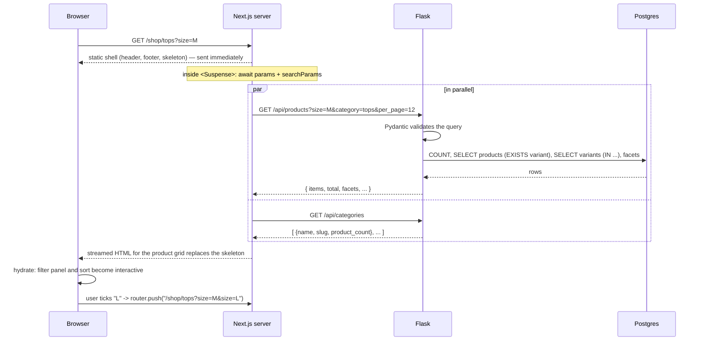

# Phase 2 — Catalog API and storefront

## What we built

**Backend (Flask)**
- `GET /api/products`: list products with filters (category, search, size, colour, price), five sort orders and
  pagination. It also returns **facets**: the sizes, colours and price range that exist, so the filter sidebar only
  offers real options.
- `GET /api/products/<slug>`: one product with every variant, its live stock and related products.
- `GET /api/categories`, `GET /api/policies`, `GET /api/policies/<key>`.
- Input validation with **Pydantic**. Bad input returns `400 validation_error`.
- 37 new tests (98 in total), including one that **counts SQL queries** to prove there is no N+1 problem.

**Frontend (Next.js)** — this also finishes the frontend half of Phase 0:
- Next.js 16 project with Tailwind CSS, the brand colours and fonts, the `/api` rewrite and a typed API client.
- Pages: home, shop, category pages, product detail, policy pages, 404 page and an error page.
- Header (desktop menu, mobile slide-in menu, search), footer, loading skeletons, SEO metadata, and product
  structured data for search engines.

## Key concepts

**REST.** A style for designing web APIs. Each URL names a *resource* (`/products/everyday-cotton-tee`) and the HTTP
method says what to do with it (`GET` = read). Responses are JSON.

**Query parameters.** The part of a URL after `?`: `/api/products?category=tops&sort=price_asc`. They are inputs to a
`GET` request. A list is sent by repeating the key: `?size=S&size=M`.

**Validation.** Checking that input has the right type and range before using it. `page=abc` or `per_page=1000`
must be refused with a clear error, not crash the server or overload the database.

**Pagination.** Returning a large list in pages. We use *offset pagination*: page 2 with 12 per page means "skip 12,
take 12" (`OFFSET 12 LIMIT 12`).

**N+1 query problem.** A common ORM performance bug. You run **1** query to get 12 products, then the code touches
`product.variants` and the ORM runs **1 more query per product**: 12 more, so N+1 = 13. It is invisible with
tiny data and slow with real data.

**Eager loading.** Telling the ORM to load related rows up front. `selectinload(Product.variants)` loads the variants
for *all* listed products in **one** extra query: `SELECT ... WHERE product_id IN (1, 2, ..., 12)`.

**Facets.** The filter options shown next to search results, with only the values that actually exist.

**Server component / client component.** In Next.js, a *server component* runs only on the server. It can fetch
data and sends finished HTML, with no JavaScript for that part. A *client component* (`"use client"`) also runs in
the browser, so it can react to clicks. We use client components only where the user interacts.

**Partial prerendering (static shell + streaming).** At build time, Next.js renders every part of a page that doesn't
need live data (header, headings, layout) into static HTML: the *shell*. Parts that need live data are wrapped in
`<Suspense>`. The shell is sent instantly with a skeleton in those places, and the real content *streams* in when the
data is ready.

**Suspense.** A React component that shows a *fallback* (our skeletons) while its children are still loading.

**Hydration.** After the HTML arrives, React runs in the browser and attaches event handlers to it, so buttons
start working.

## How it works here

### Backend

#### `backend/app/validation.py` — turning query strings into typed objects

```python
def parse_query(model: type[Model], args: MultiDict[str, str]) -> Model:
    for name, field in model.model_fields.items():
        values = [value.strip() for value in args.getlist(name) if value.strip()]
        ...
        data[name] = values if is_list else values[0]
    try:
        return model.model_validate(data)
    except ValidationError as error:
        raise APIError("validation_error", f"{field}: {first['msg']}", 400) from error
```

Query strings are always text. Pydantic converts `"2"` to the integer `2`, checks the limits, and gives us a typed
object. Empty values (`?q=`) are treated as "not given", because HTML forms send empty fields.

#### `backend/app/catalog.py` — the query logic

The rules for the list endpoint are written as a Pydantic model:

```python
class ProductListQuery(BaseModel):
    category: str | None = Field(None, max_length=60)
    q: str | None = Field(None, max_length=100)
    size: list[str] = Field(default_factory=list, max_length=20)
    sort: SortOption = "best_selling"          # only five values allowed
    page: int = Field(1, ge=1)
    per_page: int = Field(12, ge=1, le=48)     # nobody can ask for a million rows
```

**Search** uses `ILIKE` (case-insensitive match) on name, description and category. User input is escaped first:

```python
def escape_like(text: str) -> str:
    return text.replace("\\", "\\\\").replace("%", "\\%").replace("_", "\\_")
```

In `LIKE`, `%` means "anything". Without escaping, searching for `%` would match every product. This isn't SQL
injection (SQLAlchemy sends values as parameters, never as SQL text), but it is still wrong behaviour.

**Size and colour** filters use a single `EXISTS` sub-query:

```python
conditions = [ProductVariant.product_id == Product.id, ProductVariant.stock > 0]
if query.size:  conditions.append(ProductVariant.size.in_(query.size))
if query.color: conditions.append(ProductVariant.color.in_(query.color))
filters.append(exists().where(*conditions))
```

Both conditions are in the *same* `EXISTS`, so "M in Black" only matches a product that has **one in-stock variant**
that is both M and Black. Two separate checks would wrongly match a product with "M in White" and "L in Black".

**Best selling** joins a sub-query that adds up units sold, ignoring unpaid and cancelled orders:

```python
select(ProductVariant.product_id, func.sum(OrderItem.quantity).label("units"))
    .join(OrderItem, ...).join(Order, ...)
    .where(Order.status.not_in(UNSOLD_STATUSES))
    .group_by(ProductVariant.product_id)
```

Every sort ends with `Product.id` as a **tie-breaker**. Without it, Postgres may return tied rows in a different order
each time, and a product could appear on page 1 *and* page 2.

**Facets** use only the category and search filters, not the size and colour filters. If they used every filter,
picking "M" would hide all the other sizes, and you couldn't add "L".

**No N+1:**

```python
stmt = _sorted(select(Product).where(*filters), query.sort).options(selectinload(Product.variants))
```

Each list request runs the same small number of queries (count, products, variants, facets), whatever the page size.
`tests/test_catalog_api.py::test_listing_uses_the_same_number_of_queries_for_any_page_size` counts them with a
SQLAlchemy event listener.

#### `backend/app/api/products.py` — thin routes

```python
@bp.get("/products")
def list_products() -> ResponseReturnValue:
    query = parse_query(ProductListQuery, request.args)
    return catalog.list_products(db.session, query)
```

Routes only translate HTTP to Python and back. The logic lives in `catalog.py`, so the Phase 8 agent's
`/api/agent/products/search` can reuse exactly the same search.

### Frontend

#### `frontend/next.config.ts` — the `/api` proxy

```ts
async rewrites() {
  return [{ source: "/api/:path*", destination: `${backendUrl}/api/:path*` }];
},
```

The browser calls `/api/products` on our own site, and Next.js forwards it to Flask. Cookies stay first-party and we
never need CORS (see `docs/ARCHITECTURE.md`).

#### `frontend/lib/api.ts` — the typed API client

```ts
function baseUrl(): string {
  if (typeof window === "undefined") return process.env.BACKEND_URL ?? "http://localhost:5000";
  return "";   // browser: relative URL, goes through the rewrite
}

export const api = {
  products: (query: ProductQuery = {}) => request<ProductPage>(`/products?${toSearchParams(query)}`),
  product: (slug: string) => request<ProductDetail>(`/products/${encodeURIComponent(slug)}`),
  ...
};
```

Server components call Flask **directly** (server to server). There is no browser involved, so the proxy isn't
needed. Errors from the API become an `ApiError` with the status and the `code` from our JSON error envelope.
`lib/types.ts` mirrors the backend responses, so TypeScript catches a misspelled field at build time.

#### Pages: static shell + `<Suspense>`

```tsx
export default function ProductPage({ params }: PageProps<"/products/[slug]">) {
  return (
    <div className="...">
      <Suspense fallback={<ProductDetailSkeleton />}>
        <ProductContent params={params} />      {/* awaits params, fetches the product */}
      </Suspense>
    </div>
  );
}
```

This Next.js version has **Cache Components** on. The rule: anything that reads request data (`params`,
`searchParams`) or does an uncached `fetch` must sit inside `<Suspense>`. Everything else becomes the prerendered
shell. Two useful results:
- **The build never calls the API.** `npm run build` passes with Flask switched off, which matters on Vercel.
- **Stock is always live.** Product data is fetched fresh for every request, never from a cache.

The build output shows this as `◐ (Partial Prerender)` for each page.

#### `frontend/lib/shop-url.ts` + `components/shop/` — filters live in the URL

```ts
export function shopHref(category: string | undefined, filters: ShopFilters): string {
  const path = category ? `/shop/${category}` : "/shop";
  ...
}
```

The filter panel keeps no state of its own. Each click builds a new URL (`/shop/tops?size=M&sort=price_asc`) and
navigates there, and the server renders the matching products. So filtered pages can be shared and bookmarked, the
back button works, and the product grid stays a server component. `useTransition` dims the panel while the next page
loads.

#### `components/product/product-view.tsx` — the variant picker

A client component. It receives all variants (already fetched on the server) and works out what to show for the chosen
colour and size: the price, "Only 3 left", "Sold out. Restock expected in about 3 weeks", and greyed-out sizes. The
pickers are real `<input type="radio">` elements styled as buttons, so keyboards and screen readers work without
extra code. Add to bag shows the right state, but the bag itself arrives in Phase 3.

#### `components/product-art.tsx` — placeholder images

Products have no photos yet (`image_url` is null). This draws a simple line drawing of the garment type on a panel
tinted with the selected colour. When an admin sets an `image_url`, a real photo is shown instead.

#### Accessibility built in

- A "Skip to content" link, plus a visible focus outline on every interactive element.
- The mobile menu and mobile filters use the native `<dialog>` element with `showModal()`. This gives focus trapping,
  the Escape key and an inert background for free.
- Filters and pickers use `<fieldset>`/`<legend>` and real form inputs.
- `aria-live` regions announce the product count, price and stock changes.
- The muted text colour `#6b6359` was chosen to pass WCAG AA contrast on the background.

## Request flow

What happens when someone opens `/shop/tops?size=M`:



## Design decisions and alternatives

| Decision | Alternatives | Why we chose this |
|---|---|---|
| Pydantic for validation | Marshmallow, hand-written checks | Uses Python type hints we already write, fast, clear errors, and the same tool FastAPI and many AI libraries use. |
| Service layer (`catalog.py`) + thin routes | Queries inside route functions | Easy to test, and the AI agent will reuse the same search. |
| Offset pagination | Keyset (cursor) pagination | Simple, and supports "jump to page 3". Keyset is faster for huge tables and infinite scroll, but our catalog is small. |
| `ILIKE` search | Postgres full-text search, a trigram index, a search engine | Enough for 20 products. Full-text search adds stemming ("shirts" finds "shirt") and ranking; the next step if the catalog grows. |
| Unknown category → 404 | Return an empty list | The shopper typed a wrong URL. A 404 is honest, and the frontend can show the 404 page directly. |
| Exact stock in the API | Only "in stock / low / out" | The product page shows "Only 3 left", and the cart (Phase 3) needs the limit. The trade-off: competitors could read stock levels. |
| Filters in the URL | React state, or a client-side data library | Shareable, bookmarkable, back button works, server-rendered. |
| Live data in `<Suspense>`, no cache | `"use cache"` with a lifetime, or prerendering every product | Stock must be live, and the build mustn't depend on the API. Product descriptions could be cached later for speed. |
| Server calls Flask directly | Server also goes through the `/api` rewrite | One less network hop. The rewrite exists for the browser's cookies, not for the server. |
| Header categories hard-coded in `lib/site.ts` | Fetch them from `/api/categories` | The header becomes part of the static shell with no loading flicker. The shop sidebar still shows live counts. The trade-off: a new category must also be added to `lib/site.ts`. |
| Placeholder art (SVG) | Stock photos | No licence issues, and every product looks consistent. The `image_url` field switches to real photos. |

## What could go wrong

- **Every page shows "Something went wrong".** Flask isn't running, or `BACKEND_URL` is wrong. Start the backend, and
  check `frontend/.env.local`.
- **A wrong product URL returns status 200, not 404.** This is expected with streaming: the response had already
  started with `200` when we found out the product doesn't exist. Next.js shows the 404 page and adds
  `<meta name="robots" content="noindex">`, so search engines ignore it. A true 404 status would need a check in
  `proxy.ts` before rendering.
- **Build error "usePathname() ... outside of Suspense".** Reading the URL in a client component in the layout blocks
  prerendering. We hit this with the mobile menu and fixed it by closing the menu on link click instead.
- **Adding a field to an API response.** Also add it to `frontend/lib/types.ts`, or TypeScript won't let you use it.
- **A query parameter is ignored.** It must be declared in `ProductListQuery`. Unknown parameters are dropped on purpose.
- **Slow product list as data grows.** Check for missing indexes and N+1 queries. The query-count test catches N+1 in CI.

## Try it yourself

```bash
# terminal 1: backend
cd ~/Documents/kora-store/backend && source .venv/bin/activate
docker compose up -d --wait && flask seed --reset && flask run

# terminal 2: frontend
cd ~/Documents/kora-store/frontend
npm install            # first time only
npm run dev            # open http://localhost:3000
```

Things to try:
1. `/shop`: tick size M and the colour Black, then change the sort. Watch the URL change. Copy it into a new tab and
   you get the same page.
2. `/products/everyday-joggers`: sold out, with the restock note. `/products/merino-crew-sweater`: some sizes are
   greyed out.
3. `/products/gift-card`: the price changes when you pick $25 / $50 / $100.
4. Use the site with only the keyboard (Tab, Space, Enter, Escape).
5. Make your browser narrow, then open the menu and the Filters panel.
6. Call the API directly:
   ```bash
   curl -s "localhost:5000/api/products?category=tops&sort=price_asc&per_page=3" | python3 -m json.tool
   curl -s "localhost:5000/api/products?per_page=500"     # 400 validation_error
   ```
7. Run the checks: `cd backend && pytest -q` (98 passed) and `cd frontend && npm run lint && npm run build`.

## Explain it in 60 seconds

> "The catalog API is a set of REST endpoints in Flask. The product list supports filtering by category, text search,
> size, colour and price, five sort orders, and offset pagination. Query parameters are validated with Pydantic, so
> bad input gets a clear 400 instead of an error or an expensive query, and `per_page` is capped at 48.
>
> I paid attention to query efficiency. Variants are eager-loaded with `selectinload`, so a page of products is a
> fixed number of queries, and a test counts the SQL statements to prove there's no N+1 problem. Size and colour are
> checked in one `EXISTS` sub-query so they must match the same in-stock variant, and every sort has a unique
> tie-breaker so pagination never repeats items.
>
> The storefront is Next.js with the App Router. Pages are server components. The static shell is prerendered and
> the live data streams in through Suspense, so stock is always fresh and the build doesn't need the API. Filters are
> stored in the URL, which makes results shareable and keeps the grid server-rendered. Only the interactive parts —
> filters, sort, the variant picker — are client components. The browser only talks to the Next.js domain, and a
> rewrite forwards `/api` to Flask."
