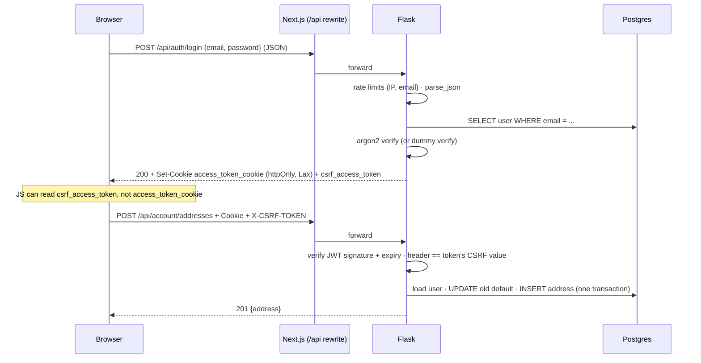
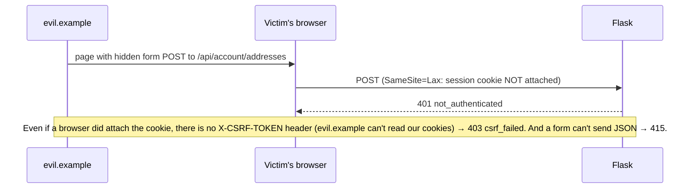
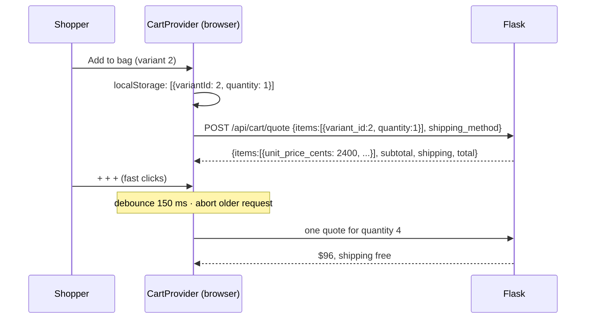

# Phase 3 — Cart and accounts

## What we built

**Backend**
- `POST /api/cart/quote`: the browser sends only `variant_id` + `quantity`. The server returns prices, line totals,
  shipping, the total, and stock warnings.
- `POST /api/auth/signup`, `/login`, `/logout` and `GET /api/auth/me`: accounts with argon2 password hashing and a
  session stored as a JWT in an httpOnly cookie, with CSRF protection.
- Rate limits on login (per IP *and* per account) and on signup.
- `GET/POST/PUT/DELETE /api/account/addresses`: saved addresses with a "one default" rule.
- `GET /api/account/orders` and `/api/account/orders/<number>`: a customer's own orders.
- 50 new tests (148 in total).

**Frontend**
- A cart stored in `localStorage`, shown in a slide-in **drawer** and on a full `/cart` page with shipping choices.
- "Add to bag" on the product page.
- `/login`, `/signup`, and an `/account` area: overview, order history, order detail with timeline, address book.
- `proxy.ts`: sends logged-out visitors from `/account` to `/login` before the page renders.

## Key concepts

**Authentication vs authorization.** *Authentication* answers "who are you?" (login). *Authorization* answers
"what may you do?" (can this user see address 42?). This phase does authentication plus "owner-only" authorization.
Phase 6 adds roles (admin).

**Password hash.** A one-way scrambled form of a password. We store the hash, never the password. At login we hash
what was typed and compare. If the database leaks, the attacker gets hashes, not passwords.

**argon2id.** A password hashing algorithm designed to be *slow* and to use *a lot of memory* on purpose. A normal
hash (like SHA-256) can be computed billions of times per second on a graphics card; argon2id only a few. That makes
guessing passwords from a stolen database very expensive.

**Salt.** Random bytes mixed into each hash. Two users with the same password get different hashes, so an attacker
can't crack them both at once or use pre-computed tables.

**Session.** How the server remembers you between requests. HTTP itself forgets everything after each request.

**JWT (JSON Web Token).** A small signed piece of JSON: `{"sub": "42", "exp": ...}` plus a signature. The server can
check the signature with its secret key and trust the content without a database lookup. It is *signed*, not
*encrypted*: anyone can read it, nobody can change it.

**Cookie.** A small value the server asks the browser to store and send back with every request to the same site.

**httpOnly cookie.** A cookie JavaScript cannot read (`document.cookie` doesn't show it). Only the browser sends it.

**XSS (Cross-Site Scripting).** An attacker gets their JavaScript to run inside our page, for example through an
unescaped review text. That script can do anything the page can do, including reading `localStorage` and
non-httpOnly cookies.

**CSRF (Cross-Site Request Forgery).** A different website makes *your* browser send a request to *our* site. The
browser automatically attaches our cookies, so the request looks like it came from you. Example: `evil.example`
contains a hidden form that POSTs a new address to our API.

**SameSite cookie attribute.** Tells the browser when to send a cookie on requests that start on another site. `Lax`:
send it when you click a normal link to us, but not on cross-site form POSTs or `fetch()` calls.

**Rate limiting.** Counting requests per key (an IP address, an email) and refusing with `429 Too Many Requests`
after a limit. It turns millions of password guesses into a handful.

**User enumeration.** Using an app's different responses to find out which emails have accounts ("no such user" vs
"wrong password"). Attackers use the list for phishing and password guessing.

**IDOR (Insecure Direct Object Reference).** Changing an id in a request (`/addresses/42` → `/addresses/43`) and
getting someone else's data because the server didn't check who owns it.

**Open redirect.** A link like `/login?next=https://evil.example` that sends the user to an attacker's site after
login. The trusted domain makes the phishing link look safe.

## Security reasoning, choice by choice

| # | Choice | The threat | Why this choice | Alternative and its trade-off |
|---|---|---|---|---|
| 1 | **Server prices the cart** (`/cart/quote` takes only ids + quantities) | A user edits `localStorage` or the request and pays $0.01 | The browser belongs to the user and can be changed. Only the database knows real prices. Extra fields like `price_cents` are dropped by Pydantic (`extra="ignore"`) | Trust client prices: never safe |
| 2 | **argon2id** password hashing | A stolen database | Slow + memory-hard, so offline guessing is very costly. We also **rehash** old hashes at login when settings get stronger | bcrypt: also fine, older. SHA-256: far too fast for passwords |
| 3 | Password **10–128 characters** | Weak passwords; huge inputs that waste CPU | Length matters more than symbols. The upper limit stops one request from making argon2 do a lot of work | Composition rules ("1 symbol, 1 number"): they annoy users and add little |
| 4 | **JWT in an httpOnly cookie** | XSS stealing the session | JavaScript (including an attacker's script) can't read httpOnly cookies | JWT in `localStorage`: any XSS can steal it and use it from anywhere |
| 5 | Cookie **Secure** in production | Network sniffing on public Wi-Fi | The cookie is only ever sent over HTTPS | Off in development only (`http://localhost`) |
| 6 | Cookie **SameSite=Lax** | CSRF | The browser won't attach the cookie to cross-site POSTs, so most CSRF fails at layer 1 | `Strict`: also blocks the cookie when you click a link to us from email, which feels like being logged out |
| 7 | **CSRF double-submit token** (`csrf_access_token` cookie → `X-CSRF-TOKEN` header) | CSRF when SameSite isn't enough (old browsers, sub-domain tricks) | Another site can make the browser *send* our cookies but can't *read* them, so it can't copy the token into the header. Checked on every POST/PUT/PATCH/DELETE that needs login | A token in every HTML form: doesn't fit an API-driven frontend |
| 8 | **JSON-only bodies** (415 otherwise) | *Login CSRF*: a hidden form logs you into the attacker's account | Signup and login have no session yet, so no CSRF token. A cross-site HTML form can't send `application/json`, and a cross-site `fetch` with JSON needs a CORS preflight we never approve | A separate pre-session CSRF token: more moving parts |
| 9 | **Same response for "no such email" and "wrong password"**, plus a dummy hash check | User enumeration through messages *and* response time | Both cases take one argon2 check and return the same 401 JSON | Different messages: friendlier, but leaks which emails exist |
| 10 | Signup **does** say "email already exists" (409) | Enumeration through signup | Honest trade-off: every shop does this, because the alternative (email verification) is a big feature. Signup is rate limited (10/hour per IP) | Email verification first, then "check your inbox" for both cases |
| 11 | **Rate limits**: login 5/min + 30/hour per IP, 10/hour **per email**; signup 10/hour per IP | Password guessing; credential stuffing (trying leaked passwords) | Per-IP slows one attacker. Per-email protects one account from attackers spread over many IPs | Account lockout: lets an attacker lock out a real user on purpose |
| 12 | **ProxyFix** with a configured number of proxies | Faking an IP to dodge rate limits | Behind Vercel + Render the real client IP is in `X-Forwarded-For`. We trust exactly as many hops as we have, so a client can't add a fake IP of its own | Trust all `X-Forwarded-For` values: anyone can fake their IP |
| 13 | JWT holds **only the user id**; the user is loaded from the DB each request | Stale roles; deleted accounts | A changed role or a deleted account takes effect immediately | Put role/name in the token: no DB lookup, but stale for up to 7 days |
| 14 | **7-day** token, no refresh token | Stolen session lasting forever | A simple, bounded lifetime for a shop. Logout deletes the cookie | Short access token + refresh token: better revocation, more complexity (a fit for Phase 6 admin) |
| 15 | Every account query filters by **`user_id`**; wrong owner → **404** | IDOR | You can only ever reach your own rows. 404 (not 403) doesn't even confirm the id exists | Check ownership after loading: easy to forget in one route |
| 16 | Account orders are linked by **`user_id`, never by email** | Reading someone's orders by signing up with their email | We don't verify emails, so an email match proves nothing | Verify email, then link guest orders: a later feature |
| 17 | **`safeNextPath()`** only allows `/path`, not `//host` or `https://` | Open redirect after login | Login can only send you to our own pages | — |
| 18 | `Cache-Control: no-store` on `/api/auth` and `/api/account` | Private data kept in a shared or browser cache | Account responses are never stored | — |
| 19 | **64 KB request body limit** | Huge bodies used to exhaust memory | Flask refuses them (413) before reading | — |
| 20 | `proxy.ts` only checks that the cookie **exists** | — | It's an early, cheap redirect for a nicer experience. The *real* check is Flask verifying the JWT on every API call | Verify the JWT in the proxy too: duplicates the secret in two places |

## How it works here

### `backend/app/pricing.py` — `quote_cart()`

```python
requested: dict[int, int] = {}
for variant_id, quantity in lines:                      # merge repeated variants
    requested[variant_id] = min(requested.get(variant_id, 0) + quantity, MAX_QUANTITY_PER_ITEM)

variants = {v.id: v for v in session.scalars(
    select(ProductVariant).where(ProductVariant.id.in_(requested))
    .options(joinedload(ProductVariant.product)))}      # one query for the whole cart
```

For each line: unknown or deactivated → `unavailable`; stock 0 → `out_of_stock`; stock lower than asked →
`insufficient_stock`, with the quantity reduced. Problem lines cost nothing. Shipping comes from the same
`shipping_cents()` used by the seed (Phase 1) and later by checkout (Phase 4).

The stock check here is **advice**, not a reservation. Two people can both see "1 left". The real check happens when
payment succeeds, inside a transaction with row locks (Phase 4).

### `backend/app/sessions.py` — cookies and session errors

```python
def start_session(response: Response, user: User) -> None:
    set_access_cookies(response, create_access_token(identity=str(user.id)))
```

This sets two cookies: `access_token_cookie` (the JWT, httpOnly) and `csrf_access_token` (readable). The JWT contains
a copy of the CSRF value, so Flask-JWT-Extended can check the header matches. `register_jwt_callbacks()` loads the
user for each request and turns every session problem into our JSON shape: `not_authenticated` (401),
`csrf_failed` (403), `session_expired` and `invalid_session` (401, and the bad cookie is deleted).

The settings are in `backend/app/config.py`:

```python
JWT_TOKEN_LOCATION = ["cookies"]
JWT_COOKIE_SECURE = True          # False only in DevelopmentConfig / TestingConfig
JWT_COOKIE_SAMESITE = "Lax"
JWT_COOKIE_CSRF_PROTECT = True
JWT_ACCESS_TOKEN_EXPIRES = timedelta(days=7)
```

### `backend/app/api/auth.py` — login

```python
@bp.post("/auth/login")
@limiter.limit("5 per minute; 30 per hour")                 # per IP
@limiter.limit("10 per hour", key_func=_login_email_key)    # per account
def login():
    body = parse_json(LoginBody)
    user = accounts.find_user_by_email(db.session, body.email)
    if user is None:
        verify_password(DUMMY_PASSWORD_HASH, body.password)  # same work, same timing
        valid = False
    else:
        valid = verify_password(user.password_hash, body.password)
    if not valid or user is None:
        raise APIError("invalid_credentials", "Wrong email or password.", 401)
```

### `backend/app/validation.py` — `parse_json()`

It refuses anything that isn't `Content-Type: application/json` (415) and validates the body with a Pydantic model.
This is the login-CSRF defence from row 8.

### `backend/app/accounts.py` — addresses and order history

Every query includes `Address.user_id == user.id` or `Order.user_id == user.id`. Setting a new default first clears
the old one *in the same transaction*. The partial unique index from Phase 1 would reject two defaults even for a
moment. Deleting the default promotes the oldest remaining address.

### `frontend/lib/cart-store.ts` + `components/cart/cart-provider.tsx`

The cart is `[{variantId, quantity}]` in `localStorage`, read through React's `useSyncExternalStore`. This hook
connects React to data that lives outside React. Other tabs stay in sync through the browser's `storage` event. Bad
data that someone typed into `localStorage` is filtered out.

The provider asks the server for a quote whenever the cart or shipping method changes:

```ts
const key = JSON.stringify([lines, shippingMethod]);
useEffect(() => {
  const controller = new AbortController();
  const timer = setTimeout(() => {
    api.quoteCart(..., controller.signal).then((quote) => setResult({ key, quote, error: false }));
  }, 150);                                   // wait for fast +/- clicks
  return () => { clearTimeout(timer); controller.abort(); };   // a newer cart cancels the old request
}, [key, ...]);
```

Two details: the **150 ms delay** (debounce) groups quick clicks into one request, and **aborting** the old request
means a slow, outdated answer can never overwrite a newer one (a *race condition*). The quote remembers which `key`
it was made for, so the UI knows when totals are out of date and dims them.

### `frontend/lib/api.ts` — sending the CSRF header

```ts
if (method !== "GET") {
  const token = csrfToken();          // reads csrf_access_token from document.cookie
  if (token) headers.set("X-CSRF-TOKEN", token);
}
```

### `frontend/lib/api-server.ts` — server components acting as the user

When a server component calls Flask, there is no browser in between, so cookies aren't sent automatically. We
forward them: `request(path, { headers: { Cookie: (await cookies()).toString() } })`. `import "server-only"` makes the
build fail if a client component ever imports this file. `requireUser()` redirects to `/login?next=...` when there's
no valid session.

### `frontend/proxy.ts`

```ts
if (!request.cookies.has("access_token_cookie")) {
  return NextResponse.redirect(new URL(`/login?next=${pathname}`, request.url));
}
```

In Next.js 16, *Middleware* is called **Proxy**. It runs before the page, so logged-out visitors get a real redirect.

### Account pages and Cache Components

After **login, signup and logout** we do a full page load (`window.location.assign`), not a client-side navigation.
Production Next.js prefetches visible links, so pages prefetched while logged out (like the redirect from `/account`
to `/login`) could otherwise be reused after login, and pages cached while logged in could reappear after logout.
(Found during Phase 5 end-to-end testing; see guide 05.)

Reading `cookies()` is request data, so each account page reads the user inside `<Suspense>`. Even the active link in
the account menu (`usePathname()`) streams in, with a plain menu as the fallback. Forms use `onSubmit`, not
`<form action>`, because React 19 resets a form after an action. That would wipe the email after a wrong password.

## Request flow

**Logging in, then saving an address:**



**What a CSRF attack runs into:**



**The cart:**



## Design decisions and alternatives

Beyond the security table above:

| Decision | Alternatives | Why we chose this |
|---|---|---|
| Cart in `localStorage`, priced by the server | A server-side cart table | Guests can shop without an account, there's nothing to clean up, and it works the same before and after login. The cost: the cart doesn't follow you to another device. |
| `/auth/me` returns 200 `{"user": null}` when logged out | 401 | "Who am I?" has a valid answer either way, and the browser console stays free of red errors. |
| Wrong owner → 404 | 403 | 403 would confirm the address or order exists. |
| `useSyncExternalStore` for the cart | `useState` + `useEffect` reading `localStorage` | No flash of wrong state, cross-tab sync, and it's the React-recommended way to read external data. |
| Rate limits in memory (`memory://`) | Redis | Fine for one process. With several gunicorn workers each has its own counter, so production should use Redis (Phase 7). |
| Account pages read the session inside `<Suspense>` | `use cache: private` | Simple and always fresh. `use cache: private` would allow prefetching account pages, an optimisation for later. |

## What could go wrong

- **Every login says "Too many attempts".** You hit the per-IP limit (5 a minute). Wait a minute. In production,
  `TRUSTED_PROXY_COUNT` must be right, or every visitor shares the proxy's IP and one limit.
- **Saving an address gives "Security check failed" (403).** The CSRF header is missing. Make sure requests go through
  `api` in `lib/api.ts`, and that the `csrf_access_token` cookie exists (log in again).
- **Logged in, but account pages redirect to login.** The cookie is `Secure` and you're on plain `http`. Locally,
  `APP_ENV=development` turns `Secure` off. In production you must use HTTPS.
- **Login works with curl but not in the browser.** Check the request goes to `/api/...` on the frontend's domain (the
  rewrite), not straight to Flask. Cookies belong to the domain that set them.
- **Prices in the cart look stale.** The quote is dimmed while updating. If it says "couldn't update prices", Flask is
  unreachable.
- **`JWT_SECRET_KEY` changes.** Every existing session becomes invalid (signatures no longer match), and everyone has
  to log in again. That is also the emergency "log out everyone" switch.
- **Two people buy the last item.** The quote can't prevent it. That's Phase 4's job (row locks at payment time).

## Try it yourself

```bash
cd ~/Documents/kora-store/backend && source .venv/bin/activate
pip install -r requirements-dev.txt        # new packages this phase
flask run                                  # terminal 1
cd ../frontend && npm install && npm run dev   # terminal 2
```

1. Add a few items to your bag. Change the quantity and watch "free shipping" appear over $75. Open `/cart` and try
   Express.
2. In the browser DevTools → Application → Local Storage, change a quantity to 999 or add `"price": 1`. Reload the
   page and see what the server does with it.
3. Open `/account`: you're sent to login. Create an account and add an address.
4. DevTools → Application → Cookies: `access_token_cookie` has **HttpOnly** ticked; `csrf_access_token` doesn't. In
   the Console, `document.cookie` shows only the CSRF cookie.
5. Try a CSRF-style request in the Console, without the header:
   ```js
   fetch("/api/account/addresses", { method: "POST", headers: { "Content-Type": "application/json" }, body: "{}" }).then(r => r.status)  // 403
   ```
6. Log out, then try a wrong password 6 times quickly. The 6th attempt is refused with 429.
7. Run the tests: `pytest -q tests/test_auth.py tests/test_cart_quote.py tests/test_addresses.py`.

## Explain it in 60 seconds

> "The cart lives in the browser's localStorage, but it only stores variant ids and quantities. Every change calls a
> `/cart/quote` endpoint where Flask loads the real prices from Postgres, checks stock, applies the shipping rules and
> returns the totals. Any price the client sends is ignored. Requests are debounced, and older ones are aborted so a
> slow response can't overwrite a newer cart.
>
> For accounts, passwords are hashed with argon2id. The session is a JWT in an httpOnly, SameSite=Lax cookie, Secure
> in production, so JavaScript, including any injected script, can't read it. Because cookies are sent
> automatically, I added CSRF protection with the double-submit pattern: a readable CSRF cookie that the frontend
> copies into a header, which other sites can't do. Login and signup accept JSON only, which blocks login CSRF from
> HTML forms.
>
> Login returns the same error, in the same time, for an unknown email or a wrong password, so it can't be used to
> find accounts. It's rate limited per IP and per email. Every account query is scoped to the user's id, so guessing
> someone else's address or order id returns 404."
