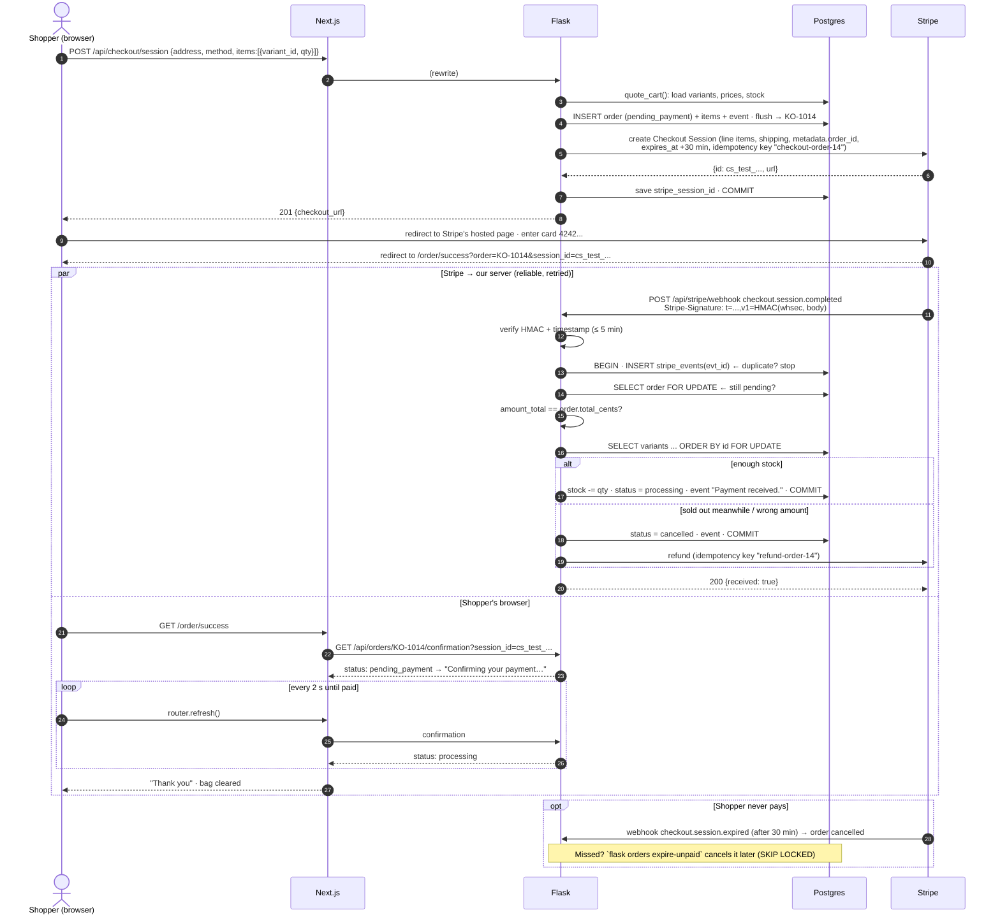

# Phase 4 — Payments (Stripe and the sandbox)

> **Two payment providers.** Stripe doesn't support accounts in Pakistan, so the store also has its own
> **sandbox provider**: a hosted payment page, test cards and HMAC-signed webhooks, with no real money. It's the
> default (`PAYMENT_PROVIDER=sandbox`). Stripe stays fully supported (`PAYMENT_PROVIDER=stripe`). Both sit behind one
> `PaymentProvider` interface, explained in [The provider interface](#the-provider-interface-and-the-adapter-pattern).

## What we built

**Backend**
- `POST /api/checkout/session`: re-prices the cart, creates the order as `pending_payment` (no stock taken yet),
  creates a **Stripe Checkout Session**, and returns its URL.
- `POST /api/stripe/webhook`: Stripe's server tells ours what happened. We verify the **signature**, then:
  - payment succeeded → **lock rows**, take stock, mark the order `processing`
  - sold out while the customer paid, or the amount is wrong → **cancel and refund automatically**
  - session expired → cancel the unpaid order
- **Idempotency**: the same event, or two events for the same order, never take stock twice.
- `GET /api/orders/<number>/confirmation?session_id=...`: the thank-you page's data.
- `flask orders expire-unpaid`: a safety net that cancels unpaid orders if an expiry webhook was missed.
- New table `stripe_events`, and a migration.
- 35 tests for Stripe, including two webhooks racing for the last item, plus 20 for the sandbox, the provider
  interface and its config (203 in total).
- **A `PaymentProvider` interface** with a Stripe adapter and a sandbox adapter (`backend/app/payments/`), and the
  sandbox's payment page API (`backend/app/sandbox.py`).

**Frontend**
- `/checkout`: contact, address (saved addresses for logged-in users), shipping method limited to what the country
  allows, order summary, and "Pay $X" → Stripe.
- `/order/success`: waits for the webhook (checks again every 2 seconds), then shows the confirmation and empties the bag.
- The checkout buttons in the bag drawer and on `/cart` now work.
- `/pay/sandbox/[sessionId]`: the sandbox's hosted payment page, clearly labelled "Sandbox payment, no real money".

## Key concepts

**Payment processor.** A company (Stripe) that takes card payments for us. Our servers never see card numbers, which
keeps us out of most of the PCI DSS card-security rules.

**Stripe Checkout (hosted).** A payment page that Stripe hosts. We send the shopper there with a URL, and Stripe
sends them back to our `success_url` or `cancel_url`.

**Checkout Session.** Stripe's record of one checkout attempt: the line items, amounts, our metadata, and its state
(`open` → `complete` or `expired`). Its id looks like `cs_test_...`.

**Webhook.** An HTTP request that *Stripe's* server sends to *our* server when something happens
(`checkout.session.completed`). It's the reliable way to learn about payments. The shopper's browser might close
before reaching our success page, but Stripe keeps retrying the webhook for up to 3 days until we answer `2xx`.

**Webhook signature.** Stripe signs each webhook with HMAC-SHA256 using a secret only Stripe and we know (`whsec_...`).
Anyone on the internet can POST to our webhook URL, so we only trust events whose signature checks out.

**HMAC.** A "keyed hash": `HMAC(secret, message)`. Without the secret you can't produce a valid one, and changing even
one byte of the message changes the result completely.

**Replay attack.** Re-sending an old, genuine message. Stripe puts a timestamp inside the signature, and we refuse
events older than 5 minutes.

**Idempotency.** An operation is idempotent if doing it twice has the same effect as doing it once. Webhooks are
*at-least-once*: Stripe may send the same event more than once. Our handler must be idempotent.

**Idempotency key.** A unique key we send *to* Stripe with a request (`checkout-order-42`). If our request is retried
(network glitch), Stripe returns the first result instead of creating a second session or a second refund.

**Transaction.** A group of database changes that happen together or not at all (`COMMIT` or `ROLLBACK`).

**Row lock (`SELECT ... FOR UPDATE`).** Reads rows *and* locks them until the transaction ends. Another transaction
that wants the same rows waits.

**Race condition / lost update.** Two transactions both read `stock = 1`, both compute `1 − 1 = 0`, both write `0`.
Two items are sold, but stock went down by one, and no constraint fires because 0 is a valid value.

**Deadlock.** Transaction A holds row 1 and waits for row 2, while B holds row 2 and waits for row 1. Neither can
continue. Postgres detects it and kills one. We avoid it by always locking rows in the same order (by id).

**`SKIP LOCKED`.** "Lock the rows you can, and skip rows someone else is holding." Used by the expiry job so it never
waits for (or fights with) a webhook that is working on an order.

## How it works here

### `backend/app/payments/stripe_provider.py` — the only code that talks to Stripe

```python
class StripeProvider(PaymentProvider):
    def create_checkout_session(self, request: CheckoutRequest) -> CheckoutSession:
        session_id, url = self._create_session(self._session_params(request), request.idempotency_key)
        return CheckoutSession(id=session_id, url=url)

    def verify_webhook(self, payload: bytes, headers) -> None:
        stripe.Webhook.construct_event(payload, headers.get("Stripe-Signature"), secret)  # raises if wrong or too old
```

Keeping Stripe in one class means the rest of the code doesn't depend on Stripe's library, and tests replace its two
network methods (`_create_session`, `_create_refund`) with a fake (`FakeStripe` in `tests/conftest.py`). Live keys
(`sk_live_...`) are refused when the app starts, because this is a demo. The sandbox is the other implementation of
the same interface; see [The provider interface](#the-provider-interface-and-the-adapter-pattern).

### `backend/app/checkout.py` — `create_checkout()`

1. Re-price the cart with `quote_cart()` (the same function as the bag). If anything changed → `409 cart_changed`.
2. Create the `Order` (`pending_payment`) with item snapshots and a "Checkout started." event, then `flush()` to get
   its id and `KO-####` number.
3. Build a provider-neutral `CheckoutRequest` (line items, shipping, `order_id`, `expires_at` = now + 30 minutes,
   `success_url = .../order/success?order=KO-1014&session_id={CHECKOUT_SESSION_ID}`) and hand it to the active
   provider: Stripe or the sandbox.
4. If the provider fails → `rollback()`. No payment session means no order. Otherwise save the session id and `commit()`.

**Stock is not taken here.** CLAUDE.md says stock goes down only when payment is confirmed, so abandoned checkouts
never hold stock.

### `backend/app/checkout.py` — `handle_payment_event()` (shared by both providers)

```python
# Layer 1: have we seen this event id before?
if session.get(StripeEvent, event["id"]):
    return "duplicate"
session.add(StripeEvent(id=event["id"], type=event_type))
session.flush()

# Layer 2: lock the order. A second webhook for the same order waits here.
order = select(Order).where(...).with_for_update()
if order.status is not OrderStatus.PENDING_PAYMENT:
    return "already_processed"
```

The `StripeEvent` row is inserted **in the same transaction** as the stock change. If processing crashes, both roll
back, Stripe retries, and the retry runs cleanly. If processing succeeds, a duplicate delivery finds the row and
stops.

### `_fulfil()` — taking stock safely

```python
if checkout_session["amount_total"] != order.total_cents or checkout_session["currency"] != "usd":
    return _cancel_and_refund(session, order, "Payment amount did not match the order. Refunded in full.")

variants = select(ProductVariant).where(ProductVariant.id.in_(ids)).order_by(ProductVariant.id).with_for_update()
short = [item for item in order.items if variants[item.variant_id].stock < item.quantity]
if short:
    return _cancel_and_refund(session, order, "Sold out while you were paying: ... Refunded in full.")

for item in order.items:
    variants[item.variant_id].stock -= item.quantity
order.status = OrderStatus.PROCESSING
order.events.append(OrderEvent(status=OrderStatus.PROCESSING, note="Payment received."))
session.commit()
```

- **The amount is checked again.** We never assume the amount paid is the amount we expected.
- **Rows are locked in id order**, which prevents deadlocks.
- **Refunds happen after `commit()`.** `_cancel_and_refund()` commits the cancellation first, releasing the locks, and
  only then calls Stripe. Holding row locks while waiting for a network call would block every other checkout for
  those products. If the refund fails, the order's note says "needs a manual refund".

### Expiry: three layers

| Layer | What happens |
|---|---|
| Stripe | The session has `expires_at` = 30 minutes. After that, nobody can pay it. |
| Webhook `checkout.session.expired` | → `_cancel_unpaid()`: the order becomes `cancelled`, with an event. |
| `flask orders expire-unpaid --older-than 60` | Safety net if that webhook was missed. Uses `FOR UPDATE SKIP LOCKED`. Refuses cut-offs under 31 minutes, so it can't cancel an order that could still be paid. |

There's also an edge case: a payment arriving for an order we already cancelled → automatic refund.

### `/api/orders/<number>/confirmation?session_id=`

Order numbers are easy to guess (KO-1014, KO-1015...). The Stripe session id is a long secret that only the buyer
received in their redirect URL. Both must match, otherwise 404.

### Frontend

- `components/checkout/checkout-form.tsx`: when the country changes, the shipping method is fixed in the **same event
  handler** (UK → international), not in an effect. Submitting calls `api.createCheckout()` and then
  `window.location.assign(checkout_url)`, leaving our site for Stripe.
- `app/order/success/page.tsx`: Stripe redirects the shopper at about the same moment it sends the webhook, so the
  order can still be `pending_payment` for a second. `<WaitForPayment>` calls `router.refresh()` every 2 seconds
  (up to 30 seconds) until the server component sees `processing`. Then `<ClearCart>` empties the bag.

## The provider interface and the adapter pattern

### Why we built a sandbox

Stripe doesn't let you open an account in Pakistan, so there are no Stripe keys to put in `.env`. Without them,
checkout stops at "Payments aren't set up". We still wanted the **whole** flow to work for anyone who opens the demo:
a hosted payment page, test cards, a signed webhook, idempotency and safe stock changes. So we wrote our own small
payment provider that behaves like Stripe in every way that matters, minus the real money.

Doing it properly (not just "skip payment and mark it paid") keeps the important engineering visible. The order is
still only fulfilled by a **verified webhook**, and the same idempotency and row-lock code runs as with Stripe.

### The interface

`backend/app/payments/base.py`:

```python
class PaymentProvider(ABC):
    name: ClassVar[str]
    signature_header: ClassVar[str]

    @abstractmethod
    def create_checkout_session(self, request: CheckoutRequest) -> CheckoutSession: ...
    @abstractmethod
    def verify_webhook(self, payload: bytes, headers: Mapping[str, str]) -> None: ...   # raise if not genuine
    @abstractmethod
    def parse_event(self, payload: bytes) -> PaymentEvent: ...
    @abstractmethod
    def refund_payment(self, payment_id: str, idempotency_key: str) -> None: ...
```

An **interface** is a promise: "any provider has these methods, with these inputs and outputs". `ABC` and
`@abstractmethod` make Python enforce it: a provider that forgets a method can't even be created (a test checks
this). We added `refund_payment` to the three methods you might expect, because the "sold out while paying" path
refunds automatically.

`CheckoutRequest` is **provider-neutral**: order id and number, email, line items, shipping, total, expiry, success
and cancel URLs, idempotency key. Nothing in it is Stripe-specific. `checkout.py` builds it and doesn't know or care
which provider will receive it:

```python
provider = payments.get_provider()                    # chosen by PAYMENT_PROVIDER
checkout_session = provider.create_checkout_session(_checkout_request(order, quote))
order.stripe_session_id = checkout_session.id         # the column name is historical; any provider's id
```

### The adapter pattern

An **adapter** translates between the interface your code wants and the interface something else offers, like a
travel plug adapter: the phone charger doesn't change, the wall socket doesn't change, the adapter sits between them.

| | `StripeProvider` (`stripe_provider.py`) | `SandboxProvider` (`sandbox_provider.py`) |
|---|---|---|
| `create_checkout_session` | Translates `CheckoutRequest` into Stripe's parameters (`line_items`, `price_data`, `shipping_options`...) and calls Stripe's API | Makes a random `cs_sandbox_...` id and returns `/pay/sandbox/<id>`. The order already holds everything the page shows |
| `verify_webhook` | `stripe.Webhook.construct_event` with the `Stripe-Signature` header | Our own HMAC-SHA256 check of the `Sandbox-Signature` header (below) |
| `parse_event` | Stripe's JSON is already our event shape | We build sandbox events in Stripe's shape, so also just `json.loads` |
| `refund_payment` | Stripe refund API with an idempotency key | Logs it: there's no real money to return |

**The webhook handler didn't change at all.** `handle_payment_event()` receives the same event shape from both
providers (`{"id", "type", "data": {"object": {...}}}`). Stripe's shape is the industry reference, so we used it as
our own. The event-id table, the order lock, the amount check, the variant locks in id order, and the refund after
commit are all shared. We proved the refactor didn't change Stripe's behaviour: all 35 Stripe tests passed unchanged
after the code moved into `StripeProvider`. Only their fakes were pointed at its two network methods.

Benefits:
- **Swap providers with one setting**, not a rewrite (`PAYMENT_PROVIDER=stripe`).
- **Add a provider** (PayPal, a Pakistani gateway such as JazzCash or Easypaisa...) by writing one adapter class.
- **Test easily**: the payment logic is tested once, through the interface.

Only the active provider's routes exist. With `PAYMENT_PROVIDER=stripe`, every `/api/sandbox/...` route returns 404,
so nobody can "pay" with a test card on a store that takes real payments, and the other way round.

### How the sandbox works

```mermaid
sequenceDiagram
    actor S as Shopper
    participant N as Next.js /pay/sandbox/[id]
    participant P as Flask /api/sandbox/sessions/<id>/pay
    participant W as Flask /api/sandbox/webhook
    participant D as Postgres

    S->>N: open payment page (from checkout_url)
    N->>P: GET /api/sandbox/sessions/<id> → total, items, status
    S->>N: card 4242 4242 4242 4242
    N->>P: POST .../pay {card_number, expiry, cvc, name}
    alt 4000 0000 0000 0002
        P-->>N: 402 card_declined (no webhook; order stays unpaid)
        N-->>S: /checkout?payment=declined
    else any other card
        P-->>N: 400 use_test_card
    else 4242...
        P->>P: build Stripe-shaped checkout.session.completed event
        P->>P: sign: t=<now>, v1=HMAC-SHA256(SANDBOX_WEBHOOK_SECRET, "t.body")
        P->>W: POST signed event (in-process, full HTTP stack)
        W->>W: verify_webhook(): timestamp ≤ 5 min · compare_digest(signature)
        W->>D: handle_payment_event(): same idempotency + row locks + stock as Stripe
        W-->>P: 200 {outcome: fulfilled}
        P-->>N: {redirect_url: /order/success?...}
        N-->>S: "Thank you" (already confirmed)
    end
```

**Test cards** (the same numbers Stripe uses, so the habit carries over):

| Card | Result |
|---|---|
| `4242 4242 4242 4242` | Succeeds: webhook sent, order confirmed |
| `4000 0000 0000 0002` | Declined: back to checkout with an error, nothing charged |
| anything else | "This is a sandbox: use test card 4242 4242 4242 4242" |

Other details:
- **"Sends itself a webhook" without a network hop.** A real HTTP request to our own URL could hang forever with a
  single gunicorn worker: the worker would wait for an answer only it can give (a *self-deadlock*). So `_deliver()`
  uses Flask's `test_client()`. The request runs **in-process** but through the full stack (routing, error
  handlers, signature verification, the webhook handler), exactly like a request from outside.
- **Expiry.** The payment page is valid for 30 minutes after checkout, like Stripe's. Paying later returns
  `410 session_expired`, and the sandbox sends itself a signed `checkout.session.expired` event, which cancels the
  order.
- **The page is honest.** A dashed "SANDBOX · Sandbox payment, no real money" banner, and `autocomplete="off"` on
  every card field so a browser never offers to fill in a *real* saved card on a fake payment page.

### How HMAC webhook signing works

A webhook URL is public: anyone can POST to it. Signing answers two questions: *did this come from someone who knows
the secret?* and *was it changed on the way?*

**HMAC** (Hash-based Message Authentication Code) mixes a secret key into a hash: `HMAC-SHA256(key, message)`. The
result is 64 hex characters. Without the key you can't compute it, and changing even one byte of the message gives a
completely different result.

**Signing** (`SandboxProvider.sign()`):

```python
t = int(time.time())                                       # 1. the current time
signed = f"{t}.".encode() + payload                        # 2. timestamp + "." + the exact body bytes
v1 = hmac.new(secret, signed, hashlib.sha256).hexdigest()  # 3. HMAC-SHA256 with the shared secret
header = f"t={t},v1={v1}"                                  # 4. Sandbox-Signature: t=1760870000,v1=3f9a...
```

**Verifying** (`SandboxProvider.verify_webhook()`):

1. Read `t` and `v1` from the header. Missing or malformed → 400.
2. **Timestamp check**: if `t` is more than 5 minutes from now → 400. This stops *replay attacks*, where someone
   re-sends an old, genuine event.
3. Recompute the HMAC over `t + "." + the raw body` with our copy of the secret.
4. Compare with `hmac.compare_digest(expected, v1)`. A normal `==` stops at the first different character, so it
   returns slightly faster the earlier the difference is. By measuring that time over many tries, an attacker could
   guess a signature one character at a time (a *timing attack*). `compare_digest` always takes the same time.

Why sign the timestamp *together with* the body? If only the body were signed, an attacker could take an old genuine
event and attach a fresh `t`. Because `t` is inside the HMAC, changing it breaks the signature. That is exactly how
Stripe's `Stripe-Signature` works too.

**Why verify the raw bytes?** The signature covers the exact bytes sent. If we parsed the JSON and turned it back
into text, spacing or key order could change and a genuine signature would fail. So we verify
`request.get_data()` first, and only parse after.

Tests (`tests/test_sandbox.py`) prove each part: wrong secret → 400, body changed after signing → 400, missing
header → 400, a 10-minute-old timestamp → 400, and the same signed event twice → `fulfilled` then `duplicate`, with
stock taken once.

## Request flow: the whole payment



## Design decisions and alternatives

| Decision | Alternatives | Why we chose this |
|---|---|---|
| Stripe **hosted** Checkout | Stripe Elements (card form on our page), or our own card form | Card data never touches our servers (the simplest PCI scope). Stripe handles 3-D Secure, wallets and errors. Less control over the design. |
| Take stock **at payment** (webhook) | Reserve stock when checkout starts, release on expiry | No stock held by abandoned checkouts, which is simpler. Cost: a rare "sold out while paying" case, which we cancel and refund automatically. Reservation is better for limited drops (sneaker launches). |
| Fulfil from the **webhook**, not the success page | Mark paid when the browser reaches `success_url` | The browser may never arrive (closed tab, lost network), and anyone can open that URL. The webhook is signed and retried. |
| **Row locks** (`FOR UPDATE`) | Optimistic locking (a `version` column, retry on conflict); `UPDATE ... SET stock = stock - 1 WHERE stock >= 1` | Locks are simple and correct for a multi-item order, and the "sold out → refund" path needs a clear yes/no. The atomic `UPDATE ... WHERE` is a fine alternative for single items. |
| **Two idempotency layers**: event id table + order status | Only the order status check | The event table also protects events that don't change an order, and it records exactly what we processed. |
| Refund **after** commit | Refund inside the transaction | Never hold locks during a network call. The failure case is visible ("needs a manual refund"). |
| Stripe calls with **idempotency keys** | No keys | `max_network_retries=2` resends requests. Keys make those retries safe (no double session or refund). |
| Cards only (`allowed_payment_method_types: ["card"]`) | Every method Stripe offers | Cards confirm instantly, so "completed" means "paid". Delayed methods (bank debits) would need the `async_payment_*` events, which we already handle. |
| Success page polls with `router.refresh()` | WebSockets / server-sent events | 2-second polling for at most 30 seconds is simple and enough. Real-time push is overkill here. |
| Confirmation needs order number **and** session id | Order number alone; login required | Guests must see their receipt, and order numbers are guessable. |
| A `PaymentProvider` interface with adapters | Stripe calls spread through `checkout.py`; `if provider == "stripe"` branches | One place per provider; the stock and idempotency logic is written and tested once. |
| Our own **sandbox** provider as the default | Skip payment in development; a third-party sandbox | Stripe isn't available in Pakistan. A real hosted-page + signed-webhook flow keeps the important engineering, and the demo works for every visitor. |
| Sandbox events use **Stripe's event shape** | Our own event format | The existing webhook handler works unchanged, and Stripe's shape is the best-known one. |
| Sandbox webhook delivered **in-process** (`test_client`) | A real HTTP request to our own URL; calling the handler function directly | A self-request can deadlock a single worker. Calling the function directly would skip signature verification. The in-process request goes through everything. |
| `hmac.compare_digest` | `==` | Constant time: no timing attack on the signature. |

## What could go wrong

- **`Webhook signature verification failed` (400).** `STRIPE_WEBHOOK_SECRET` doesn't match. Locally, every
  `stripe listen` session prints the secret; copy it into `backend/.env` and restart Flask. Also, nothing must
  change the body before we verify it: we use `request.get_data()`, the raw bytes.
- **Orders stay "Confirming your payment…".** The webhook isn't reaching Flask. Is `stripe listen` running? In
  production, the Stripe dashboard shows each delivery attempt and our response.
- **Stripe returns "unknown parameter" / "additional properties are not allowed".** Stripe renamed a parameter in
  this API version. This happened to us: `payment_method_types` became `allowed_payment_method_types`. A test now
  checks every parameter we send exists in the installed library's schema.
- **Gaps in order numbers (KO-1013 missing).** Normal. A failed checkout used the number, and sequences never reuse
  values, even after a rollback.
- **Deadlock errors in the logs.** Something locks variants in a different order. Always sort by id before
  `FOR UPDATE`.
- **"Automatic refund failed: needs a manual refund".** Stripe was unreachable during the refund. Refund the payment in
  the Stripe dashboard (search for the order number in the payment's metadata).
- **Several gunicorn workers + memory rate limits.** See Phase 3: use Redis in production.

## Test it locally with the sandbox (default)

No accounts or keys needed. `backend/.env` already has `PAYMENT_PROVIDER=sandbox` and a `SANDBOX_WEBHOOK_SECRET`.

1. Run both apps (`flask run`, `npm run dev`) and open http://localhost:3000.
2. Add a product to your bag → **Checkout** → fill in the form → **Pay**.
3. You land on `/pay/sandbox/cs_sandbox_...`, with the sandbox banner, the total and a card form.
4. Click **Use · Declined** (`4000 0000 0000 0002`), add a name, and pay → back at checkout with "Your card was
   declined". Nothing is charged and no stock is taken.
5. Check out again, click **Use · Succeeds** (`4242 4242 4242 4242`) → the success page says "Thank you" straight away.
6. Watch the Flask terminal: `sandbox event evt_sandbox_... (checkout.session.completed): fulfilled`.
7. Open the same payment link again → "Already paid".
8. Look in the database:
   ```bash
   docker compose exec db psql -U kora -d kora -c "SELECT order_number, status, stripe_payment_intent FROM orders ORDER BY id DESC LIMIT 3"
   docker compose exec db psql -U kora -d kora -c "SELECT id, type FROM stripe_events ORDER BY created_at DESC LIMIT 3"
   ```

**Send a webhook yourself** to see signature checking. In `flask shell`:

```python
import json, time
from app.payments import SandboxProvider
body = json.dumps({"id": "evt_manual_1", "type": "customer.created", "data": {"object": {}}}).encode()
p = SandboxProvider()
good = p.sign(body)
old = p.sign(body, timestamp=int(time.time()) - 600)
c = app.test_client()
for header in (good, old, "t=1,v1=forged"):
    r = c.post("/api/sandbox/webhook", data=body, headers={"Sandbox-Signature": header, "Content-Type": "application/json"})
    print(r.status_code, r.get_json())
# 200 {'outcome': 'ignored', ...}, then 400 (too old), then 400 (malformed/forged)
```

## Test it locally with the Stripe CLI (optional)

Only if you have a Stripe account (not available in Pakistan; useful if you later work somewhere that uses Stripe).
Set `PAYMENT_PROVIDER=stripe` in `backend/.env`. The automated tests use a fake Stripe. To see the real flow:

**1. Create a Stripe account** (free) at dashboard.stripe.com. Stay in **Test mode** (the toggle at the top). Copy
the **secret key** (`sk_test_...`) from *Developers → API keys* into `backend/.env`:

```bash
STRIPE_SECRET_KEY=sk_test_...
```

**2. Install the Stripe CLI on Ubuntu:**

```bash
curl -s https://packages.stripe.dev/api/security/keypair/stripe-cli-gpg/public | gpg --dearmor | sudo tee /usr/share/keyrings/stripe.gpg >/dev/null
echo "deb [signed-by=/usr/share/keyrings/stripe.gpg] https://packages.stripe.dev/stripe-cli-debian-local stable main" | sudo tee /etc/apt/sources.list.d/stripe.list
sudo apt update && sudo apt install stripe
stripe login          # opens the browser to connect the CLI to your account
```

**3. Forward webhooks to your laptop.** Stripe can't reach `localhost`, so the CLI receives events for you and passes
them on:

```bash
stripe listen --forward-to localhost:5000/api/stripe/webhook
# > Ready! Your webhook signing secret is whsec_...   ← copy this
```

Put that value in `backend/.env` as `STRIPE_WEBHOOK_SECRET=whsec_...` and restart `flask run`. Keep `stripe listen`
running in its own terminal.

**4. Pay.** Run the frontend (`npm run dev`), add something to your bag, check out, and use these test cards (any
future date, any CVC, any postcode):

| Card | Result |
|---|---|
| `4242 4242 4242 4242` | Payment succeeds |
| `4000 0025 0000 3155` | Asks for 3-D Secure authentication first |
| `4000 0000 0000 9995` | Declined (insufficient funds): you stay on Stripe's page |

Watch three places: the `stripe listen` terminal (`checkout.session.completed [200]`), the Flask log (`outcome:
fulfilled`), and the success page changing from "Confirming…" to "Thank you".

**5. Try the hard cases:**

```bash
# Idempotency: send the same event again → Flask logs "duplicate", stock unchanged
stripe events resend evt_...                      # id from the `stripe listen` output

# Sold out while paying: start checkout, then BEFORE paying run:
docker compose exec db psql -U kora -d kora -c "UPDATE product_variants SET stock = 0 WHERE sku = 'KO-001-WHIT-M'"
# ...now pay → order cancelled, and the refund appears in the Stripe dashboard

# Expiry: start checkout, don't pay, then expire the session now instead of in 30 minutes
stripe checkout sessions expire cs_test_...       # session id from the Flask log or the orders table
flask orders expire-unpaid --older-than 60        # the safety net (cancels nothing if the webhook worked)

# Signature check: an event Stripe creates itself, for an order we don't know
stripe trigger checkout.session.completed         # → 200, outcome "unknown_order"
```

**Offline alternative.** `docker run -p 12111:12111 stripe/stripe-mock` runs Stripe's official mock API, which checks
your requests against Stripe's schema. Set `STRIPE_API_BASE=http://localhost:12111` and any `sk_test_` key. This is
how this phase was tested end to end. It found the renamed parameter.

## Try it yourself

```bash
cd ~/Documents/kora-store/backend && source .venv/bin/activate
pip install -r requirements-dev.txt     # adds the stripe package
flask db upgrade                        # adds the stripe_events table
pytest -q tests/test_checkout.py tests/test_sandbox.py   # 35 + 19 passed
```

Read the concurrency test (`test_two_payments_for_the_last_item_sell_it_once`). Then, to see why the lock matters,
remove `.with_for_update()` from the variants query in `app/checkout.py`, run that one test, and watch it fail with
`['fulfilled', 'fulfilled']`: the last item sold twice. Put the line back.

## Explain it in 60 seconds

> "Checkout uses Stripe's hosted Checkout, so card details never touch our servers. When the shopper clicks Pay,
> Flask re-prices the cart from the database, creates the order as pending payment, and creates a Checkout Session
> with the line items, our order id in the metadata, a 30-minute expiry and an idempotency key. The browser is
> redirected to Stripe.
>
> We don't trust the redirect back. The source of truth is Stripe's webhook. We verify its HMAC signature and
> timestamp, then process it in one transaction. First we insert the event id into a table, so a duplicate delivery
> stops there. Then we lock the order row and check it's still pending, and check the amount paid matches our total.
> Then we lock the variant rows in id order, to avoid deadlocks, and decrement stock. Without the row lock, two
> webhooks for the last item both read stock one and both write zero: I have a test with two threads that proves
> it oversells without the lock.
>
> Stock is only taken after payment, so in the rare case something sold out while the shopper was paying, we cancel
> and refund automatically, after committing, so we never hold locks during a network call. Unpaid orders expire via
> Stripe's expired webhook, with a CLI job as a safety net.
>
> Stripe isn't available in Pakistan, so payments sit behind a `PaymentProvider` interface with two adapters: Stripe
> and my own sandbox. The sandbox has a hosted payment page with test cards and sends itself a Stripe-shaped webhook
> signed with HMAC-SHA256 and a timestamp, verified with a constant-time comparison. The webhook handler, idempotency
> and row locks are shared, so switching providers is one environment variable."
