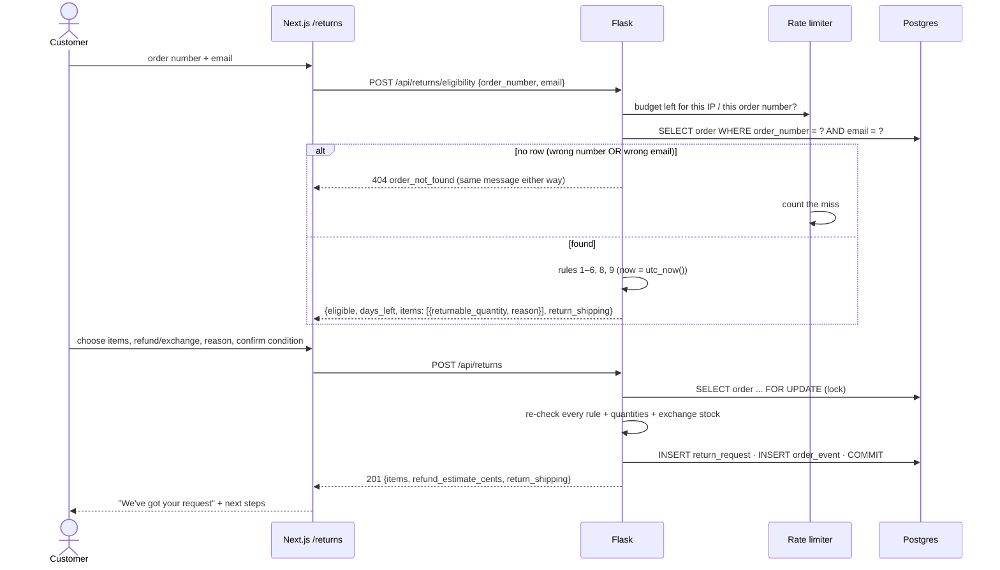

# Phase 5 — Order tracking and returns

## What we built

**Backend**
- `POST /api/orders/track`: order number + email → status, timeline, carrier, tracking number, ETA. It's rate
  limited, and a wrong number and a wrong email get **exactly the same** "not found" response.
- **The returns policy as code** (`backend/app/returns.py`): nine rules, one test each.
- `POST /api/returns/eligibility`: which items can be returned, how many, and *why not* for the others.
- `POST /api/returns`: start a refund or an exchange. The order row is locked while the request is created.
- Account order detail now includes the order's returns.
- 39 new tests (242 in total): 38 for tracking and returns, 1 for the session cookie lifetime.

**Frontend**
- `/track`: a lookup form, a progress bar, the timeline, and "Start a return" for delivered orders.
- `/returns`: find the order → choose items (non-returnable items are shown with the reason) → refund or exchange →
  confirmation with next steps.
- Account order page: a "Start a return" button and a list of the order's returns. Logged-in customers never type
  their email.
- "Track your order" and "Start a return" links in the footer and mobile menu.

**Phase "done when":** KO-1005 is eligible (8 days left), KO-1007 is refused (delivered 49 days ago), and the crew
socks in KO-1011 are refused (final sale) while the belt in the same order can be returned.

## Key concepts

**User enumeration (again).** Learning which records exist from an API's answers. Here the records are *orders*: if
"wrong email" and "no such order" gave different answers, anyone could find out which order numbers exist, and
then guess emails for them.

**Information leak through a side channel.** A difference that isn't in the message itself: a different status code,
response size, or **timing**. A fair defence makes every failure look and take the same.

**Business rules as code.** The returns policy is written for people. We turn each sentence into a small, named
function with a clear yes/no and a reason. The website, the API and (in Phase 8) the AI agent then apply exactly the
same rules.

**Test-driven development (TDD).** Writing a test for a rule, ideally *before* the code, then making it pass. One test
per rule means a failing test tells you exactly which rule broke.

**Boundary testing.** Testing at the edge of a rule: day 30 exactly, and 30 days plus one minute. Most rule bugs are
off-by-one mistakes at boundaries.

**Shared rate limit.** One counter used by several endpoints, so an attacker can't get more attempts by switching
from `/orders/track` to `/returns/eligibility`.

## The returns rules

The policy text, from the `policies` table:

> Returns accepted within 30 days of delivery for unworn items with tags attached. US returns are free with a prepaid
> label; international customers pay return shipping. Exchanges for a different size or color are free, subject to
> stock. Final sale (cannot be returned): Crew Socks (3-pack) and Gift Cards.

| # | Rule | Code | Refusal code | Test |
|---|---|---|---|---|
| 1 | Only delivered orders | `order_refusal()` | `not_delivered` | KO-1002 (shipped) |
| 2 | Not cancelled | `order_refusal()` | `order_cancelled` | KO-1012 |
| 3 | Not already returned | `order_refusal()` | `already_returned` | KO-1010 |
| 4 | Within 30 days of delivery (day 30 counts) | `order_refusal()` | `window_closed` | KO-1005 ✓, KO-1007 ✗, day 30 ✓, day 30 + 1 min ✗ |
| 5 | No final-sale items (the snapshot from purchase time) | `item_eligibility()` | `final_sale` | KO-1011 socks ✗, belt ✓ |
| 6 | Not more than bought, minus open returns (rejected ones don't count) | `item_eligibility()`, `already_requested()` | `quantity_too_high`, `already_requested` | KO-1001: 3 of 2 tees ✗; second return of the same tees ✗ |
| 7 | Unworn with tags → the customer confirms | `create_return()` | `condition_not_confirmed` | |
| 8 | US: free prepaid label; international: customer pays | `return_shipping()` | (not a refusal) | US vs GB |
| 9 | Exchange: same product, other size/colour, in stock | `exchange_options()`, `create_return()` | `exchange_unavailable` | in stock ✓, out of stock ✗, different product ✗ |

Rule 7 is honest about what software can check: we can't inspect a sweater online, so the customer confirms it, and
the warehouse checks when the parcel arrives.

## How it works here

### `backend/app/returns.py` — finding an order without leaking

```python
def find_order(session, order_number, email, user, *, lock=False) -> Order:
    number = normalize_order_number(order_number)      # "1005", " ko-1005 " → "KO-1005"; junk → None
    if number is None:
        raise order_not_found()
    stmt = select(Order).where(Order.order_number == number)
    if email:
        stmt = stmt.where(Order.email == normalize_email(email))   # guests: number AND email
    elif user is not None:
        stmt = stmt.where(Order.user_id == user.id)                # logged in: number AND owner
    else:
        raise order_not_found()
    ...
```

The key choice is **one query with both conditions**. The tempting version, "load by number, then
`if order.email != email`", has two failure paths. It's easy to give them different messages by accident, and even
with identical messages, the timing differs (one path found a row, the other didn't). With one query there is only
one path: the database finds a row or it doesn't. `order_not_found()` builds the same response every time:

```json
{"error": {"code": "order_not_found", "message": "We couldn't find an order with that number and email."}}
```

`tracking_view()` returns status, timeline, carrier, tracking number, ETA, city and country, but **no street
address or payment details**. Knowing an order number and an email isn't strong proof of identity: emails leak, and
order numbers appear in screenshots. The address is only shown to the logged-in owner (account pages).

### Rate limiting that only counts guesses

```python
def _was_a_miss(response) -> bool:
    return response.status_code == 404

lookup_per_ip = limiter.shared_limit("10 per minute; 60 per hour", scope="order-lookup-ip", deduct_when=_was_a_miss)
lookup_per_order = limiter.shared_limit("20 per hour", scope="order-lookup-number",
                                        key_func=_order_number_key, deduct_when=_was_a_miss)
```

Three decisions:
1. **Shared** (`shared_limit`, one `scope`): tracking, eligibility and creating a return use one budget.
2. **Two keys**: per IP (one attacker), and **per order number** (many IPs guessing emails for one known order).
3. **Only misses count** (`deduct_when`). The threat is guessing, and every wrong guess is a 404. A successful
   lookup reveals nothing new (the caller already knew both values), so a real customer can track, check and
   return as often as they like. We found this need during browser testing: a normal returns journey had hit the
   limit.

### Eligibility: rules as small functions

```python
def order_refusal(order, now) -> Refusal | None:      # rules 1–4
    if order.status is OrderStatus.CANCELLED: return Refusal("order_cancelled", ...)
    if order.status is OrderStatus.RETURNED:  return Refusal("already_returned", ...)
    if order.status is not OrderStatus.DELIVERED or order.delivered_at is None: return Refusal("not_delivered", ...)
    if now > order.delivered_at + RETURN_WINDOW: return Refusal("window_closed", ...)
    return None

def item_eligibility(item, requested) -> tuple[int, Refusal | None]:   # rules 5–6
    if item.is_final_sale: return 0, Refusal("final_sale", ...)
    remaining = item.quantity - requested
    if remaining <= 0: return 0, Refusal("already_requested", ...)
    return remaining, None
```

- **`now` is a parameter**, never read inside the rules. Tests pass any moment they like (day 30, day 30 + 1 minute).
  The API passes `utc_now()`, which the tests replace with the seed's fixed date.
- **Every refusal has a code and a human message.** The page shows the message; the AI agent (Phase 8) will use the
  code to decide what to say or do next.
- **Final sale uses `order_items.is_final_sale`**, the snapshot from Phase 1. A test makes the socks *not* final sale
  today and checks the old order still refuses them.

### Creating a return safely

```python
def create_return(session, body, user, created_by, now) -> ReturnRequest:
    order = find_order(session, body.order_number, body.email, user, lock=True)   # SELECT ... FOR UPDATE
    eligibility = check_eligibility(session, order, now)
    ...                                          # re-check every rule against THIS request
    session.add(ReturnRequest(order=order, items=lines, ...))
    order.events.append(OrderEvent(status=order.status, note="Return requested: 1 × Wool Beanie."))
    session.commit()
```

- **The rules are checked again on the server.** The page already disabled the socks' checkbox, but a request
  built by hand would still get `422 final_sale`. The frontend is for convenience; the backend is the rulebook.
- **The order row is locked**: two quick submissions (a double click, or two tabs) can't both return the same last
  item. The same lesson as stock in Phase 4.
- **The order's status doesn't change** (it becomes `returned` when the refund happens, in Phase 6). The request is
  still written to the **timeline**, so support and the agent see it.

### Frontend

- `components/orders/track-form.tsx`: a client form that calls `api.trackOrder()` with **POST**, so the email never
  appears in a URL, server log or browser history. `?order=KO-1005` only pre-fills the number.
- `components/orders/order-progress.tsx`: five steps (Ordered → Delivered). `delayed` and `partially_shipped` show the
  current step in the accent colour; `cancelled` hides the bar.
- `components/orders/return-wizard.tsx`: three steps with no page reloads. Logged in with `?order=`, it loads
  eligibility straight away without asking for the email (the backend matches by account instead).
- `/returns` and `/track` are partly prerendered; the parts that read the URL or cookies stream in.

## Request flow



## Design decisions and alternatives

| Decision | Alternatives | Why we chose this |
|---|---|---|
| Number + email in **one query** | Find by number, then compare email | One code path, so no difference in message, status or timing. |
| POST for tracking | `GET /orders/track?order=..&email=..` | The email stays out of URLs, logs, history and `Referer` headers. |
| Rate limit counts **only 404s** | Count every request | Stops guessing just as well, without blocking real customers. |
| Rate limit per IP **and** per order number | Per IP only | Many IPs guessing emails for one known order are still limited. |
| No address on the public tracking page | Show everything | Order number + email isn't strong proof of identity. |
| Rules as small pure functions with `now` passed in | One big `if` block; reading the clock inside | Each rule can be tested on its own, including boundaries, and the agent can reuse them. |
| Server re-checks everything on create | Trust what the page allowed | A hand-made request can't skip a rule. |
| Lock the order when creating a return | No lock | Two quick submissions can't both return the same item. |
| Condition (unworn, tags) is confirmed by the customer | Ignore that rule | The rule can't be checked online, but it's visible and recorded. |
| Exchanges: one item at a time | Multi-item exchanges | Much simpler UI and rules; covers most real exchanges. |
| Days left rounded **up** | `timedelta.days` (rounds down) | "7 days 23 hours" is "8 days" to a person. Rounding down would steal a day. |

## Bugs that end-to-end testing found

The unit tests all passed. Running the real journeys in a browser against a production build found four more
problems:

1. **Stale redirect after signup (a Phase 3 bug).** Production Next.js *prefetches* visible links. The header's
   "Your account" link was prefetched while logged out, so the client cached "redirect to /login". After signing up,
   `router.replace("/account")` reused that cached redirect. **Fix:** login, signup and logout now do a full page load
   (`window.location.assign`), which clears every client-side cache. It only appeared in production builds, because
   `next dev` doesn't prefetch.
2. **The rate limit blocked real customers.** Track → eligibility → submit used up "10 per minute". **Fix:** only
   failed lookups count (`deduct_when`).
3. **"7 days left" when it was 7 days 23 hours.** **Fix:** round up, with a test.
4. **The session cookie lived for a year** (the library's default) while the token inside expires after 7 days.
   **Fix:** set the cookie's `max_age` to the token lifetime, with a test.

## What could go wrong

- **Tracking says "not found" for a real order.** Check the email is the one used for *that* order (guest orders
  don't follow account email changes). The order number can be typed as `1005` or `KO-1005`.
- **"Too many lookups".** More than 10 *failed* lookups a minute from one IP, or 20 failed lookups an hour for one
  order number. Wait, or, in development, restart Flask (the counters are in memory).
- **A logged-in customer must type their email.** That order isn't linked to their account (`user_id`), e.g. it
  was placed as a guest. That's intentional: we never link orders by email (see Phase 3).
- **Returns still possible after the window.** Check the server time zone: everything is UTC (`TIMESTAMPTZ`).
- **A rule changes in the policy text.** Change the function *and* its test. Phase 6 lets admins edit policy text,
  but the rules are code, so a text change alone doesn't change behaviour. That's a deliberate trade-off: rules are
  tested, while text is free to edit.

## Try it yourself

```bash
cd ~/Documents/kora-store/backend && source .venv/bin/activate
pytest -q tests/test_returns.py tests/test_tracking.py     # 38 passed
docker compose exec db psql -U kora -d kora -c "SELECT order_number, email, status FROM orders ORDER BY id"
```

Then, with both apps running:
1. `/track`: KO-1009 + its email → "Delayed", with the carrier note. Now use a wrong email, then a made-up number:
   the same message both times.
2. `/track` KO-1005 → **Start a return** → enter the email → 8 days left → return the beanie.
3. `/returns` KO-1007 → refused, with the date the window closed.
4. `/returns` KO-1011 → the socks are greyed out ("final sale"); exchange the belt for size L.
5. Try 11 wrong lookups quickly → "Too many lookups". Then look up a real order 20 times → never blocked.
6. Log in, link an order to yourself (`UPDATE orders SET user_id = <your id> WHERE order_number = 'KO-1001'`), open it
   under Account → Orders, and click **Start a return**: no email needed.

## Explain it in 60 seconds

> "Guests track orders with their order number and email. I look both up in a single query, so a wrong email and a
> wrong order number go down exactly the same path and return the same 404. There's no difference in message,
> status or timing that would let someone find out which orders exist. Lookups are rate limited per IP and per
> order number, with one budget shared between tracking and returns. Only failed lookups count, because guessing is
> the threat and a successful lookup reveals nothing new. The tracking response leaves out the street address,
> because an order number and an email aren't strong proof of identity.
>
> For returns, I turned each sentence of the returns policy into a small function with a refusal code and a
> message: delivered, not cancelled, within 30 days of delivery with day 30 included, no final-sale items based on
> the snapshot taken at purchase, and quantities minus open returns. Exchanges must be the same product and in
> stock. Each rule has its own test, including boundary tests. Creating a return re-checks every rule on the server
> and locks the order row, so a double submit can't over-return. The AI agent will call the same functions."
