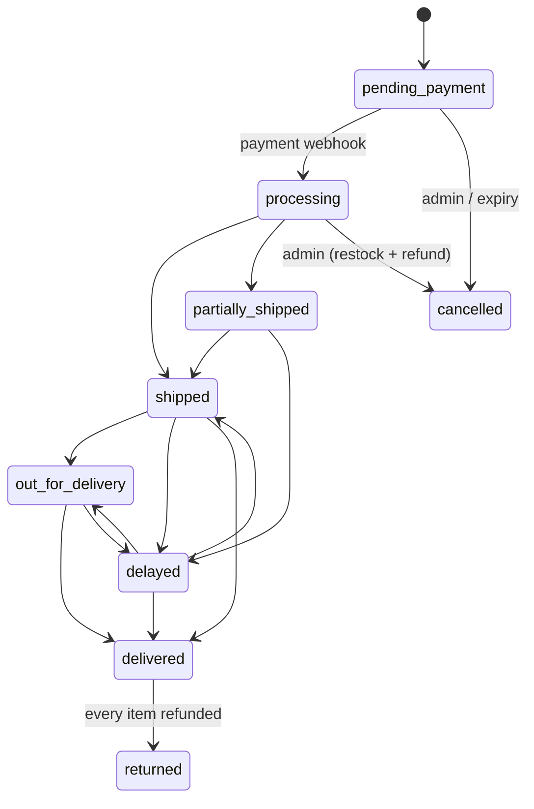
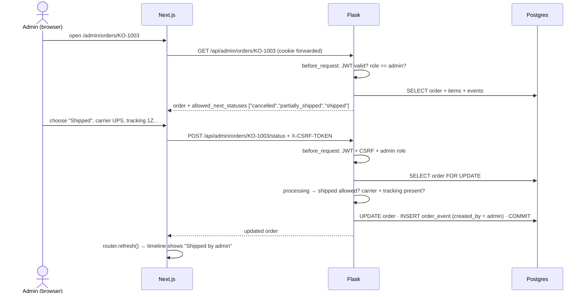
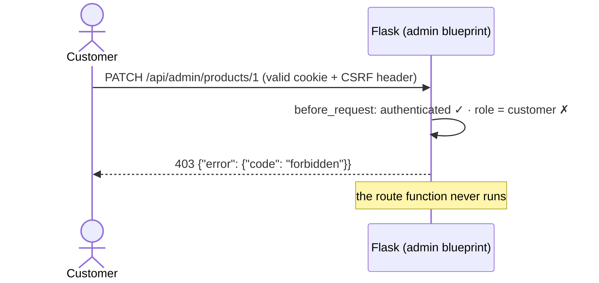

# Phase 6 — Admin dashboard

## What we built

**Backend** (`backend/app/admin.py`, `backend/app/api/admin.py`)
- **One permission check for every admin route**: a `before_request` hook on the admin blueprint. Not logged in →
  401; logged in but not an admin → 403.
- **Products and stock**: list, create, edit (incl. hide from the shop), add variants, and **stock adjustments as
  changes** (`+10`, `−1`), never as new totals.
- **Orders**: list with status filter and search, full detail, and status changes through a **state machine**. Each
  change writes an `order_events` row with `created_by = "admin"`. Cancelling a paid order puts the stock back and
  refunds it.
- **Returns**: approve → label sent → received (stock goes back) → refunded (a **partial** refund of just those
  items). When everything in an order has been refunded, the order becomes `returned`.
- **Support tickets**: list (open and urgent first) and update. A new public **contact form** creates them.
- **Policies**: edit the text the website (and later the AI agent) shows.
- **Stats**: revenue for 7 and 30 days, revenue per day, orders by status, low stock, open returns and tickets, all
  computed by SQL aggregates.
- 37 new tests (279 in total), including permission tests that **discover every admin route automatically**.

**Frontend** (`frontend/app/admin/`)
- Dashboard with a hero revenue figure, a daily revenue chart (hover, keyboard, "show as table"), orders by
  status and low stock.
- Orders list and detail (status form that only offers allowed moves, full timeline with who did what), products list,
  create and edit (variants and stock), returns queue, tickets and policies.
- `/contact` page, and an "Open the admin dashboard" button on the account page for admins.

## Key concepts

**Authentication vs authorization.** *Authentication* = "who are you?" (the login cookie, Phase 3).
*Authorization* = "are you allowed to do this?" (the admin role, this phase). A logged-in customer is authenticated
but not authorized for `/api/admin/*`.

**401 vs 403.** `401 Unauthorized` really means "not authenticated: log in". `403 Forbidden` means "we know who you
are, and the answer is no".

**Role-based access control (RBAC).** Permissions are given to *roles* (`customer`, `admin`), and users have a role.
To change what someone may do, you change their role, not a list of permissions on every route.

**Principle of least privilege.** Give each person only the access they need. Customers can't reach admin routes at
all; admins act through specific, checked operations (a state machine, deltas), not "edit any field".

**State machine.** A list of states and the allowed moves between them. An order can go `shipped → delivered` but
never `delivered → processing`. Anything not listed is refused.

**Audit trail.** A record of who changed what and when, which can't be edited later. Our `order_events` rows, with
`created_by` = `system`, `admin` or `agent`, are the order's audit trail.

**Aggregate query.** SQL that summarises many rows into a few numbers: `SUM`, `COUNT`, `GROUP BY`. The database does
the maths; Python only receives the results.

**Lost update (again).** Two writers read the same value, each writes its own result, and one write disappears.
Phase 4 had it with two webhooks; here it would happen with an admin and a customer.

## How it works here

### One check for every admin route

```python
# backend/app/api/admin.py
@bp.before_request
def require_admin() -> None:
    verify_jwt_in_request()          # authentication: no valid cookie → 401; writes without CSRF header → 403
    user = get_current_user()
    if user is None or not user.is_admin:
        raise APIError("forbidden", "You don't have permission to do that.", 403)   # authorization
```

`before_request` on a **blueprint** runs before every route in that blueprint. So a route added next month is
protected *automatically*; nobody can forget a decorator. The role is read from the **database on every request**
(Phase 3: the JWT holds only the user id), so removing someone's admin role works on their very next click, even
with the same cookie. There's a test for exactly that.

### Permission tests that find every route themselves

```python
# backend/tests/test_admin.py
def admin_routes(app):
    for rule in app.url_map.iter_rules():
        if rule.rule.startswith("/api/admin"):
            ...   # every method of every admin URL, with dummy ids

def test_every_admin_route_refuses_customers(app, logged_in, seeded):
    for method, path in admin_routes(app):
        response = call(logged_in, method, path, {})   # with a VALID CSRF header: only the role is missing
        assert response.status_code == 403
```

Three tests (anonymous → 401, customer → 403, admin → neither) loop over **all** admin routes. A fourth test checks
the loop found at least 15 routes, so a broken discovery can't pass by checking nothing. We also proved the tests
work: with the `before_request` hook commented out, they **failed**.

### Stock: changes, not totals

```python
def adjust_stock(session, variant_id, change):
    result = session.execute(
        update(ProductVariant)
        .where(ProductVariant.id == variant_id, ProductVariant.stock + change >= 0)
        .values(stock=ProductVariant.stock + change)        # SQL: SET stock = stock + :change
    )
    if result.rowcount == 0:
        raise APIError("stock_too_low", "That would make stock negative.", 409)
```

Picture the admin's screen showing "25". A customer buys one (stock is now 24), and then the admin, who received 10
more, types "35". Saving 35 erases the sale. With a *change* of `+10`, Postgres computes `24 + 10 = 34` from the
**current** value, atomically, and both events count. The `WHERE` refuses changes that would go below zero. The admin
UI therefore offers "Adjust stock: +10 / −1" instead of a stock box.

### Orders: a state machine

```python
ORDER_TRANSITIONS = {
    OrderStatus.PENDING_PAYMENT: {OrderStatus.CANCELLED},
    OrderStatus.PROCESSING: {OrderStatus.SHIPPED, OrderStatus.PARTIALLY_SHIPPED, OrderStatus.CANCELLED},
    OrderStatus.PARTIALLY_SHIPPED: {OrderStatus.SHIPPED, OrderStatus.DELAYED},
    OrderStatus.SHIPPED: {OrderStatus.OUT_FOR_DELIVERY, OrderStatus.DELAYED, OrderStatus.DELIVERED},
    OrderStatus.DELAYED: {OrderStatus.SHIPPED, OrderStatus.OUT_FOR_DELIVERY, OrderStatus.DELIVERED},
    OrderStatus.OUT_FOR_DELIVERY: {OrderStatus.DELIVERED, OrderStatus.DELAYED},
    OrderStatus.DELIVERED: set(), OrderStatus.CANCELLED: set(), OrderStatus.RETURNED: set(),
}
```



`change_order_status()`:
1. **Locks the order row**, so an admin and a webhook can't change the same order at once.
2. Refuses moves not in the table (`409 invalid_transition`, listing what *is* allowed).
3. Applies each status's own rules: `shipped` needs carrier + tracking number, `delayed` needs a note (the customer
   reads it on `/track`), and `delivered` sets `delivered_at`, which starts the 30-day return window from Phase 5.
4. Cancelling a **paid** order (`processing`) puts the stock back (locking variants in id order, as in Phase 4) and
   refunds the payment **after** the commit. Cancelling an unpaid order does neither, because no stock was taken
   and no money was paid.
5. Writes an `order_events` row with `created_by = "admin"`.

`returned` is not in the table: it's set only by refunding returns, so the order's status and the money can never
disagree. The detail endpoint returns `allowed_next_statuses`, so the UI shows only valid moves. The backend still
checks, though.

### Returns: a second state machine, with partial refunds

```
requested → approved → label_sent → received → refunded
          ↘ rejected (needs a reason)      ↑ exchanges finish at "received"
```

- **received** puts the returned items back in stock (they can be sold again).
- **refunded** refunds `refund_estimate_cents`, just those items, using a new optional `amount_cents` on the
  `PaymentProvider.refund_payment()` interface (Stripe passes it as `amount`; the sandbox logs it). If every unit of
  the order has now been refunded, the order becomes `returned`.
- Exchanges can't be refunded: the customer gets a different size, not money.

### Stats: let the database add up

```python
total, count = session.execute(
    select(func.coalesce(func.sum(Order.total_cents), 0), func.count())
    .where(Order.status.in_(PAID_STATUSES), Order.created_at >= now - timedelta(days=days))
).one()

day = func.date_trunc("day", Order.created_at)
daily = session.execute(select(day, func.sum(Order.total_cents)).where(...).group_by(day)).all()
```

`SUM`, `COUNT` and `GROUP BY date_trunc('day', …)` run in Postgres and send back a handful of numbers, not every
order. Days with no sales are filled with 0 in Python, so the chart always has 30 bars. "Revenue" counts paid orders
only (not `pending_payment` or `cancelled`). The test compares each number with the same total worked out a
different way.

### The admin UI

- **One gate for all pages**: `app/admin/layout.tsx` wraps every admin page in `<AdminGate>`, which calls
  `requireAdmin()`: not logged in → `/login?next=/admin`; logged in but not an admin → **404**, so customers can't
  even tell an admin area exists. `proxy.ts` also covers `/admin`. These are courtesies; the security boundary is
  Flask's check on every API call.
- **Reads on the server, writes in the browser**: pages fetch with `adminApi` (server-side, forwarding the cookie);
  forms call `api.admin.*` (browser, with the CSRF header), then `router.refresh()` to re-render the server data.
- **Filters live in the URL** (`/admin/orders?status=processing&q=olivia`), using a GET `<Form>`.
- **The revenue chart** (`components/admin/revenue-chart.tsx`) follows the dataviz skill:
  - single-series columns, at most 24px wide, 4px rounded tops, 2px gaps, hairline gridlines
  - one direct label (the peak day), with no legend because there's only one series
  - a tooltip on hover **and** with the arrow keys, plus a "Show as table" view
  - the colour was checked with the palette validator, and the hero revenue number uses the sans font, not the serif

## Role-based redirects: the admin experience

Admins and customers use different parts of the site. After login, an admin goes to `/admin` and a customer to
`/account` (or back to the page they came from). An admin who opens any `/account` page is sent to `/admin`. The header
shows an **Admin** badge, admins can browse and fill a bag but can't check out, and the admin layout has its own
profile area (name, email, log out).

### Where each decision is made

| What | Where | How it knows the role |
|---|---|---|
| Where to go after login | `components/account/auth-form.tsx` → `postLoginPath()` in `lib/session-hint.ts` | the `user.role` in the login response |
| Admin opens `/account/*` → `/admin` | `proxy.ts`, **before** the page renders | a `role` **hint** inside the session JWT |
| …second check | `requireCustomer()` in `lib/api-server.ts` | `/api/auth/me` (the database) |
| Header icon and "Admin" badge | `components/account-link.tsx` (streamed in `<Suspense>`) | the same JWT hint |
| Checkout message for admins | `app/checkout/page.tsx` | `/api/auth/me` |
| **Checkout refused for admins** | `create_checkout()` in `backend/app/checkout.py` → `403 admin_cannot_order` | **the user row in the database** |
| **Every admin API call** | `before_request` in `backend/app/api/admin.py` | **the user row in the database** |

### Why the proxy needs a "role hint"

Account pages read the user inside `<Suspense>`, so their static shell ("Your account" and the menu) is sent before
the server knows who you are. A redirect from inside the page would come *after* that shell had appeared: a flash of
the customer page. `proxy.ts` runs before rendering starts, but it only sees cookies. So at login Flask now adds the
role to the token:

```python
token = create_access_token(identity=str(user.id), additional_claims={"role": user.role.value})
```

`roleHint()` reads that claim **without verifying the signature** (the frontend doesn't have the secret, and
shouldn't). That's acceptable only because of how it's used:
- It decides **where to send** someone (redirect) and **which icon to show**. It never decides **what anyone may
  see or do**.
- If someone edits the hint to say "admin", they get redirected to `/admin`, where the page gate asks Flask, Flask
  checks the database, and they see a 404. Every admin API call returns 403. A test proves that even a *validly
  signed* token claiming "admin" for a customer gets 403.
- If an admin is demoted, their old token still says "admin" until they log in again. The worst case is an annoying
  redirect, never access.

The browser test confirms there's no flash: requesting `/account` as an admin returns a **307 redirect**, with no
customer HTML sent at all.

### The UI hides; the backend enforces

Hiding a button is for the person using the site. Refusing the request is for security. Anyone can open DevTools
and send any request, so every rule must hold even when the UI is skipped:

| The UI… | …but the backend still |
|---|---|
| hides the checkout form from admins | returns `403 admin_cannot_order` to `POST /api/checkout/session` |
| shows customers a 404 at `/admin` | returns `403` to every `/api/admin/*` call |
| redirects admins away from `/account` | (no extra rule needed: account data is scoped to the logged-in user) |
| greys out final-sale items on `/returns` (Phase 5) | returns `422 final_sale` |
| only offers allowed order statuses | returns `409 invalid_transition` |

**Why admins can't order:** staff test orders would mix into revenue stats, stock and the audit trail. Testing
checkout with a customer account keeps the numbers honest.

**Tests:** `npm test` in `frontend/` (login redirects for both roles, open-redirect protection, the role hint, and
the proxy sending an admin from every `/account` page to `/admin`), plus `test_login_puts_the_role_hint_in_the_session`,
`test_a_forged_role_hint_unlocks_nothing` and `test_admins_cannot_check_out` in `backend/tests/test_admin.py`.

## Request flow

**An admin ships an order:**



**A customer tries the admin API:**



## Design decisions and alternatives

| Decision | Alternatives | Why we chose this |
|---|---|---|
| `before_request` on the admin blueprint | `@admin_required` on each route | Impossible to forget on a new route. |
| Permission tests that discover routes | One test per route | New routes are covered without new tests. |
| Role read from the DB each request | Role inside the JWT | Removing admin rights works immediately. Costs one small query per request. |
| Non-admins get a 404 page (the API says 403) | Show "403 Forbidden" | Pages don't reveal that an admin area exists; the API is honest for debugging and tests. |
| Order state machine | Free status dropdown | No impossible histories; the UI and the agent can ask "what's allowed next?". |
| Stock as **deltas** (`stock = stock + change`) | Absolute values | No lost updates when a sale happens while the admin is editing. |
| Restock + refund on cancelling a paid order | Leave it to the admin | Stock and money always match the order's status. |
| Partial refunds per return | Refund whole orders only | Customers return one item out of three. |
| `returned` only via refunds | Admin can set it directly | The status can't claim a refund that didn't happen. |
| Aggregates in SQL | Load orders, add up in Python | Scales with data; one round trip. |
| Audit trail = `order_events` with `created_by` | A separate audit log table | Already exists, the customer timeline and staff history in one place. A real store would also log product and policy edits. |
| `useId()` for form field ids | `id={name}` | See "Bugs found" below. |

## Bugs and lessons from end-to-end testing

1. **Duplicate ids across pages.** Next.js keeps the previous page mounted (hidden) after a client-side navigation. The
   "New product" and "Edit product" pages both had `id="name"`, so the visible input's accessible name became "Name
   Name": both labels pointed at it. **Fix:** React's `useId()` gives every form-field instance a unique id, in the
   product, variant, address and checkout forms.
2. **A grid item stretched the page on phones.** The admin nav scrolls sideways, but a grid item's default
   `min-width: auto` made it as wide as all six links, so the whole page scrolled sideways (556px in a 390px
   viewport). **Fix:** `min-w-0` (also on the account layout). Now every admin and account page measures 390px.
3. **Chart labels collided** ("Oct 18" and "Oct 19"), and the tooltip wrapped. **Fix:** skip a weekly tick near the
   last label; `whitespace-nowrap` on the tooltip.
4. **We proved the permission tests can fail**: we disabled the hook, the tests failed, and we put it back.

## What could go wrong

- **Admin pages show "We couldn't find that page".** Your account isn't an admin. Locally the admin is created by
  `flask seed --reset` from `ADMIN_EMAIL` / `ADMIN_PASSWORD` in `backend/.env`. To make an existing user an admin:
  `UPDATE users SET role = 'admin' WHERE email = '...'`.
- **"An order can't go from delivered to shipped".** That's the state machine working. To undo a mistake, the
  timeline shows what happened; a real store might add a "correction" transition with a required reason.
- **Stock "won't go lower".** Changes that make stock negative are refused (409).
- **Refunds of seeded orders do nothing in Stripe.** Seeded orders have no payment reference, so there's nothing to
  refund (`_refund` skips it). New sandbox orders do have one.
- **Product and policy edits aren't in the audit trail.** Only order and return changes write events. Adding an
  `admin_actions` table is a good next step.
- **Tickets are empty.** They come from `/contact` now and from the AI agent in Phase 8.

## Try it yourself

```bash
cd ~/Documents/kora-store/backend && source .venv/bin/activate
pytest -q tests/test_admin.py          # 37 passed
```

Then log in at http://localhost:3000/login as `admin@kora.test` with the `ADMIN_PASSWORD` from `backend/.env`:

1. You land on **/admin** straight after login (the header shows the **Admin** badge). Hover the chart, or focus it
   with Tab and press ← / →.
2. **Orders → status "Processing" → KO-1003.** The dropdown offers only Cancelled, Partially shipped, Shipped. Ship it
   with a carrier and tracking number, then mark it delivered. The timeline says "by admin". Look it up on `/track`.
3. **Products → Everyday Joggers.** Add `+5` to one variant. Open the product in the shop: it's in stock.
4. **Products → New product.** Create one, add a variant, find it in the shop.
5. **Returns:** start a return for KO-1005 on `/returns`, then approve → received → refund it here.
6. **Contact:** send a message from `/contact` (log out first), then see it under **Tickets**.
7. **Security check:** log in as a normal customer and open `/admin` (404). In DevTools Console:
   `fetch("/api/admin/stats").then(r => r.status)` → 403.

## Explain it in 60 seconds

> "The admin API is a Flask blueprint with a single `before_request` hook that runs before every route. It verifies
> the JWT cookie, which also enforces CSRF on writes, then checks the user's role, which is loaded from the database
> on each request. So no route can forget the check, and removing someone's admin role takes effect immediately. My
> permission tests discover every admin route from Flask's URL map and assert anonymous users get 401, customers get
> 403, and admins get through. I proved they work by disabling the hook and watching them fail.
>
> Order status changes go through a state machine: a table of allowed moves, enforced on the server and exposed to
> the UI. Each change writes an order event with `created_by` set to admin, which is the audit trail. Cancelling a
> paid order restocks and refunds after the commit. Stock edits are deltas applied as `SET stock = stock + change`,
> which avoids the lost update where an admin's absolute number overwrites a sale that just happened. Returns follow
> their own state machine with partial refunds. The dashboard numbers are SQL aggregates, and the chart has hover and
> keyboard tooltips plus a table view."
