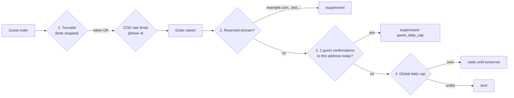
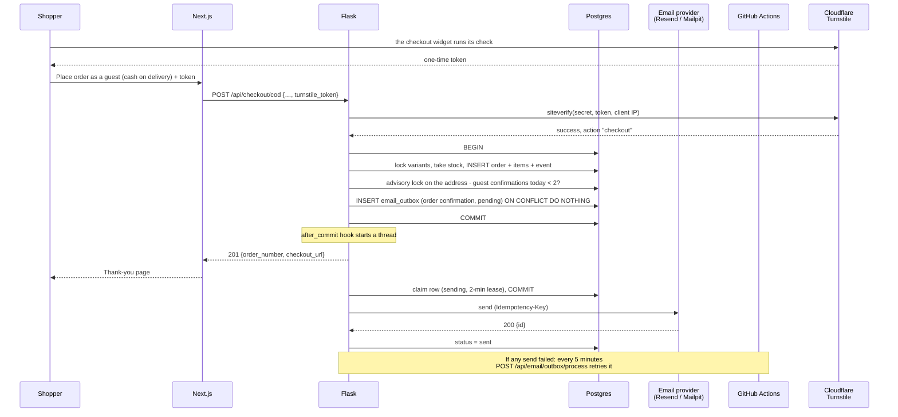

# Phase 8A — Email notifications (the outbox)

> **Step 8A of phase 8.** There is no AI in this step. We build the email system that both AI assistants will use
> later: when an order or a ticket changes, the store emails the right person, exactly once, and never sends an
> email for a change that didn't really happen. The full phase 8 plan is in [AI_PLAN.md](../AI_PLAN.md).

## What we built

**Backend**
- A new table, **`email_outbox`**. Every email the store sends is first a row in this table. The row is written in
  the **same database transaction** as the change that causes it (an order paid, a status changed).
- **Sending right after the commit**, in a background thread, so nobody waits for the email provider.
- A **retry job**: `POST /api/email/outbox/process`, called every 5 minutes by GitHub Actions
  (`.github/workflows/email-outbox.yml`). It sends anything that failed, with **backoff** and a maximum of 6 attempts.
- **Three email providers**, chosen by `EMAIL_PROVIDER`: `resend` (production, an HTTP API), `mailpit` (a fake inbox
  on your laptop) and `log` (tests: send nothing).
- **Nine email types**, each with a branded HTML version and a plain-text version: account verification, order
  confirmation, dispatched, out for delivery / delivered / delayed, cancelled (with refund details), return
  approved, return rejected, refund issued, and a new-ticket alert for the store owner.
- **Two rules for who gets order emails:**
  - **Accounts** confirm their address first: sign-up sends a link, and until it's clicked the account can shop
    but gets no order emails (table **`verified_emails`**, column `users.email_verified_at`).
  - **Guests** get their confirmation and status emails directly, with no confirmation step. What stops abuse
    instead: **Cloudflare Turnstile** on guest checkout, **at most 2 guest-order confirmations per address per
    day**, the global daily cap, and never emailing reserved domains.
- **Abuse protection** for everyone: reserved domains (`example.com`, `kora.test`, …) are never emailed, plus a daily
  cap per recipient and a global daily cap.
- **Reply-To**: customer emails have `Reply-To: ADMIN_NOTIFY_EMAIL`, so a customer who presses "Reply" reaches a
  person. Ticket alerts have `Reply-To: <the customer>`, so the owner can answer straight from the alert.
- Two commands: `flask outbox process` (run the retry job now) and `flask email preview <name|all>` (render any
  email to an HTML file).
- 98 new tests (443 in total).

**Frontend**
- After sign-up (already logged in): **`/check-email`**. It shows the address, a **Resend link** button with a
  60-second countdown, and **"Wrong email? Change it"** (new address + password).
- `/verify-email`: the page the email links open. It confirms with a button click (see "Why a button?" below),
  then goes to `/account?email_confirmed=1`, which shows "Email confirmed".
- A "Please confirm your email" banner on `/account` until then, with "Send the link again" and "Change it".
- The **Turnstile widget** on checkout, for guests only. The order button stays disabled until it passes.
- A line on the order success page: "Your confirmation is on its way to …", or, for an unconfirmed account,
  "Confirm your email to get your order confirmation".

**Local tools**
- **Mailpit** in `backend/docker-compose.yml`: a mail server that catches every email and shows it in a web inbox
  at http://localhost:8025. Nothing leaves your laptop.

## Key concepts

**Transaction.** A group of database changes that succeed or fail together. `COMMIT` saves all of them, and
`ROLLBACK` throws all of them away. Example: "mark the order shipped + add a timeline event + add an outbox row".

**The dual-write problem.** We want to do two things: change the database, *and* call an outside service (send an
email). No transaction can cover both, because the email provider is not part of our database. So one can happen
without the other:

| Order | What can go wrong |
|---|---|
| Send the email, then commit | The commit fails. The customer reads "your order shipped", but it didn't. |
| Commit, then send the email | The server crashes, or Resend is down, between the two steps. The email is lost forever. |

**The outbox pattern.** The answer to the dual-write problem. We don't send the email inside the transaction. We
write a *note* that says "this email must be sent" (an outbox row) **in the same transaction** as the change. Now
the change and the note are saved together or not at all. A separate step reads the notes and sends them. If
sending fails, the note is still there, so we can try again. An email can only be lost if the database itself
loses committed data.

**At-least-once vs exactly-once.** The outbox guarantees *at least once*: a note is retried until it works, so a
crash at the wrong moment could send it twice. To get *effectively exactly once*, we add idempotency.

**Idempotency.** An operation is idempotent if doing it twice has the same effect as doing it once. We use two layers:
1. **In our database:** every outbox row has a unique `idempotency_key`, for example `order-confirmation:42`. If
   the same trigger runs twice (Stripe retries a webhook, an admin double-clicks), the second `INSERT` does nothing.
2. **At the provider:** we send the same key to Resend in an `Idempotency-Key` header. If we crash *after* Resend
   accepted the email but *before* we saved "sent", the retry carries the same key, and Resend doesn't deliver a
   second copy.

**Backoff.** Waiting longer after each failure: 1, 5, 15, 60, then 240 minutes. A provider that is down needs time
to recover, and hammering it makes things worse. After 6 attempts we stop and mark the email `failed`.

**Lease.** Before sending, a sender marks the row `sending` with `locked_until = now + 2 minutes`. The row belongs
to that sender until then. If the sender crashes mid-send, the lease runs out and another run takes the row over.
A lease is like a room key that expires.

**Advisory lock.** A Postgres lock on a *number* instead of a table row. We take lock number `80801` while counting
today's emails and claiming new ones, so two senders can't both see "79 sent today" and both send the 80th.

**Email authentication: SPF, DKIM and DMARC.** Anyone can write any `From:` address on an email, just as anyone can
write any return address on an envelope. Mail servers (Gmail, Outlook) check three DNS records to decide whether
to trust a message:
- **SPF** (Sender Policy Framework): a TXT record listing which servers may send mail for the domain. Gmail
  checks that the sending server is on the list.
- **DKIM** (DomainKeys Identified Mail): the sender signs each email with a private key. The public key is a DNS
  record. Gmail checks the signature, which proves the email wasn't changed and really came from the domain.
- **DMARC**: a TXT record that tells receivers what to do when SPF or DKIM fail (`p=none` = just report,
  `quarantine` = spam folder, `reject` = refuse), and where to send reports.

Without these, our emails go to spam or are rejected. Resend gives us the SPF and DKIM records to add (DEPLOY.md,
step 9.2).

**CAPTCHA and Cloudflare Turnstile.** A CAPTCHA is a test that tells people and bots apart. Turnstile is
Cloudflare's free version. Usually it's invisible: it checks the browser quietly and only sometimes asks for a
click. When it passes, the widget gives the page a **token**. Our server sends that token, with our secret key, to
Cloudflare's `siteverify` API, which answers "real" or "not". A token works **once** and expires after 5 minutes,
so a bot can't solve one and reuse it.

**Fail open vs fail closed.** What a security check does when it can't run (here: Cloudflare is unreachable). *Fail
open* lets the request through, so the store keeps working but the protection silently disappears. *Fail closed*
refuses it, so it's safer but stricter. Our guest checkout **fails closed**, because an attacker who could make the
check fail would otherwise switch the protection off.

**Deliverability.** The chance that an email reaches the inbox and not spam. It depends on authentication
(above), the domain's **reputation** (its history of sending wanted mail), having a plain-text version, few
bounces, and few spam complaints. That is why we use a **subdomain** (`kora.abdullahrasheed.tech`): if the demo
store ever gets a bad reputation, the main domain stays clean.

## How it works here

### 1. A trigger: `app/notifications.py`

Every automatic email has one small function. It decides *what* to send and *to whom*, then calls `enqueue()`. It
never commits: the caller does.

```python
# app/admin.py, inside change_order_status()  (backend/app/admin.py:386)
event = _event(order, body.note or f"Status changed from {previous.value} to {target.value}.", target)
session.flush()  # the event id is part of the email's idempotency key
if cancelling_confirmed_order:
    notifications.order_cancelled(session, order, refund_cents=refund_cents, note=body.note)
else:
    notifications.order_status_changed(session, order, event)
session.commit()  # status + event + email row: all or nothing
```

The idempotency key for a status email is `order-status:<order id>:<event id>`, not `…:<status>`. An order can be
delayed twice, and each delay is news the customer should get.

Where each trigger is called:

| Email | Called from |
|---|---|
| Order confirmation | `checkout._fulfil` (card paid, `backend/app/checkout.py:359`) and `create_cod_order` (`:218`) |
| Dispatched / out for delivery / delivered / delayed | `admin.change_order_status` (`backend/app/admin.py:397`) |
| Cancelled + refund | `admin.change_order_status`, when a *confirmed* order is cancelled (`:395`) |
| Return approved / rejected / refund issued | `admin.change_return_status` (`:543`, `:552`, `:554`) |
| New ticket alert (to the owner) | `support.create_ticket` (`backend/app/support.py:38`) |
| Verify your account | `api/auth.signup` (`backend/app/api/auth.py:51`) and `POST /api/email/resend-verification` |

In phase 8D, the admin Copilot will call these same functions after the admin clicks **Approve**, so a
refund approved in the chat panel sends exactly the same email as one approved on the Returns page.

### 2. Writing the row: `enqueue()` (`backend/app/mail/outbox.py:65`)

```python
new_id = session.execute(
    insert(EmailOutbox)
    .values(idempotency_key=key, kind=kind, to_email=to, subject=rendered.subject,
            html_body=rendered.html, text_body=rendered.text, status=status, ...)
    .on_conflict_do_nothing(index_elements=["idempotency_key"])   # layer 1 of idempotency
    .returning(EmailOutbox.id)
).scalar_one_or_none()

if new_id is not None and status is EmailStatus.PENDING:
    session.info.setdefault(NEW_IDS, []).append(new_id)   # remember it for after the commit
```

Two details:
- The email is **rendered now**, when the row is written, not when it's sent. A retry hours later sends exactly
  what was true at the moment of the change. (This is the same idea as `order_items`, which copy the price at
  purchase time.)
- `ON CONFLICT DO NOTHING` lets the **database** refuse duplicates, even when two requests race each other. A
  Python "check, then insert" could let both through.

### 3. Sending after the commit (`backend/app/mail/outbox.py:115`)

```python
@event.listens_for(Session, "after_commit")
def _send_after_commit(session: Session) -> None:
    ids = session.info.pop(NEW_IDS, None)
    if not ids:
        return
    ...
    threading.Thread(target=_send_ids, args=(app, ids), name="outbox-after-commit").start()


@event.listens_for(Session, "after_rollback")
def _forget_after_rollback(session: Session) -> None:
    session.info.pop(NEW_IDS, None)   # the rows are gone with the transaction
```

SQLAlchemy calls these **hooks** (event listeners) on every commit and rollback. No service function has to
remember to "send the email". The rule "a rolled-back change sends no email" is enforced in one place.

The send runs in a **background thread**, so the admin's click or the shopper's order doesn't wait for Resend
(~300 ms). Tests set `EMAIL_SEND_IN_BACKGROUND = False`, so the send happens inline and the test can check the
result straight away.

### 4. Claiming, caps and sending: `process_outbox()` (`backend/app/mail/outbox.py:167`)

`_claim()` (`:180`) runs in its own short transaction:
1. Take the advisory lock (`pg_advisory_xact_lock`).
2. Select due rows: `pending` and `next_attempt_at <= now`, **or** `sending` with an expired lease. Use
   `FOR UPDATE SKIP LOCKED`, so a row another sender is working on is skipped, not waited for.
3. For each row: blocked domain → `suppressed`; recipient over the daily cap → `suppressed`; everyone over the
   global cap → postponed to tomorrow (`next_attempt_at` = midnight UTC). Otherwise → `sending`, `attempts + 1`,
   lease of 2 minutes.
4. **Commit.** This releases the locks *before* the slow network call. It's the same rule as Stripe refunds in
   `app/admin.py`: never hold database locks while waiting on the network.

Then `_deliver()` (`:245`) sends each claimed row and commits the result, one row at a time:
- success → `sent`, `sent_at`, `provider_message_id`
- a temporary error (network, 429, 5xx) → back to `pending`, `next_attempt_at = last_attempt_at + backoff`
- a permanent error (other 4xx: bad address, unverified domain) → `failed` at once
- after 6 attempts → `failed`

Why different rules for the two caps? Many emails to **one** stranger in a day looks like abuse, so we drop them.
Running out of the **global** budget is our problem, not the customer's, so the email waits for tomorrow.
`ADMIN_NOTIFY_EMAIL` has no per-recipient cap: it's our own inbox.

### 5. The providers: `backend/app/mail/senders.py`

All three have the same small interface, `send(email) -> message_id` (`:43`). This is the **adapter pattern**
again, as with `PaymentProvider` in phase 4.

```python
class ResendSender:                      # backend/app/mail/senders.py:87
    def send(self, email: OutgoingEmail) -> str:
        headers = {"Authorization": f"Bearer {self.api_key}",
                   "Idempotency-Key": email.idempotency_key}   # layer 2 of idempotency
        ...
        retryable = response.status_code in (408, 409, 429) or response.status_code >= 500
        raise SendError(f"Resend {response.status_code}: ...", retryable=retryable)
```

Why HTTP and not SMTP in production? Render's free plan **blocks outgoing SMTP ports** (25, 465, 587) to stop
spam. Resend's API runs over HTTPS (port 443). Locally, Mailpit speaks SMTP, and Python has `smtplib` built in,
so `MailpitSender` (`:59`) uses it.

### 6. The retry job and the "maybe due" flag (`backend/app/mail/outbox.py:291`)

GitHub Actions calls `POST /api/email/outbox/process` every 5 minutes with `Authorization: Bearer
<OUTBOX_CRON_SECRET>`. The endpoint compares the token with `hmac.compare_digest`, which takes the same time
whether the first or the last character is wrong, so the response time can't leak the secret.

A query every 5 minutes would keep Neon's free database awake all the time and use up its free compute hours. So
the process keeps a small flag in memory, `_maybe_due`: "might anything be waiting?"
- It starts as `True` at start-up, so the first run after a restart or crash always checks.
- It becomes `True` after any commit that wrote an outbox row.
- A run sets it to `False` **before** it looks, and back to `True` if anything is still waiting (a retry or a
  postponed email).

When the flag is `False`, the endpoint answers `{"skipped": true}` without touching the database.

### 7. Account verification: `backend/app/mail/verification.py`

```python
def make_token(email: str) -> str:
    return _serializer().dumps({"email": normalize_email(email)})
```

The token is **signed** with `SECRET_KEY` by `itsdangerous` (Flask's own signing library). Nobody can make a valid
one without the key. It includes a timestamp, so `read_token` refuses links older than 7 days. A **salt**
(`"kora-email-verification"`) keeps these tokens separate from anything else signed with the same key. Because
the token checks itself, we need no table of issued tokens.

The sign-up journey:

1. `POST /api/auth/signup` creates the account, logs it in (the session cookie), and writes the "Confirm your
   email" outbox row, all in one transaction (`backend/app/api/auth.py`).
2. The browser goes to **`/check-email`**: "We sent a link to maya@…". **Resend link** calls
   `POST /api/email/resend-verification`, which is limited to **1 a minute and 5 an hour**. The button counts down
   60 seconds. If the limit is hit anyway, the API's `429` carries a `Retry-After` header, and the countdown uses that
   number, so the page and the server always agree.
3. **"Wrong email? Change it"** → `POST /api/email/change` with the new address **and the password**
   (`accounts.change_unconfirmed_email`). It only works while the address is unconfirmed: changing a *confirmed*
   address safely needs a confirmation of the new address before switching, which is a bigger feature. The
   password means a stolen session cookie alone can't move the account to an attacker's address.
4. The customer clicks the link → `/verify-email?token=…` → **Confirm my email** → `POST /api/email/verify`. The
   answer includes `signed_in`: is this browser logged in as the owner of the address?
   - yes → full page load to `/account?email_confirmed=1` ("Email confirmed")
   - no (opened on a phone, say) → "Thank you, … is confirmed" with a **Log in** button. After login the
     customer lands on the same page, because `proxy.ts` now keeps the query string in `?next=`.

Until step 4, the account can browse and order normally. Its order emails are written as `suppressed /
unverified`, so support can still see them.

**Why a button, not "confirm on page load"?** Mail scanners (in Outlook, corporate filters) open every link in an
email to check it for viruses. If opening the link confirmed the address, the scanner would confirm it, not the
person. Scanners don't click buttons, and the confirmation is a `POST`.

### 8. Guests: no confirmation step, and what stops abuse instead

A guest typed an email address to get a receipt. Asking them to click a link before we send it is friction at
the worst moment, and many real customers would never see their confirmation. So guests get their order emails
**directly** (`notifications.order_placed`, `backend/app/notifications.py`).

The risk this creates: anyone could type a *stranger's* address, and our store would email them. Four layers
make that useless to an attacker:



1. **Turnstile** (`backend/app/turnstile.py`). Guest checkout (card and COD) needs a token, checked with Cloudflare
   *before* the order is created:
   ```python
   if user is None:  # guests only: a logged-in account is already a barrier to bots
       turnstile.verify(body.turnstile_token, request.remote_addr)
   ```
   We also send the client IP (Cloudflare uses it as an extra signal) and check `action == "checkout"`, so a token
   solved on some other page can't be used to order. If Cloudflare can't be reached, guest orders **fail closed**
   with a 503 "try again in a moment".
2. **Reserved domains** are never emailed (unchanged).
3. **The guest cap: at most 2 guest-order confirmations per address per day** (`EMAIL_GUEST_ORDER_DAILY_CAP`).
   It is counted when the email is *written*, inside the order's transaction, and a Postgres **advisory lock on
   the address** makes two simultaneous orders take turns, so both can't see "1 so far":
   ```python
   session.execute(select(func.pg_advisory_xact_lock(func.hashtext(f"guest-email-cap:{email}"))))
   ```
   The third order still goes through (it's a real order), but its confirmation is `suppressed / guest_daily_cap`.
   Its later status emails are suppressed too. Status emails for the *first two* orders still go out, because the
   admin triggers those, not the attacker.
4. **The global cap** (80 a day) is the last line: whatever happens, the store can't send more than that.

So the worst an attacker can do to one stranger is 2 order confirmations a day, and only after solving Turnstile
and passing the COD rate limits. Account holders aren't affected by the guest cap: their address is confirmed.

**Links:** account holders' emails link to `/account/orders/KO-…`. Guests have no account, so their emails link to
the public tracking page, `/track?order=KO-…` (`order_context()` in `app/notifications.py`).

### 9. Templates: `backend/app/mail/templates/`

Jinja templates: `base.html` + `base.txt` (shared layout), `_macros.html` (button, order summary, notes), then one
`.html` and one `.txt` per email. Email apps are not browsers: Gmail and Outlook ignore much of CSS, so the layout
uses **tables** and **inline styles**, is 600 px wide, and headings fall back from Fraunces to Georgia.

Two safety details in `backend/app/mail/render.py`:
- HTML templates **autoescape** every value, so a customer named `<script>` appears as text.
- The subject is collapsed to one line. A newline in a ticket subject can't add a fake `Bcc:` header (header
  injection).

`flask email preview` builds sample orders as plain Python objects (never saved) and runs them through the
**same** context functions the real triggers use (`dispatch_context`, `refund_context`, … in
`app/notifications.py`), so a preview always matches a real email.

## Request flow



## Design decisions and alternatives

| Decision | Alternatives | Why we chose this |
|---|---|---|
| **Outbox table** in our own Postgres | Send inside the request; a message queue (RabbitMQ, SQS, Redis + Celery) | Sending inside the request has the dual-write problem. A queue is a second system that also needs the outbox to be safe (the "commit, then publish" step is the same dual write). Postgres is already there and transactional. |
| **Send right after commit, in a thread** | Only the 5-minute job; a background worker process | The plan's target is "under 1 minute". The job alone would mean up to 5 minutes. Render's free plan has no background workers. A thread is enough for a small store, and the job catches anything a thread loses. |
| Retry job as an **HTTP endpoint** called by GitHub Actions | GitHub Actions running a CLI command against the database (as `expire-unpaid` does); Render cron (paid) | The endpoint runs on Render, so the Resend key never has to be copied to GitHub. The secret it needs can only do one harmless thing. |
| **In-memory "maybe due" flag** | Query the database every 5 minutes | Keeps Neon's free compute asleep between orders. It's safe because the flag starts as `True` after every restart. |
| **Resend over HTTP** | SMTP (Gmail, SES SMTP); SendGrid, Postmark, Amazon SES API | Render's free plan blocks SMTP ports. Resend has a free tier (100/day), a simple API, and supports idempotency keys. |
| **httpx** directly | Resend's Python SDK | Full control of the timeout and the idempotency header. `httpx.MockTransport` makes tests easy. One small, well-known dependency. |
| Render the email **when the row is written** | Store only the data and render at send time | A retry sends what was true at the moment of the change. The sender stays simple. Downside: fixing a template typo doesn't fix emails already queued. |
| **Signed tokens** (itsdangerous) for verification | A random token stored in a table | No table and no clean-up job. Downside: a token can't be revoked before it expires (fine for "confirm your email"). |
| **Accounts** confirm their email before getting order emails | Email any account straight away | Sign-up is cheap to automate, and an account keeps getting emails for its whole life. One click at sign-up, with "change it" for typos, is a small price. |
| **Guests skip** the confirmation step | Ask guests to confirm too (our first version) | A guest wants a receipt *now*; a "confirm first" email loses real customers' confirmations. The abuse risk is handled by Turnstile + the guest cap instead. Most real shops do the same. |
| **Cloudflare Turnstile** | Google reCAPTCHA; hCaptcha; no check, only rate limits | Free, usually invisible (no picture puzzles), no Google tracking, simple server check. Rate limits alone don't stop a bot that rotates IPs. |
| Turnstile **fails closed** | Fail open (let guests order if Cloudflare is down) | Failing open would let an attacker who breaks the check switch the protection off. Logged-in customers aren't affected. |
| Guest cap counted **when the email is written**, with an advisory lock per address | Count when sending; no lock | Written-time counting decides inside the order's transaction, so the decision is recorded with the order. The lock makes two simultaneous orders take turns. |
| **Password required** to change an unconfirmed email | Just the session cookie | A stolen cookie alone can't move the account to an attacker's mailbox. |
| Suppressed rows are **kept** | Don't write a row when we won't send | Support (and later the AI agent) can see what we didn't send and why: `blocked_domain`, `unverified`, `recipient_daily_cap`. |
| **Mailpit** locally | Print emails to the console; a real test inbox | You see the real HTML and headers (Reply-To, multipart) in a real inbox UI, and nothing can reach a real person. |

## What could go wrong

| Problem | What happens / what we do |
|---|---|
| Resend is down for an hour | Rows go back to `pending` with backoff. The 5-minute job retries them. Nothing is lost. |
| The server crashes between "Resend accepted" and "save sent" | The lease runs out and the job resends with the **same** Idempotency-Key. Resend recognises it and doesn't deliver a second copy (Resend keeps keys for 24 hours). |
| Render restarts while a thread is sending | Same as above: the lease protects the row. Python also waits for non-daemon threads before exiting. |
| The domain isn't verified in Resend | Resend answers 403. That's a permanent error, so the row becomes `failed` with the message in `last_error`. Fix the DNS, then requeue (see DEPLOY.md troubleshooting). |
| Someone types a stranger's address at guest checkout | They must pass Turnstile and the COD rate limits, and the stranger gets at most 2 order confirmations a day. |
| A bot tries to place thousands of guest orders | Turnstile stops it before any order exists. If it somehow got through: the rate limits, the guest cap, and the global cap (at most 80 emails a day overall). |
| Cloudflare is down | Guest checkout answers 503 "try again in a moment" (fails closed). Logged-in customers can still order. |
| A shopper's Turnstile token expires (5 minutes) or was used by a failed attempt | The widget gets a fresh token: it resets after every failed order attempt, and the button stays disabled until it has one. |
| Someone signs up with a typo in their email | "Wrong email? Change it" on `/check-email` (password required), and a new link goes to the fixed address. |
| An admin's change fails halfway | The transaction rolls back, and the outbox row goes with it. No email (tested). |
| Emails land in spam | Check SPF/DKIM/DMARC in Resend. A brand-new domain has no reputation, so the first emails may land in spam anyway. |
| We change a template | Already-queued rows keep the old text (rendered at write time). New emails use the new template. |
| Two gunicorn workers run the job at once | The advisory lock and `SKIP LOCKED` make them take different rows, and the caps stay exact. |

## Try it yourself

### Local test checklist (Mailpit)

Every email lands in Mailpit at **http://localhost:8025**. Nothing reaches a real inbox.

**0. Start everything** (three terminals)

```bash
# Terminal 1: database + Mailpit, then the API
cd ~/Documents/kora-store/backend
docker compose up -d                 # starts db AND mailpit
source .venv/bin/activate
flask db upgrade                     # adds email_outbox, verified_emails, users.email_verified_at
flask seed --reset                   # fresh demo data (local only; never on Neon)
flask run

# Terminal 2: the website
cd ~/Documents/kora-store/frontend && npm run dev

# Terminal 3: for commands and SQL later
cd ~/Documents/kora-store/backend && source .venv/bin/activate
```

Open http://localhost:8025 (Mailpit) next to http://localhost:3000 (the store). Use an email address on a
**normal-looking domain** below, for example `abdullah.test1@gmail.com`. Mailpit catches it, so nothing is sent
to Gmail. Don't use `@example.com` or `@kora.test`: those domains are never emailed, by design.

Locally, Turnstile uses Cloudflare's **test keys** (`TURNSTILE_SITE_KEY` in `frontend/.env.local`,
`TURNSTILE_SECRET_KEY` in `backend/.env`). The widget shows a "Testing only" box that always passes, and the
backend still really calls Cloudflare to check the token.

**1. Sign up, the wrong address first.** Go to `/signup` and use `abdullah.test1@gmial.com` (a typo).
- You're logged in and land on **`/check-email`**: "We sent a link to abdullah.test1@gmial.com". The **Resend
  link** button counts down from 60.
- Mailpit: **"Confirm your email for Kora Outfitters"** to the typo address.
- Click **Wrong email? Change it** → `abdullah.test1@gmail.com` + your password → "Updated. We sent a new link…".
  Mailpit: a second "Confirm your email", now to the right address. (A wrong password says "That password isn't
  right.")
- When the countdown ends, click **Resend link**. A third email arrives and the countdown restarts. Click again at
  once: the button is disabled. (The API allows 1 a minute.)
- Open `/account` before confirming: the sage "Please confirm your email" banner is there.

**2. Confirm, then order while logged in.** In Mailpit, open the newest link → **Confirm my email** → you land on
`/account` with **"Email confirmed."** and no banner. Then add something to the bag → checkout. No Turnstile box
appears for logged-in customers → **Cash on delivery** (US address, phone number).
- Mailpit: **"Your order KO-10xx is confirmed"** with the items, totals, address, the "have $X ready in cash"
  note, and a button that links to **`/account/orders/KO-10xx`**.

**3. Card order as a guest, no confirmation step.** Log out. Checkout with `abdullah.test2@gmail.com`.
- A **Turnstile** box appears above the Pay button, and the button is disabled until it shows a tick.
- Card → sandbox page → `4242 4242 4242 4242` → thank-you page: "Your confirmation is on its way to …".
- Mailpit: **"Your order KO-10xx is confirmed"** straight away. Its button links to **`/track?order=KO-10xx`**,
  not the account page.

**3b. The guest cap.** Still logged out, place **two more** guest **card** orders with the same
`abdullah.test2@gmail.com`. (Card, because cash on delivery allows only 3 orders an hour per IP. Restart
`flask run` to reset that limit if you hit it.)
- The first of the two gets a confirmation (2 for this address today). The second order works, but **no email**
  arrives. In the database it's `suppressed | guest_daily_cap` (see the SQL in step 8).

**3c. Turnstile really is checked.** Stop the frontend, set `TURNSTILE_SITE_KEY=2x00000000000000000000AB` in
`frontend/.env.local` (Cloudflare's "always fails" test key), start it again and try a guest checkout: the widget
fails and the button stays disabled. Or send an order with no token at all:
```bash
curl -s -X POST http://localhost:5000/api/checkout/cod -H 'Content-Type: application/json' -d '{}' ; echo
# → validation error first; with a full body and no token: {"error":{"code":"bot_check_required",...}}
```
Put `1x00000000000000000000AA` back afterwards.

**4. Support ticket.** `/contact` → send a message.
- Mailpit: **"New support ticket #N: …"** to `owner@kora.local`. Its Reply-To is the customer's address. In
  Mailpit, open the email and look at the **Headers** tab.

**5. Ship it, step by step** (log in as the admin from your `.env`). Admin → Orders → the order from step 2:
- **Shipped** (carrier `UPS`, tracking `1Z999AA10123456784`, an ETA) → **"Your order KO-10xx is on its way"**
  with the carrier, tracking number and date.
- **Delayed** (with a note) → **"… is delayed"**, showing your note.
- **Out for delivery** → **"… is out for delivery"**. **Delivered** → **"… was delivered"**, with a returns link.

**6. Cancel from admin.** Place one more COD order (as in step 2), then Admin → that order → **Cancelled** with a note.
- Mailpit: **"Your order KO-10xx has been cancelled"**: "You chose cash on delivery … nothing to refund".
- For the guest **card** order from step 3 (it's `processing`): cancelling says **"We've refunded $X to your
  original payment method."**

**7. Return → approve → refund.** As the customer from step 1, go to `/returns` with the delivered order from step 5 → start a
return. (Nothing is emailed yet: a customer's own request isn't in the plan's table.) Then Admin → Returns:
- **Approved** → **"Your return for order KO-10xx is approved"** (prepaid label steps for a US order).
- **Label sent** → no email. **Received** → no email.
- It's a cash-on-delivery order, so first open the order in Admin → Orders and click **Cash collected** (you can't
  refund money that was never paid; this rule is from phase 6). Then **Refunded** → **"Your refund for order
  KO-10xx"** with the amount and "By bank transfer or store credit".
- Start another return and **Reject** it with a note → **"About your return for order KO-10xx"** with your note.

**8. A demo order sends nothing.** Admin → **KO-1003** (its email is `@example.com`) → Shipped. Mailpit: nothing.
Check the outbox row:

```bash
docker exec -it backend-db-1 psql -U kora -d kora -c \
  "select id, kind, to_email, status, suppressed_reason, attempts from email_outbox order by id;"
```

You'll see `suppressed | blocked_domain` for KO-1003, and `sent` for the rest.

**9. Retries.** Stop Mailpit, cause an email, then retry:

```bash
docker compose stop mailpit          # in backend/
# now send the contact form once more: the page still works (the email is sent in the background)
# the row is "pending" with last_error "Mailpit at localhost:1025: [Errno 111] Connection refused"
docker compose start mailpit         # note: restarting Mailpit empties its inbox
docker exec backend-db-1 psql -U kora -d kora -c "update email_outbox set next_attempt_at = now() where status = 'pending';"
flask outbox process                 # → sent: 1, ...
```

Or call the same endpoint GitHub Actions uses:

```bash
curl -s -X POST http://localhost:5000/api/email/outbox/process \
  -H "Authorization: Bearer $(grep ^OUTBOX_CRON_SECRET= .env | cut -d= -f2)"
```

**10. Look at every template without placing orders.**

```bash
flask email preview all              # writes backend/email-previews/*.html and *.txt
xdg-open email-previews/order_dispatched.html
```

### One real test with Resend (to your own inbox)

1. Make a Resend account with your own email. **API Keys → Create** (Sending access) → copy `re_…`.
2. In `backend/.env`, temporarily change these lines (`.env` is git-ignored, so the key never reaches git):
   ```bash
   EMAIL_PROVIDER=resend
   RESEND_API_KEY=re_...
   EMAIL_FROM=Kora Outfitters <onboarding@resend.dev>
   ADMIN_NOTIFY_EMAIL=you@your-real-inbox.com
   ```
   `onboarding@resend.dev` is Resend's shared test sender. It works before you set up any DNS, but it only
   delivers to **the address you signed up to Resend with**, so use that address for `ADMIN_NOTIFY_EMAIL`.
3. Restart `flask run`, then send the contact form on http://localhost:3000/contact (any name and email). The
   "New support ticket" alert goes to `ADMIN_NOTIFY_EMAIL`: your real inbox, within a few seconds.
4. Resend dashboard → **Emails**: the email shows as **Delivered**. Open it in your inbox and check that it looks
   like the Mailpit version.
5. Put `EMAIL_PROVIDER=mailpit` back (and the old `EMAIL_FROM` and `ADMIN_NOTIFY_EMAIL`), and restart.

## Explain it in 60 seconds

> "When an order changes, the store emails the customer: confirmation, dispatched, delivered, refunds. The hard part
> isn't sending, it's reliability. If you send inside the request, a failed commit means you emailed about something
> that never happened. If you commit and then send, a crash loses the email. So I used the **transactional outbox
> pattern**: the email is written as a row in the *same* database transaction as the order change. Either both are
> saved or neither. After the commit, a SQLAlchemy hook sends it in a background thread. A GitHub Actions job
> retries failures every 5 minutes, with exponential backoff, leases for crashed senders, and a max attempt count.
> Duplicates are prevented twice: a unique idempotency key in our table, and the same key sent to Resend's API.
> Accounts confirm their email once at sign-up. Guests get their receipt directly, because a confirm-first step loses
> real customers. Instead, guest checkout needs a Cloudflare Turnstile token verified on the server, and one address
> gets at most two guest confirmations a day, under a global cap, never to reserved domains. In production it uses
> Resend over HTTP because Render blocks SMTP, with SPF and DKIM on a subdomain. Locally, everything goes to Mailpit."
